# Thuyết trình cho CTO — Architect your solution for Amazon ECS

> Tổng hợp từ các file `05-*` trong folder này. Mục đích: nói về **quyết định kiến trúc, chi phí, rủi ro**, không đi vào thao tác console/CLI.
>
> Ký hiệu: ⚠️ = rủi ro cần nói rõ · 💬 = ý của mình, docs không nói.
>
> Sơ đồ viết bằng **Mermaid**: GitHub, GitLab, IntelliJ (bật plugin Mermaid) và VS Code (extension *Markdown Preview Mermaid Support*) đều render được. Muốn đưa vào slide thì dán vào <https://mermaid.live> rồi export PNG/SVG.
>
> Bài này đi trước bài `15-99-thuyet-trinh-cto.md`: phần 05 là **thiết kế nền** (compute, mạng, IAM, sizing), phần 15 là **vận hành** (lập lịch, scale, deploy).

---

## Tổng quan folder 05 — Architect your solution

**Folder này nói về gì:** các quyết định **thiết kế nền** phải chốt trước khi chạy bất kỳ workload nào trên ECS. Gồm: chọn compute, mạng (traffic vào, traffic ra, service gọi nhau), IAM role, quy ước container image, cách tính kích thước task, độ trễ của autoscaling, và các giới hạn quota/throttling ở quy mô lớn.

**Vị trí trong tổng thể:** đây là bài **mở đầu**, đóng vai trò khung cho cả loạt. Mỗi chủ đề ở đây được các folder khác đi sâu hơn:

```
05 Architect ─┬─ chọn compute      → 08 Fargate · 06 Managed Instances · 09 EC2
              ├─ task definition    → 13 Task definitions
              ├─ cluster, capacity  → 14 Cluster
              ├─ scale, deploy, LB  → 15 Schedule
              └─ traffic HTTPS vào  → 12 Gateway
```

**Những ý cần nhớ của riêng folder này:**
1. Dùng **capacity provider ngay từ đầu**. Đã chuyển sang capacity provider thì không quay về launch type được.
2. Kiến trúc chuẩn: task nằm ở **private subnet**, vào qua **ALB**, ra qua **NAT**, gọi dịch vụ AWS qua **VPC endpoint**.
3. Hai loại IAM role phải tách rõ: **task execution role** cho ECS, **task role** cho code ứng dụng.
4. Cấp dư để chịu được sự cố một AZ: **2 AZ thì chạy 2×**, **3 AZ thì chạy 1,5×**, target utilization 60–80%.
5. Hệ thống có trần cứng. Ví dụ: Cloud Map chỉ cho **1.000 task mỗi service**, và mức này không tăng được.

---

## Mục lục

0. [Sơ đồ tổng thể (slide mở đầu)](#0-sơ-đồ-tổng-thể-slide-mở-đầu)
1. [Chọn compute](#1-chọn-compute)
2. [Mạng: traffic từ internet vào](#2-mạng-traffic-từ-internet-vào)
3. [Mạng: task đi ra ngoài](#3-mạng-task-đi-ra-ngoài)
4. [Mạng: service gọi nhau](#4-mạng-service-gọi-nhau)
5. [IAM: ai được làm gì](#5-iam-ai-được-làm-gì)
6. [Container image: chuẩn chung cho team](#6-container-image-chuẩn-chung-cho-team)
7. [Sizing và capacity](#7-sizing-và-capacity)
8. [Scale nhanh và chịu được cú sốc nhu cầu](#8-scale-nhanh-và-chịu-được-cú-sốc-nhu-cầu)
9. [Giới hạn ở quy mô lớn: quota và throttling](#9-giới-hạn-ở-quy-mô-lớn-quota-và-throttling)
10. [Quyết định cần CTO chốt](#10-quyết-định-cần-cto-chốt)
11. [Phụ lục](#11-phụ-lục)

---

## 0. Sơ đồ tổng thể (slide mở đầu)

Kiến trúc tham chiếu gom các khuyến nghị của folder: task nằm ở private subnet, traffic vào đi qua ALB, traffic ra đi qua NAT hoặc VPC endpoint, và trải trên nhiều AZ.

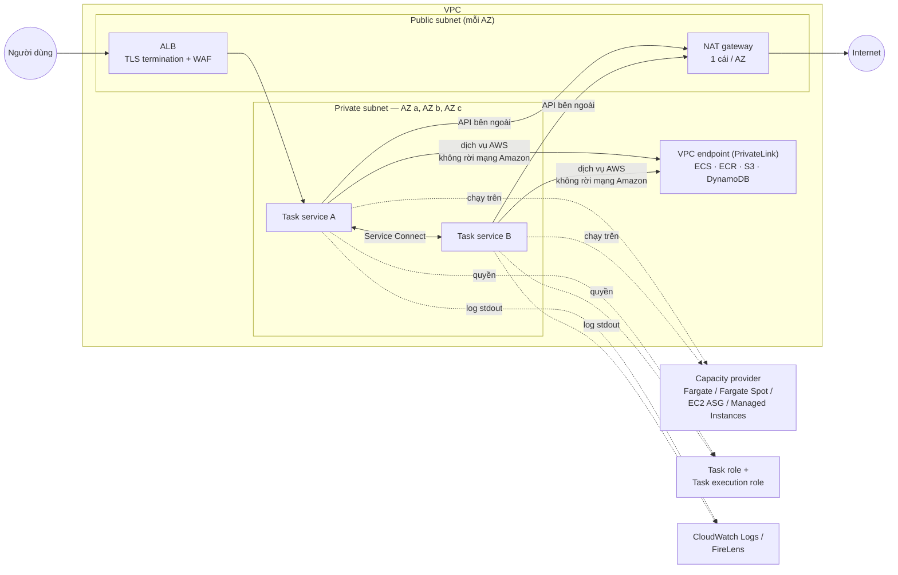

**Cách nói:** đi theo hướng một request. Request vào qua ALB ở public subnet, tới task ở private subnet. Các service gọi nhau qua Service Connect. Khi cần ra ngoài, task dùng NAT; khi gọi dịch vụ AWS thì dùng VPC endpoint. Bên dưới các task là capacity provider, IAM và log.

---

## 1. Chọn compute

*(Nguồn: `05-00`, `05-01`, `05-03`, `05-09-04`)*

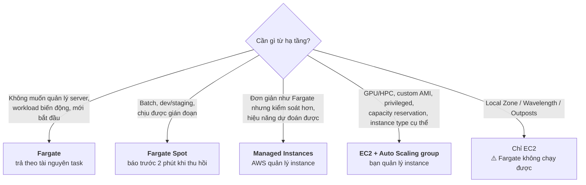

Những điểm nên nói:

- Docs **khuyến nghị capacity provider** thay cho launch type. Launch type (`requiresCompatibilities`) chỉ khai báo task *tương thích* với hạ tầng nào. Capacity provider strategy mới quyết định task *thực sự chạy* ở đâu.
- Một cluster chứa được mọi loại capacity provider, nhưng **một strategy chỉ chứa một loại**.
- ⚠️ Chuyển đổi về sau: từ launch type sang capacity provider thì được. Ngược lại từ capacity provider về launch type thì **không**, trừ trường hợp quay về đúng launch type ban đầu. Đổi thẳng EC2 ↔ Fargate launch type cũng không được. Vì vậy nên **bắt đầu ngay với capacity provider**.

---

## 2. Mạng: traffic từ internet vào

*(Nguồn: `05-06-02`)*

Docs không khuyến nghị cho container nhận traffic trực tiếp ở public subnet khi chạy quy mô lớn. Nên có một lớp đầu vào scale được:

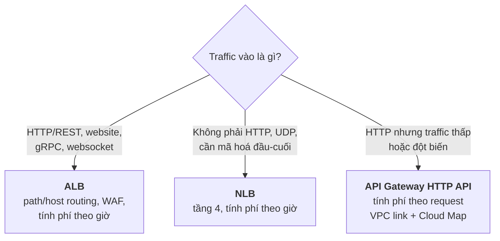

| | ALB | NLB | API Gateway |
|---|---|---|---|
| Tính phí | Theo giờ | Theo giờ | **Theo request** (không có request thì không mất phí) |
| Tải cao | Rẻ hơn mỗi request | Rẻ hơn mỗi request | Đắt hơn mỗi request |
| Bảo mật | WAF, chống HTTP desync | — | Phân quyền client, Lambda authorizer |
| Lưu ý | Một ALB dùng chung cho nhiều service | ⚠️ Phải xử lý đóng kết nối khi task dừng | Cache, usage tier |

---

## 3. Mạng: task đi ra ngoài

*(Nguồn: `05-06-01`, `05-06-03`)*

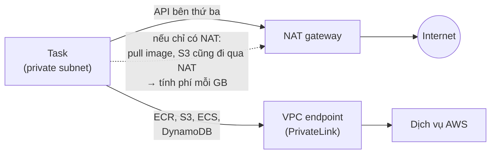

| | Public subnet + IGW | Private subnet + NAT | VPC endpoint |
|---|---|---|---|
| Chiều | Hai chiều, nên dễ bị quét (vd SSH port 22) | Chỉ đi ra | Chỉ tới dịch vụ có endpoint |
| Hợp với | Streaming, game (băng thông lớn) | Thanh toán, dữ liệu người dùng | Traffic tới dịch vụ AWS |
| Chi phí | — | Theo giờ + **mỗi GB**; nên có 1 NAT mỗi AZ | Không chịu phí NAT cho traffic này |
| Giới hạn | — | 5 Gbps, tự scale tới 45 Gbps mỗi NAT | — |

💬 VPC endpoint cũng có phí riêng (theo giờ và theo GB). Docs ở đây không nhắc tới, nên cần tự so sánh với khối lượng traffic thực tế trước khi kết luận.

⚠️ Với EC2 dùng network mode `awsvpc`, ENI của task **không** được cấp IP public, nên bắt buộc phải ra ngoài qua NAT.

---

## 4. Mạng: service gọi nhau

*(Nguồn: `05-06-04`, `05-06-05`)*

| | Service Connect | Service discovery (Cloud Map) | Internal load balancer |
|---|---|---|---|
| Docs đánh giá | **Khuyến nghị** | Lựa chọn khác | Lựa chọn khác |
| Thành phần ở giữa | Agent trong task | Không có (độ trễ thấp) | Load balancer |
| Đổi đích | Theo deployment | Chờ TTL của DNS | LB tự cập nhật pool |
| Retry khi backend hỏng | — | **App tự viết** | LB health check |
| Chi phí | — | — | Có (giảm được bằng ALB dùng chung) |

Chi tiết về Service Connect nằm ở `15-99-thuyet-trinh-cto.md`, mục 7.

---

## 5. IAM: ai được làm gì

*(Nguồn: `05-11`)*

Câu hỏi CTO hay hỏi là "app có quyền gì". Cần tách rõ hai role:

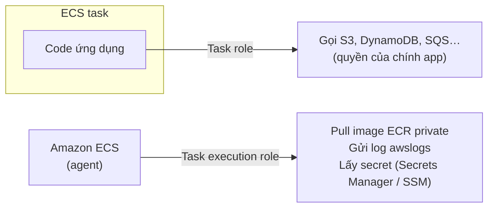

| Role | Ai dùng | Cần khi |
|---|---|---|
| **Task execution role** | ECS | ECR private, `awslogs`, secret, private registry |
| **Task role** | Code ứng dụng | App gọi dịch vụ AWS |
| Container instance role | EC2 instance | Dùng EC2 |
| Infrastructure role | ECS | EBS volume, TLS cho Service Connect, VPC Lattice, Managed Instances |
| Infrastructure for LB role | ECS | Blue/green deployment của ECS |

💬 Nên dùng mỗi service một task role, cấp quyền tối thiểu. Đây là nguyên tắc least privilege chung, docs ở đây không nói.

---

## 6. Container image: chuẩn chung cho team

*(Nguồn: `05-05`, `05-09-03`)*

Đây là slide "quy ước cho dev". Mỗi điểm đi kèm một lợi ích cụ thể:

| Quy ước | Vì sao |
|---|---|
| Image đầy đủ dependency, muốn đổi thì build mới | Task thay thế khởi động được ở bất kỳ đâu ECS chọn |
| Một tiến trình mỗi container | Tiến trình crash thì container chết, ECS thay task |
| **Bắt `SIGTERM`**: ngừng nhận việc, làm nốt, lưu việc dở ra ngoài | Không mất việc khi deploy hoặc scale in |
| Log ra `stdout`/`stderr` | Đổi hệ thống log mà không phải sửa code |
| Tag image = **git SHA**, bật immutable tag ở ECR, không dùng `latest` ở prod | Biết chính xác code nào đang chạy |
| Image nhỏ (multi-stage, base tối giản), ECR cùng Region | Scale out nhanh hơn |

Khi nào gộp nhiều container vào một task definition (trên Fargate):

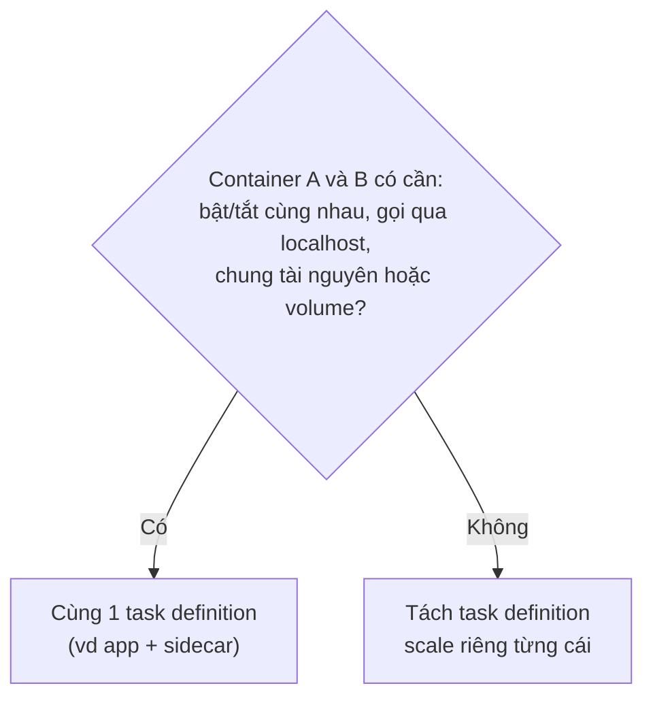

---

## 7. Sizing và capacity

*(Nguồn: `05-09-01`, `05-09-05`, `05-09-03`)*

**Reservation, bursting và limit:**

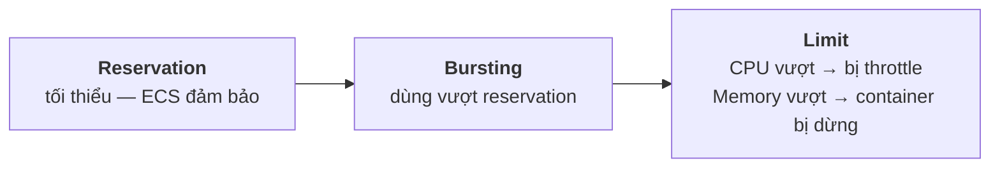

- Cách chọn con số: **load test**, không đoán. Với app stateless, đo memory khi đang phục vụ request, rồi chọn CPU theo cách muốn scale.
- CPU nhỏ (vd ¼ vCPU) thì scale chi tiết và rẻ, nhưng có thể không kịp đỡ đợt tăng đột biến. CPU lớn thì ngược lại.
- Trên Fargate, limit của task bằng tổng reservation của các container, sau đó làm tròn lên kích thước Fargate gần nhất.

**Cấp dư để chịu được sự cố một AZ** ⭐ con số dễ nhớ:

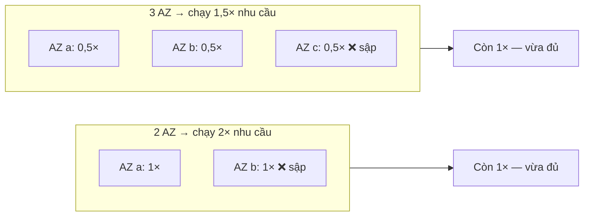

Kết hợp thêm việc đặt target scale ở mức **60–80% utilization** để đỡ khoảng trễ của autoscaling.

---

## 8. Scale nhanh và chịu được cú sốc nhu cầu

*(Nguồn: `05-09-02`, `05-09-03`, `05-09-06`, `05-07`)*

Autoscaling luôn có độ trễ:

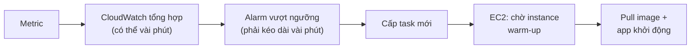

Ở bước nào thì rút ngắn bằng cách nào:

| Bước | Cách rút ngắn |
|---|---|
| Chọn metric | Metric phải **giảm một nửa khi số task gấp đôi**. Java thì không scale theo memory; worker queue thì scale theo queue depth |
| Alarm | Step scaling phản ứng nhanh hơn target tracking |
| Instance EC2 | Tăng `minimumScalingStepSize`, giữ capacity dự phòng |
| Pull image | Image nhỏ; EC2 thì dùng `prefer-cached` + `binpack` |
| Network mode | `bridge` khởi động nhanh hơn `awsvpc` vài giây, nhưng mất security group riêng mỗi task |
| Health check | Ngưỡng mặc định có thể ≥ 90s, có thể giảm xuống |

Cú sốc nhu cầu:

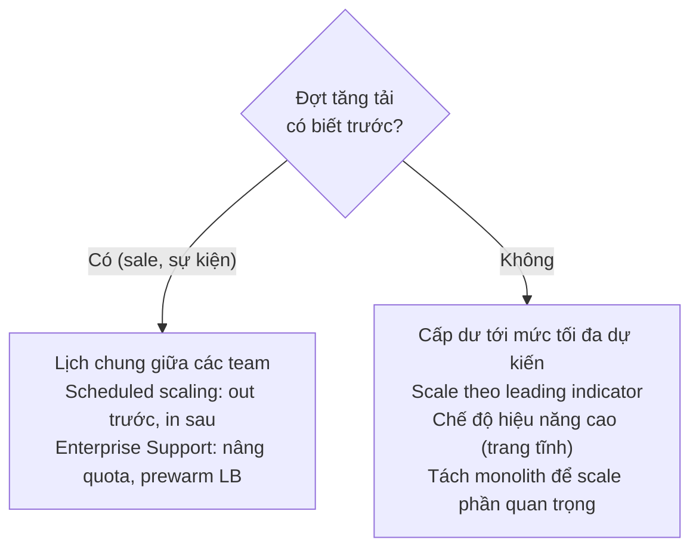

---

## 9. Giới hạn ở quy mô lớn: quota và throttling

*(Nguồn: `05-08-01`, `05-08-02`)*

Slide này để CTO biết **trần của hệ thống** trước khi gặp sự cố.

| Giới hạn | Giá trị | Điều chỉnh được? |
|---|---|---|
| EC2 instance mỗi cluster | 5.000 | Có / tạo thêm cluster |
| Task Fargate đồng thời mỗi Region | Theo account (tính cả EKS pod) | Có |
| ⚠️ Task mỗi service khi dùng service discovery (Cloud Map) | **1.000** | **Không** |
| ENI mỗi instance (`awsvpc`) | Theo instance type, vd c5.large: 2 task, bật trunking lên 10 | Không (dùng trunking) |
| Target mỗi ALB / NLB | Theo quota ELB | Có |

Khi deploy hàng trăm service cùng lúc, chính ECS bị throttle khi gọi API thay bạn:

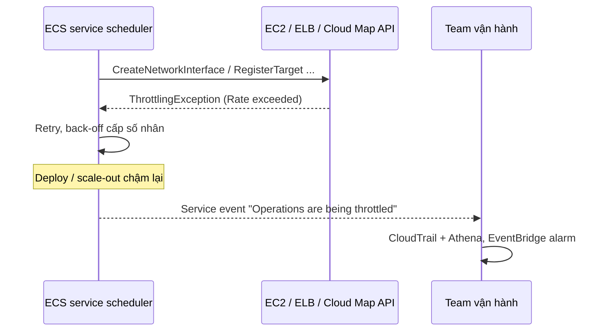

Cách giám sát: CloudTrail kết hợp Athena hoặc Logs Insights, sự kiện EventBridge `ECS_OPERATION_THROTTLED`, và metric CloudWatch `Usage/CallCount` kèm alarm.

⚠️ Standalone task (`RunTask`) **không tự retry**. Docs gợi ý dùng Step Functions để retry.

---

## 10. Quyết định cần CTO chốt

| # | Quyết định | Lựa chọn |
|---|---|---|
| 1 | Compute mặc định | Fargate / Managed Instances / EC2; có dùng Spot cho dev và batch không |
| 2 | Chuẩn hoá capacity provider ngay từ đầu (không dùng launch type) | Có / Không |
| 3 | Đầu vào | ALB dùng chung / NLB / API Gateway (nếu traffic thấp) |
| 4 | Đầu ra | Chỉ NAT, hay thêm VPC endpoint cho ECR/S3/DynamoDB |
| 5 | Mức cấp dư HA | 2 AZ (2×) hay 3 AZ (1,5×); target utilization 60–80% |
| 6 | Quy ước image và IAM bắt buộc | git SHA tag, immutable ECR, SIGTERM, stdout log, mỗi service một task role |
| 7 | Kế hoạch quy mô | Có cần xin tăng quota trước sự kiện lớn không; có giám sát throttling không |

---

## 11. Phụ lục

Bỏ khỏi slide, chỉ giữ ở đây để trả lời khi bị hỏi:

- Dual-stack endpoint (IPv6 cho ECS API): `05-02`
- Shared subnet, Local Zones, Wavelength Zones: `05-03`
- ECS trên Outposts: `05-04`
- Công cụ troubleshoot mạng (Container Insights, X-Ray, VPC Flow Logs, ulimit, sysctl): `05-06-06`
- Chi tiết metric scale theo từng mô hình app (CPU-bound, worker-based, Java, job processor): `05-09-02`
- Danh sách account setting (Container Insights, trunking, FIPS…): `05-00` mục 4
