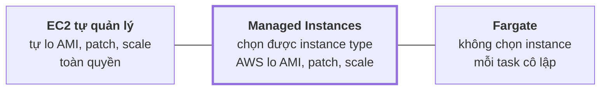
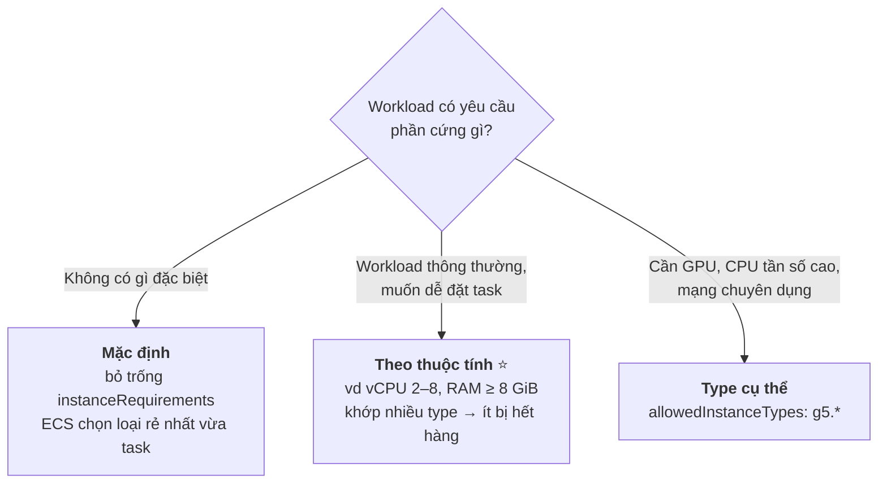
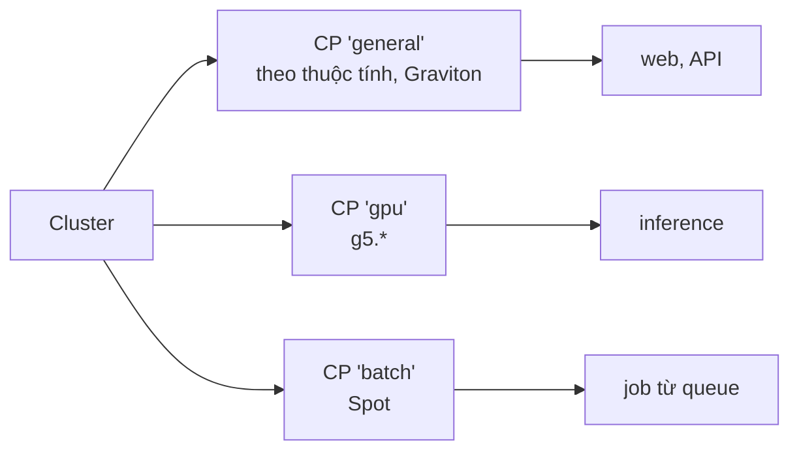
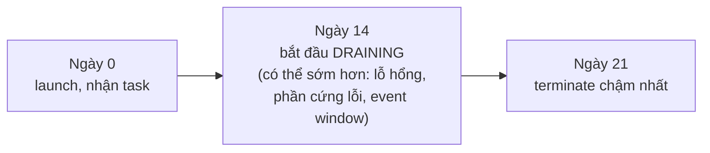
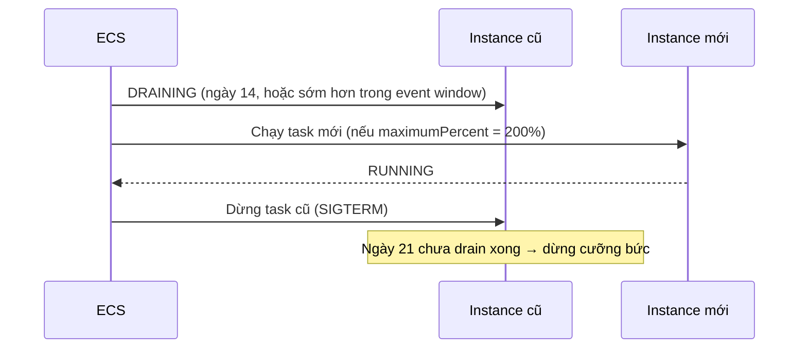
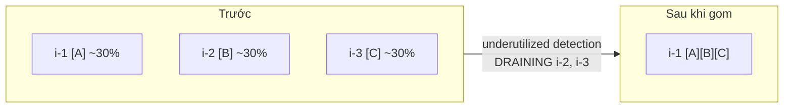
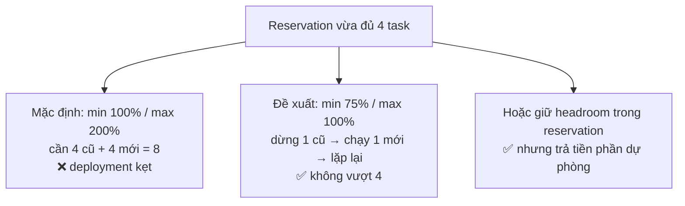
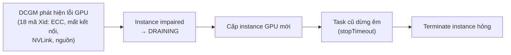
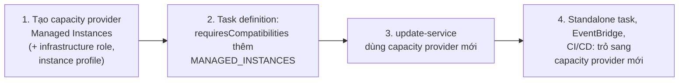

# Thuyết trình cho CTO — Amazon ECS Managed Instances

> Mục đích: nói về **quyết định, chi phí, rủi ro**, không đi vào thao tác.
>
> Ký hiệu: ⚠️ = rủi ro cần nói rõ · 💬 = ý của mình, docs không nói.
>
> Sơ đồ viết bằng **Mermaid**. Muốn đưa vào slide thì dán vào <https://mermaid.live> rồi export PNG/SVG.

---

## Tổng quan folder 06 — Amazon ECS Managed Instances

**Folder này nói về gì:** loại compute **nằm giữa EC2 và Fargate**. Team chọn được phần cứng (GPU, Graviton, mạng cao, instance store), còn AWS lo AMI, vá lỗi, scale và thay máy. Folder đi qua: cách ECS chọn instance, vòng đời máy, cơ chế tự tối ưu chi phí, bảo mật, GPU auto repair và cách migrate sang.

**Vị trí trong tổng thể:** là một trong ba lựa chọn compute, nằm giữa Fargate và EC2.

```
Chọn compute ──► Managed Instances ──► Managed Daemons (chỉ chạy được ở đây)
                         │
                         ├─ task definition có tham số khác EC2/Fargate
                         └─ capacity provider nên coi là bất biến
```

**Những ý cần nhớ của riêng folder này:**
1. Tiền phải trả là **tiền instance cộng phí quản lý**. Đổi lại, team không phải tự patch AMI hay scale ASG.
2. Mỗi máy chỉ sống **14–21 ngày** rồi bị thay. Task chạy liên tục lâu hơn mức này thì không phù hợp.
3. Mặc định **nhiều task chạy chung một máy**, nên mức cô lập kém hơn Fargate. Workload nhạy cảm thì bật single-task mode.
4. ⚠️ Dùng Capacity Reservation với cấu hình deploy mặc định (max 200%) thì deploy sẽ kẹt.
5. Migrate được **từng service một** trong cùng cluster.

---

## Mục lục

0. [Managed Instances nằm ở đâu](#0-managed-instances-nằm-ở-đâu)
1. [So sánh EC2, Managed Instances, Fargate](#1-so-sánh-ec2-managed-instances-fargate)
2. [ECS chọn instance thế nào](#2-ecs-chọn-instance-thế-nào)
3. [Vòng đời 14–21 ngày và patching](#3-vòng-đời-1421-ngày-và-patching)
4. [Tự tối ưu chi phí: gom và xoá instance](#4-tự-tối-ưu-chi-phí-gom-và-xoá-instance)
5. [Capacity Reservations và cấu hình deployment](#5-capacity-reservations-và-cấu-hình-deployment)
6. [Bảo mật và tuân thủ](#6-bảo-mật-và-tuân-thủ)
7. [GPU auto repair](#7-gpu-auto-repair)
8. [Lộ trình migrate](#8-lộ-trình-migrate)
9. [Quyết định cần CTO chốt](#9-quyết-định-cần-cto-chốt)

---

## 0. Managed Instances nằm ở đâu

> Nguồn: [`06-00`](06-00-ecs-managed-instances-architect.md)



**Cách nói:** đây là lựa chọn ở giữa. Team được chọn phần cứng như EC2 (GPU, Graviton, mạng cao, instance store), nhưng AWS lo vận hành gần như Fargate. Đổi lại, phải trả thêm **phí quản lý** và chấp nhận việc instance bị thay định kỳ.

---

## 1. So sánh EC2, Managed Instances, Fargate

> Nguồn: [`06-00`](06-00-ecs-managed-instances-architect.md) · [`06-09`](06-09-ecs-migrate-fargate-to-managed-instances.md) · [`06-10`](06-10-ecs-migrate-ec2-to-managed-instances.md)

| | EC2 tự quản lý | **Managed Instances** | Fargate |
|---|---|---|---|
| Chọn instance type | Có | **Có** | Không |
| AMI | Tự chọn, custom được | Bottlerocket do AWS quản lý, **không custom** | AWS |
| Patch, scale instance | Team (hoặc ASG) | **AWS** | AWS |
| Vòng đời instance | Không giới hạn | **14–21 ngày** | — |
| SSH | Có | **Không** (dùng ECS Exec) | Không |
| Nhiều task trên một instance | Có | Có (mặc định) | Không |
| GPU | Có | **Có** | Không |
| Capability đặc quyền | Có | Có (`NET_ADMIN`, `SYS_ADMIN`, `BPF`, `PERFMON`), phải bật trên capacity provider | Chỉ `SYS_PTRACE` |
| Network mode | `awsvpc`, `bridge`, `host`, `none` | `awsvpc`, `host` | `awsvpc` |
| Placement strategy | Có | Không (điều khiển qua subnet) | Không |
| Daemon | Strategy `DAEMON` | **Managed Daemons** | Không |
| Tính tiền | Theo instance | **Theo instance + phí quản lý** | Theo vCPU/memory của task |
| OS | Linux, Windows | Chỉ Linux (x86_64, ARM64) | Linux, Windows |

⚠️ Một capacity provider strategy chỉ chứa **một loại** provider, nên không trộn được Managed Instances với Fargate Spot trong cùng strategy.

---

## 2. ECS chọn instance thế nào

> Nguồn: [`06-01`](06-01-ecs-managed-instances-instance-types.md) · [`06-02`](06-02-ecs-managed-instances-selection-best-practices.md)



Hình thức mua: On-Demand (mặc định), **Spot** (có thể bị thu hồi), **Capacity Reservations** (`reservations-only` / `-first` / `-excluded`). Savings Plans tự áp dụng.

Ví dụ nhiều capacity provider trong một cluster:



💬 Ví dụ trên do mình đặt. Lưu ý: chọn Graviton thì image phải build cho ARM64.

---

## 3. Vòng đời 14–21 ngày và patching

> Nguồn: [`06-04`](06-04-ecs-managed-instances-patching.md)

AWS không vá tại chỗ mà **thay instance**:





| Rủi ro | Cách giảm |
|---|---|
| Drain rơi vào giờ cao điểm | Cấu hình **EC2 event window** vào giờ thấp điểm (best effort) |
| Mất request khi thay task | App bắt SIGTERM, đặt `stopTimeout` hợp lý |
| Service chỉ có 1 task | Desired count ≥ 2, trải nhiều AZ |
| ⚠️ Task chạy liên tục > 14 ngày | **Không phù hợp** với Managed Instances |
| ⚠️ Standalone task dài | Không có service để thay, nên phải thiết kế chạy lại được |

---

## 4. Tự tối ưu chi phí: gom và xoá instance

> Nguồn: [`06-07`](06-07-ecs-managed-instances-infrastructure-optimization.md)



| | Idle detection (instance trống) | Underutilized detection (gom task) |
|---|---|---|
| On-Demand, task của service | Có | Có |
| Có standalone task | Có (khi hết task) | **Không** |
| **Spot** | Có | **Không** |

- `ScaleInAfter` (0–3600s, `-1` để tắt) là thời gian chờ trước khi tối ưu.
- 💬 Giá trị thấp phù hợp khi tải ổn định, muốn tiết kiệm tối đa. Giá trị cao phù hợp khi tải lên xuống liên tục, vì giữ được cache image lâu hơn.
- ⚠️ Khi gom, task của service sẽ **bị dời sang instance khác**, nên app phải tắt êm được.

---

## 5. Capacity Reservations và cấu hình deployment

> Nguồn: [`06-02`](06-02-ecs-managed-instances-selection-best-practices.md)

⚠️ Bẫy hay gặp: cấu hình deploy mặc định (min 100%, max 200%) cần **gấp đôi** capacity trong lúc deploy, trong khi reservation chỉ vừa đủ.



---

## 6. Bảo mật và tuân thủ

> Nguồn: [`06-05`](06-05-ecs-managed-instances-security.md) · [`06-06`](06-06-ecs-managed-instances-vpc-encryption.md)

| Có sẵn | Ghi chú |
|---|---|
| Bottlerocket, không SSH, root filesystem bất biến, SELinux | AWS không đăng nhập vào instance, không truy cập dữ liệu |
| Tự vá theo vòng đời | Xem mục 3 |
| PCI-DSS, HIPAA, FedRAMP, CMK | — |
| FIPS-140-3 | ⚠️ Chỉ ở **GovCloud (US)**, chỉ x86_64 |
| VPC Encryption Controls | ⚠️ Phải dùng **custom** capacity provider, chỉ cho phép instance type có hỗ trợ (T3/T3a/T4g **không** hỗ trợ). Chạy Monitor trước, chuyển sang Enforced sau |

Các điểm cần nói rõ:

- ⚠️ Mặc định **nhiều task chạy chung một instance**, nên mức cô lập kém hơn Fargate. Nếu cần cô lập ở mức VM thì bật **single-task mode**.
- ⚠️ Từ 22/4/2026, EC2 mặc định **ẩn** managed instance trong `describe-instances`, dù chúng vẫn tính tiền. Script kiểm kê hay báo cáo chi phí cần lọc theo tag `aws:ec2:managed-launch`.
- ⚠️ Organization: SCP và EC2 Allowed AMIs phải cho phép AMI từ account Managed Instances của từng Region.

---

## 7. GPU auto repair

> Nguồn: [`06-08`](06-08-ecs-managed-instances-gpu-auto-repair.md)



- Bật mặc định. Tối đa **20%** instance của một capacity provider được drain cùng lúc (dưới 9 instance thì tối đa 1).
- ⚠️ Tắt GPU auto repair thì **daemon auto repair cũng bị tắt theo**.
- 💬 Job GPU dài (vd training) nên có checkpoint, vì standalone task không được thay tự động.

---

## 8. Lộ trình migrate

> Nguồn: [`06-09`](06-09-ecs-migrate-fargate-to-managed-instances.md) · [`06-10`](06-10-ecs-migrate-ec2-to-managed-instances.md)



| Migrate từ | Điểm cần soát |
|---|---|
| **Fargate** | Platform 1.4.0+; bỏ các tham số không hợp lệ (`ephemeralStorage`…); bind mount phải nằm ở `/var` hoặc `/tmp`; mức cô lập thay đổi (nhiều task/instance) |
| **EC2** | Bỏ `bridge`, swap, Docker volume, custom AMI/user data, placement strategy, Windows; chuyển `DAEMON` sang Managed Daemons; ALB target `instance` → `ip` (cần **target group mới**) |

Có thể migrate **từng service một** trong cùng cluster.

---

## 9. Quyết định cần CTO chốt

> Nguồn: tổng hợp từ các mục 0–8 ở trên.

| # | Quyết định |
|---|---|
| 1 | Workload nào chuyển sang Managed Instances (cần GPU/Graviton/reservation nhưng không muốn tự vận hành EC2) |
| 2 | Chấp nhận **phí quản lý** để đổi lấy việc không phải tự patch AMI, scale ASG |
| 3 | Cách chọn instance: mặc định / theo thuộc tính / type cụ thể; có dùng Spot cho batch không |
| 4 | Event window bảo trì (vd đêm Chủ nhật giờ Việt Nam) |
| 5 | Multi-task hay single-task mode cho workload nhạy cảm |
| 6 | Nếu dùng Capacity Reservations: đổi deployment config sang min 75% / max 100%, hay giữ headroom |
| 7 | Kiểm tra SCP và script kiểm kê trước khi bật |
