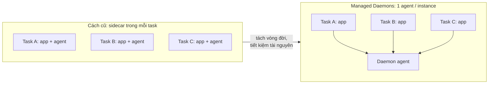
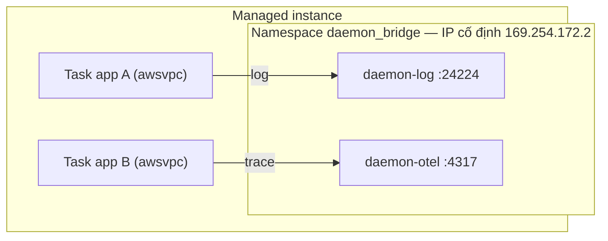
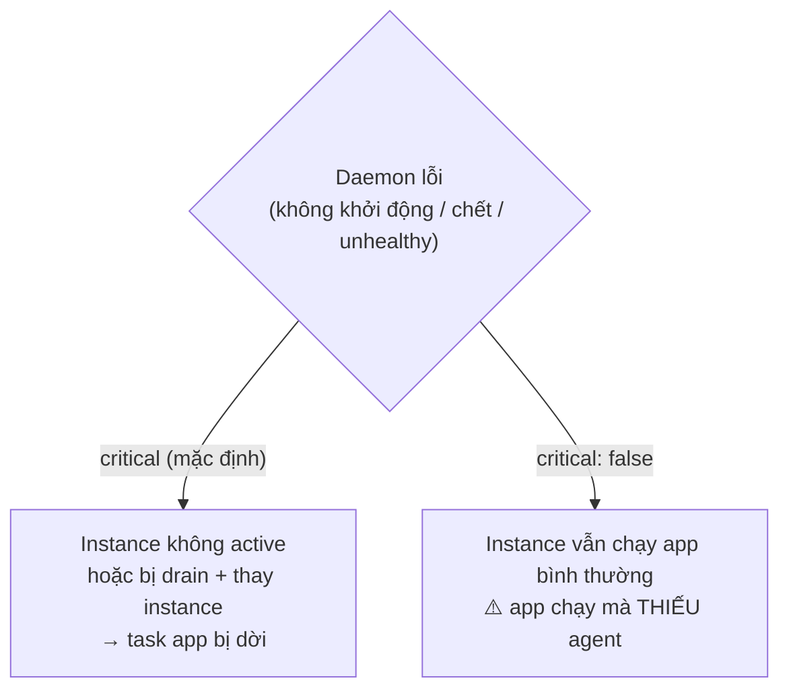
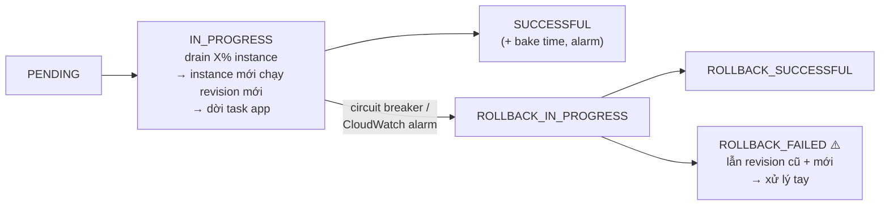
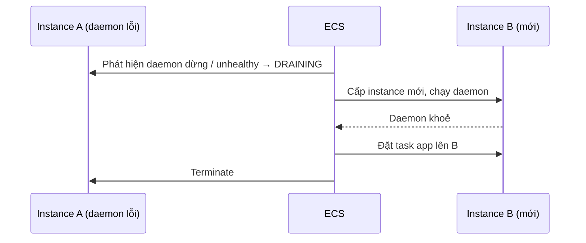

# Thuyết trình cho CTO — Amazon ECS Managed Daemons

> Tổng hợp từ các file `07-*` trong folder này. Mục đích: nói về **quyết định, chi phí, rủi ro**, không đi vào thao tác.
>
> Ký hiệu: ⚠️ = rủi ro cần nói rõ · 💬 = ý của mình, docs không nói.
>
> Sơ đồ viết bằng **Mermaid**. Muốn đưa vào slide thì dán vào <https://mermaid.live> rồi export PNG/SVG.
>
> Điều kiện: Managed Daemons **chỉ chạy trên Managed Instances** (xem `06-99`).

---

## Tổng quan folder 07 — Amazon ECS Managed Daemons

**Folder này nói về gì:** cách chạy **agent hạ tầng** (bảo mật, log, APM, eBPF) **đúng một bản trên mỗi máy**, quản lý tách biệt khỏi ứng dụng. Folder đi qua: daemon task definition, mạng `daemon_bridge`, chế độ critical và non-critical, rolling deployment, auto repair, event và metric.

**Vị trí trong tổng thể:** là tính năng đi kèm **riêng cho Managed Instances** (`06-99`). Đây là lựa chọn thay cho cách gắn sidecar vào từng task (`13-99`) và cho strategy `DAEMON` của service trên EC2.

```
06 Managed Instances ──► 07 Managed Daemons
                              │  mỗi lần cập nhật daemon = drain và thay máy
                              └─► task của app bị dời chỗ → liên quan cách deploy ở 15
```

**Những ý cần nhớ của riêng folder này:**
1. Team platform/security cập nhật agent mà **không phải đụng vào** task definition của các team app.
2. Chọn **critical** (agent lỗi thì thay máy) hay **non-critical** (agent lỗi thì app vẫn chạy, chỉ có cảnh báo).
3. Mỗi lần cập nhật daemon, ECS **drain và thay máy**, nên task của app bị dời. Service app cần desired count ≥ 2.
4. ⚠️ `UpdateDaemon` **ghi đè toàn bộ** cấu hình. Cần quản lý bằng IaC.
5. Phải có `healthCheck`. Thiếu nó thì daemon bị treo sẽ không ai phát hiện.

---

## Mục lục

0. [Vấn đề cần giải quyết](#0-vấn-đề-cần-giải-quyết)
1. [Daemon chạy thế nào trên instance](#1-daemon-chạy-thế-nào-trên-instance)
2. [Critical và non-critical](#2-critical-và-non-critical)
3. [Cập nhật daemon: rolling deployment](#3-cập-nhật-daemon-rolling-deployment)
4. [Auto repair](#4-auto-repair)
5. [Giám sát: event và metric](#5-giám-sát-event-và-metric)
6. [Bẫy vận hành](#6-bẫy-vận-hành)
7. [Quyết định cần CTO chốt](#7-quyết-định-cần-cto-chốt)

---

## 0. Vấn đề cần giải quyết

> Nguồn: [`07-00`](<07-00-ecs-managed-daemons.md>) · [`07-01`](<07-01-ecs-daemon-task-definitions.md>) · [`07-02`](<07-02-ecs-daemons-create-manage.md>)

Agent bảo mật, agent observability, log router… cần chạy **trên mọi máy**. Có hai cách:



| Lợi ích | Ý nghĩa với tổ chức |
|---|---|
| Tách vòng đời | Team platform/security cập nhật agent mà **không phải đụng vào** task definition của các team app |
| Đảm bảo độ phủ | Mỗi instance đúng **1** daemon task. ECS luôn khởi động daemon **trước** app |
| Tiết kiệm | Một agent cho mỗi instance thay vì một agent cho mỗi task |
| Quyền đặc biệt | Daemon được dùng `privileged`, `SYS_ADMIN`, `NET_ADMIN`, `BPF`, `PERFMON` (để chạy agent eBPF) |

Khác với strategy `DAEMON` của service trên EC2: daemon ở đây là tài nguyên riêng, có API riêng (`register-daemon-task-definition`, `create-daemon`).

---

## 1. Daemon chạy thế nào trên instance

> Nguồn: [`07-01`](<07-01-ecs-daemon-task-definitions.md>)



- App gửi dữ liệu tới `169.254.172.2:<port>`. Địa chỉ này **giống nhau trên mọi instance**, nên không cần service discovery.
- ⚠️ Các daemon dùng chung một namespace, nên **phải dùng port khác nhau**.
- Volume: chỉ hỗ trợ bind mount từ host (để đọc dữ liệu của host). Không hỗ trợ EBS, EFS hay FSx.

💬 Số port trong hình là ví dụ.

---

## 2. Critical và non-critical

> Nguồn: [`07-00`](<07-00-ecs-managed-daemons.md>) · [`07-02`](<07-02-ecs-daemons-create-manage.md>) · [`07-06`](<07-06-ecs-daemon-auto-repair.md>)



| Chọn | Hợp với | Đánh đổi |
|---|---|---|
| **Critical** | Agent bảo mật, compliance ("không được chạy app nếu thiếu agent") | Agent lỗi thì instance bị thay, task app bị dời chỗ |
| **Non-critical** | Agent "nice to have" (metric phụ) | Agent hỏng thì chỉ có event cảnh báo, workload không bị ảnh hưởng |

💬 Nên đặt mặc định như sau: agent bảo mật là critical, agent observability là non-critical kèm alarm.

---

## 3. Cập nhật daemon: rolling deployment

> Nguồn: [`07-03`](<07-03-ecs-daemon-deployments.md>)

Daemon **không được chèn vào instance đang chạy**. Thay vào đó, ECS drain instance cũ và thay bằng instance mới có sẵn daemon:



| Tham số | Mặc định | Chọn thế nào |
|---|---|---|
| `drainPercent` | 25% | Thấp thì an toàn, ít task bị dời cùng lúc; cao thì deploy nhanh |
| `bakeTimeInMinutes` | 0 | Đặt > 0 kèm alarm để bắt lỗi xuất hiện chậm |
| `alarms` | — | Alarm đang đỏ sẵn trước khi deploy thì **không** có tác dụng rollback |

⚠️ Mỗi lần cập nhật daemon đều **dời task app**. Vì vậy service app nên có desired count ≥ 2 và trải trên nhiều instance.

---

## 4. Auto repair

> Nguồn: [`07-06`](<07-06-ecs-daemon-auto-repair.md>) · [`06-08`](<../06 - Amazon ECS Managed Instances/06-08-ecs-managed-instances-gpu-auto-repair.md>)



- Task app chỉ bị dời **sau khi** daemon ở instance mới đã khoẻ.
- ⚠️ Nếu **không có `healthCheck`**, ECS chỉ phát hiện được khi daemon chết hẳn. Daemon bị treo thì không ai biết. Ngược lại, health check quá nhạy sẽ gây thay instance không cần thiết, nên dùng `startPeriod`.
- ⚠️ Tắt GPU auto repair ở capacity provider thì daemon auto repair **cũng bị tắt theo** (xem `06-99`).

---

## 5. Giám sát: event và metric

> Nguồn: [`07-04`](<07-04-ecs-daemon-events.md>) · [`07-05`](<07-05-ecs-daemon-metrics.md>)

| Nguồn | Theo dõi | Cảnh báo ngay khi |
|---|---|---|
| EventBridge `ECS Daemon Service Action` | `DAEMON_TASK_START_IMPAIRED` (`TASK_FAILED_TO_RUN`, `TASK_CREATION_FAILED`) | Với non-critical, đây là **tín hiệu duy nhất** cho biết agent đang thiếu |
| EventBridge `ECS Daemon Deployment State Change` | Trạng thái deployment | **`DAEMON_DEPLOYMENT_ROLLBACK_FAILED`** (event ERROR duy nhất) |
| CloudWatch `AWS/ECS`, `ServiceName = daemon:<tên>` | `CPUUtilization`, `MemoryUtilization` | Xem **Maximum**, không chỉ Average, vì instance bận sẽ đẩy daemon ở đó lên cao |

---

## 6. Bẫy vận hành

> Nguồn: [`07-02`](<07-02-ecs-daemons-create-manage.md>) · [`07-03`](<07-03-ecs-daemon-deployments.md>) · [`07-04`](<07-04-ecs-daemon-events.md>)

| Bẫy | Hậu quả | Cách tránh |
|---|---|---|
| ⚠️ `UpdateDaemon` **ghi đè toàn bộ** cấu hình | Thiếu `--no-critical` thì daemon thành critical; mất tag, mất ECS Exec, deployment config về mặc định | `describe-daemons` trước, rồi truyền **đủ** mọi thiết lập; 💬 nên quản lý bằng IaC |
| Daemon khai báo CPU/memory quá lớn | `TASK_CREATION_FAILED` trên instance nhỏ | Daemon phải "vừa" với **mọi** instance type của capacity provider |
| Xoá daemon trước, rồi xoá capacity provider/cluster | Kẹt | Chờ mọi daemon task dừng hẳn rồi mới xoá tiếp |

---

## 7. Quyết định cần CTO chốt

> Nguồn: tổng hợp từ các mục 0–6 ở trên.

| # | Quyết định |
|---|---|
| 1 | Agent nào chuyển từ sidecar sang daemon (security, log, APM) |
| 2 | Agent nào là critical, agent nào là non-critical |
| 3 | Ai sở hữu daemon (team platform/security), và quy trình cập nhật (drainPercent, bake time, alarm) |
| 4 | Bắt buộc có `healthCheck` cho daemon critical |
| 5 | Cảnh báo bắt buộc: `ROLLBACK_FAILED`, `DAEMON_TASK_START_IMPAIRED` |
| 6 | Quản lý daemon bằng IaC để tránh bẫy ghi đè của `UpdateDaemon` |
