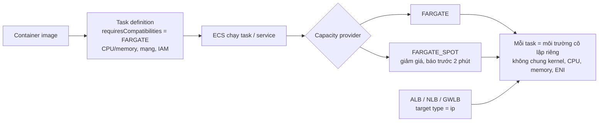
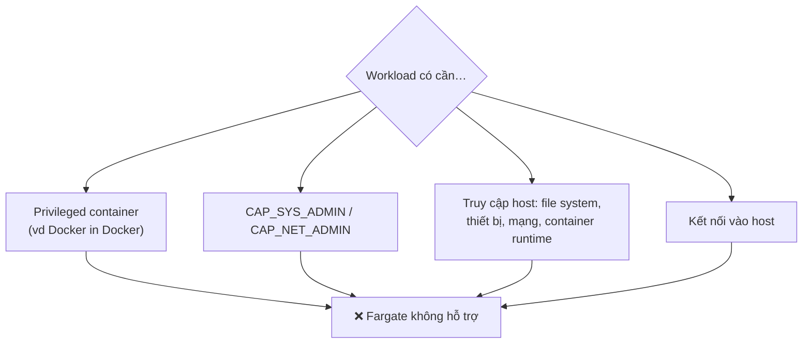
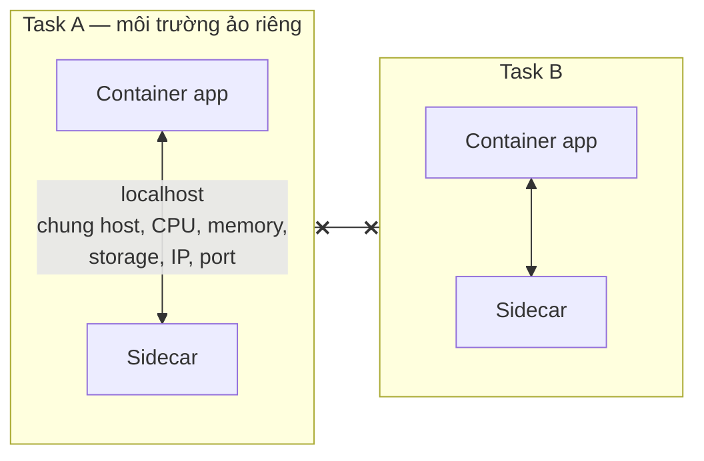
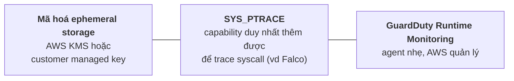
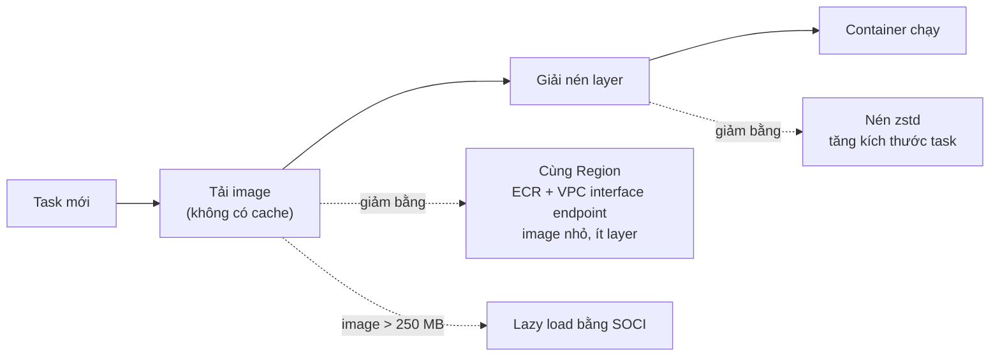
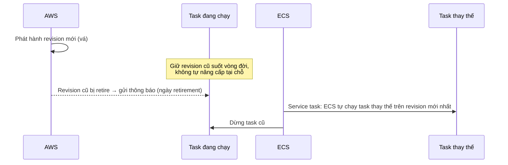
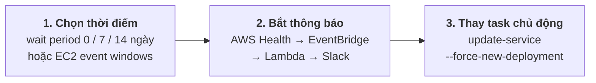
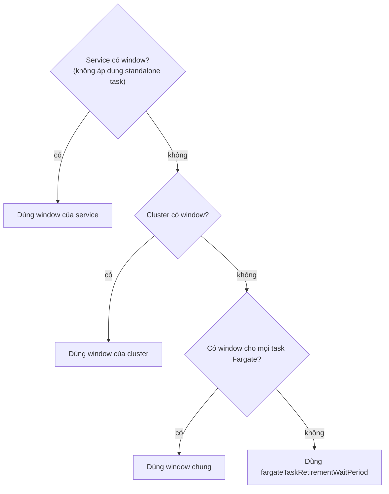

# Thuyết trình cho CTO — AWS Fargate cho Amazon ECS

> Tổng hợp từ các file `08-*` trong folder này. Mục đích: nói về **quyết định, chi phí, rủi ro**, không đi vào thao tác.
>
> Ký hiệu: ⚠️ = rủi ro cần nói rõ · 💬 = ý của mình, docs không nói.
>
> Sơ đồ viết bằng **Mermaid**. Muốn đưa vào slide thì dán vào <https://mermaid.live> rồi export PNG/SVG.

---

## Tổng quan folder 08 — AWS Fargate

**Folder này nói về gì:** compute **serverless** cho ECS. Team không quản lý server, mỗi task chạy trong một môi trường ảo cô lập riêng. Folder đi qua: Fargate và Fargate Spot, ranh giới cô lập, giới hạn của môi trường Fargate, best practice bảo mật, ephemeral storage và customer managed key, tối ưu thời gian pull image, platform version và task retirement.

**Vị trí trong tổng thể:** là lựa chọn compute **ít phải vận hành nhất**. Workload cần privileged, capability đặc quyền hay truy cập host thì phải chọn compute khác.

```
Chọn compute ──► Fargate
                    ├─ task definition: requiresCompatibilities = FARGATE, network mode awsvpc
                    ├─ capacity provider: FARGATE / FARGATE_SPOT
                    └─ load balancer: target type ip
```

**Những ý cần nhớ của riêng folder này:**
1. Ranh giới cô lập nằm ở **task**. Các container trong cùng một task dùng chung host, CPU, memory, storage và network namespace.
2. **Không** có privileged container, không truy cập host. Capability duy nhất được thêm là `SYS_PTRACE`.
3. Fargate **không cache image**: mỗi task pull lại toàn bộ image, nên kích thước image quyết định thời gian khởi động.
4. AWS **retire task** để vá platform version. Service task được tự thay, **standalone task thì không**.
5. Ephemeral storage mặc định 20 GiB, tối đa 200 GiB, đã mã hoá sẵn. Dùng customer managed key khi cần tuân thủ.

---

## Mục lục

0. [Sơ đồ tổng thể](#0-sơ-đồ-tổng-thể)
1. [Fargate là gì, khi nào không dùng được](#1-fargate-là-gì-khi-nào-không-dùng-được)
2. [Fargate và Fargate Spot](#2-fargate-và-fargate-spot)
3. [Ranh giới cô lập: task, không phải container](#3-ranh-giới-cô-lập-task-không-phải-container)
4. [Ba best practice bảo mật](#4-ba-best-practice-bảo-mật)
5. [Ephemeral storage và customer managed key](#5-ephemeral-storage-và-customer-managed-key)
6. [Thời gian khởi động: pull image](#6-thời-gian-khởi-động-pull-image)
7. [Platform version và task retirement](#7-platform-version-và-task-retirement)
8. [Chuẩn bị cho task retirement](#8-chuẩn-bị-cho-task-retirement)
9. [Load balancer và usage metric](#9-load-balancer-và-usage-metric)
10. [Quyết định cần CTO chốt](#10-quyết-định-cần-cto-chốt)

---

## 0. Sơ đồ tổng thể

> Nguồn: [`08-00`](08-00-ecs-architect-for-fargate.md)



**Cách nói:** team chỉ đóng gói app thành container, chỉ định CPU/memory, định nghĩa mạng và IAM policy. AWS lo việc cấp phát, chọn loại server, scale cluster và xếp task.

---

## 1. Fargate là gì, khi nào không dùng được

> Nguồn: [`08-00`](08-00-ecs-architect-for-fargate.md) · [`08-02-01`](08-02-01-ecs-fargate-security-considerations-detail.md)

| Không còn phải làm | Team vẫn làm |
|---|---|
| Cấp phát, cấu hình, scale cluster máy ảo | Đóng gói app thành container |
| Chọn loại server | Chỉ định CPU và memory |
| Quyết định khi nào scale cluster | Định nghĩa mạng và IAM policy |
| Tối ưu việc xếp task | Khởi chạy ứng dụng |

⚠️ Môi trường Fargate bị **khoá chặt**. Không hợp với workload cần:



- Capability duy nhất được thêm là `CAP_SYS_PTRACE`, dành cho công cụ quan sát và bảo mật.
- **Cả khách hàng lẫn nhân viên AWS** đều không kết nối được vào host. Muốn chạy lệnh, mở shell hay lấy thông tin chẩn đoán thì dùng **ECS Exec**.
- Task Fargate không hỗ trợ mọi tham số task definition: một số không được hỗ trợ, một số hoạt động khác.

---

## 2. Fargate và Fargate Spot

> Nguồn: [`08-00`](08-00-ecs-architect-for-fargate.md)

| | FARGATE | FARGATE_SPOT |
|---|---|---|
| Giá | Giá Fargate | **Giảm giá** |
| Chạy trên | Capacity Fargate | Capacity compute **dư** |
| Gián đoạn | Không | Có, AWS **báo trước 2 phút** khi cần lấy lại capacity |
| Hợp với | — | Task **chịu được gián đoạn** |

💬 Thực tế nên để API và workload quan trọng ở FARGATE, đưa worker, batch, job có retry sang FARGATE_SPOT.

---

## 3. Ranh giới cô lập: task, không phải container

> Nguồn: [`08-01`](08-01-ecs-fargate-security-considerations.md) · [`08-02-01`](08-02-01-ecs-fargate-security-considerations-detail.md)

Fargate chạy **mỗi task** trong một môi trường **ảo hoá phần cứng** riêng. AWS khuyến nghị dùng Fargate khi cần **cô lập mạnh** giữa các task.



| Tài nguyên | Giữa các **task** | Giữa các **container** trong cùng task |
|---|---|---|
| Host | Riêng | **Chung** |
| CPU, memory | Riêng | **Chung** |
| Ephemeral storage | Riêng | **Chung** |
| Network namespace (IP, port) | Riêng | **Chung** |
| Giao tiếp | Qua mạng | Qua **localhost** |

**Cách nói:** sidecar giúp tách chức năng để cập nhật từng phần dễ hơn, nhưng nó **không** được cô lập với container app.

💬 Hai thành phần không tin nhau (khác tenant, tool bên thứ ba quyền rộng) thì nên tách thành task riêng.

---

## 4. Ba best practice bảo mật

> Nguồn: [`08-02-00`](08-02-00-ecs-fargate-security-best-practices.md) · [`08-02-01`](08-02-01-ecs-fargate-security-considerations-detail.md)



| Best practice | Điểm chính |
|---|---|
| Mã hoá ephemeral storage | Mặc định đã mã hoá AES-256 bằng khoá do Fargate quản lý. Khuyến nghị dùng KMS hoặc customer managed key (xem mục 5) |
| `SYS_PTRACE` | Dùng cho công cụ trace syscall của kernel, ví dụ Falco của Sysdig |
| GuardDuty Runtime Monitoring | Quan sát truy cập file, thực thi tiến trình, kết nối mạng. Phát hiện leo thang đặc quyền, credential bị lộ, IP/domain độc hại, malware |
| Mạng | Kiểm soát traffic vào/ra bằng **security group** và **network ACL**. Task nhận IP từ subnet trong VPC |

💬 GuardDuty chỉ là lớp phát hiện. Cần có người trực và quy trình xử lý finding thì mới có tác dụng.

---

## 5. Ephemeral storage và customer managed key

> Nguồn: [`08-07-00`](08-07-00-ecs-fargate-task-ephemeral-storage.md) · [`08-07-01-00`](08-07-01-00-ecs-fargate-ephemeral-storage-customer-managed-keys.md)

| Điểm | Platform version ≥ 1.4.0 |
|---|---|
| Dung lượng | Mặc định ≥ **20 GiB**, tăng tới **200 GiB** qua `ephemeralStorage` |
| Image chiếm chỗ | Image đã pull (cả bản nén và giải nén) nằm **trên** ephemeral storage |
| Mã hoá | AES-256 (task từ 28/5/2020), dùng AWS owned key hoặc customer managed key |
| Theo dõi mức dùng | Task metadata endpoint v4 (task từ 18/11/2022), Container Insights nếu bật |
| Windows | **Không** hỗ trợ ephemeral storage dạng bind mount này |

```
dung lượng app dùng được = ephemeral storage được cấp − dung lượng image (nén + giải nén)
```

⚠️ Image lớn ăn mất phần lớn 20 GiB mặc định. Ví dụ image chiếm 6 GiB thì app chỉ còn khoảng 14 GiB.

**Customer managed key:**

| | Khoá do Fargate quản lý (mặc định) | Customer managed key |
|---|---|---|
| Ai quản lý | Fargate | Team (tạo hoặc import vào AWS KMS) |
| Vòng đời | — | Rotate, disable, delete |
| Kiểm toán | — | Truy cập và sử dụng khoá trong **CloudTrail** |
| Hợp với | Mặc định | Dữ liệu nhạy cảm (tài chính, sức khoẻ), yêu cầu tuân thủ |
| Phí | — | Fargate **không** thu thêm, chỉ trả phí KMS tiêu chuẩn |

⚠️ Mỗi task dùng **1 KMS grant**, mỗi key mặc định có **50.000 grant**, nên tối đa **50.000 task đồng thời** dùng chung một key. Muốn hơn thì xin tăng giới hạn (duyệt theo từng trường hợp).

---

## 6. Thời gian khởi động: pull image

> Nguồn: [`08-05`](08-05-ecs-fargate-linux-image-pull-behavior.md)

Mỗi task Fargate chạy trên instance **riêng, dùng một lần**. Image **không được cache**, nên mỗi task mới phải pull **toàn bộ** image. Thời gian pull **tương quan trực tiếp** với thời gian khởi động task.



| Cách tối ưu | Giảm phần nào | Cách làm |
|---|---|---|
| Đặt image gần | Thời gian tải | Cùng Region với task; ECR + VPC interface endpoint |
| Giảm kích thước | Thời gian tải | Ít layer, base image nhẹ (vd AL2023 minimal) |
| Nén khác | Thời gian giải nén | zstd, hoặc tăng kích thước task để có thêm vCPU |
| Lazy loading | Không phải tải hết | Seekable OCI (SOCI) cho image > 250 MB |

**Cách nói:** trên Fargate, kích thước image ảnh hưởng thẳng tới tốc độ scale out. Đây là lý do nên có quy chuẩn base image cho toàn team.

---

## 7. Platform version và task retirement

> Nguồn: [`08-00`](08-00-ecs-architect-for-fargate.md) · [`08-08-00`](08-08-00-ecs-fargate-task-retirement-maintenance.md)

Platform version = kernel + container runtime. Khi có cập nhật kernel/OS, tính năng, sửa lỗi hay bảo mật, AWS phát hành **revision mới**.



| | Service task | Standalone task (`RunTask`, EventBridge, Batch, Step Functions) |
|---|---|---|
| Khi bị retire | ECS **tự thay** | ECS **không** thay |
| Team cần làm | Không, trừ khi muốn thay sớm | ⚠️ Tự thay **trước** ngày retirement và tự viết logic giám sát |

- Thứ tự thay theo `maximumPercent`: **200%** (mặc định) thì chạy task mới trước rồi mới dừng task cũ; **100%** thì dừng task cũ trước.
- Host Fargate bên dưới gặp sự cố thì ECS thay host **không báo trước**.
- ⚠️ Nếu task thay thế không chạy được (IAM sai, subnet thiếu capacity, security group sai, task definition lỗi) thì task cũ **vẫn bị dừng**, và service bị **giảm capacity**.
- Thông báo **không từ chối được**, và retirement đã lên lịch thì **không đổi được**.
- Best practice cho service stateless: nhiều replica, `minimumHealthyPercent` = 100%. Theo dõi số task và metric CloudWatch trong lúc retirement.

---

## 8. Chuẩn bị cho task retirement

> Nguồn: [`08-08-00`](08-08-00-ecs-fargate-task-retirement-maintenance.md) · [`08-08-01`](08-08-01-ecs-fargate-prepare-task-retirement.md)

Ba bước AWS khuyến nghị:



**Bước 1: chọn thời điểm retire**

| Cách | Điểm chính |
|---|---|
| `fargateTaskRetirementWaitPeriod` | `0` = ngay · `7` = mặc định · `14` ngày. AWS khuyến nghị chọn thời gian **ngắn hơn** để lên revision mới sớm |
| EC2 event windows (từ 18/12/2025) | Chọn **chính xác** khung giờ (vd cuối tuần). Gắn cho service, cluster hoặc mọi task Fargate. Ưu tiên hơn wait period |

Thứ tự Fargate chọn window cho một task:



- Mỗi window phải mở ≥ **4 giờ/tuần**, mỗi khoảng ≥ **2 giờ**. Cluster/service lớn nên dùng khoảng ≥ **8 giờ** hoặc lặp **ít nhất mỗi 3 ngày**.
- Task chạy ít nhất **3 ngày** trước khi bị retire.
- ⚠️ Event window chỉ là **best effort**. Thấy task bị retire ngoài window thì kéo dài window hoặc tăng tần suất.

Ví dụ của docs:

| Window | Thời gian | Gắn với |
|---|---|---|
| Mặc định cho mọi task | 0h–4h mỗi ngày | `aws:ecs:fargateTask` |
| Cluster development | Cả ngày thứ Bảy, Chủ nhật | `aws:ecs:clusterArn` |
| Service thanh toán | 0h–4h thứ Bảy, Chủ nhật | `aws:ecs:serviceArn` |

**Bước 2: bắt thông báo.** Event `AWS_ECS_TASK_PATCHING_RETIREMENT` (category `scheduledChange`) đi qua AWS Health Dashboard, email đã đăng ký, hoặc EventBridge rồi tới Lambda/Slack.

**Bước 3: thay task trước ngày retire.** Rolling deployment dùng `update-service --force-new-deployment`. Blue/green thì tạo deployment mới trong CodeDeploy. Standalone task thì tự thay.

---

## 9. Load balancer và usage metric

> Nguồn: [`08-00`](08-00-ecs-architect-for-fargate.md)

| Load balancer | Dùng cho |
|---|---|
| Application Load Balancer | HTTP/HTTPS (tầng 7) |
| Network Load Balancer | TCP/UDP (tầng 4). ⚠️ UDP cần platform version ≥ 1.4 |
| Gateway Load Balancer | Được hỗ trợ |

- Target group phải dùng target type **`ip`**, không dùng `instance`, vì task dùng `awsvpc` và gắn với ENI.
- **Usage metric** của Fargate tương ứng với **service quota**. Vẽ lên dashboard CloudWatch và đặt alarm khi mức dùng gần chạm quota.

---

## 10. Quyết định cần CTO chốt

> Nguồn: tổng hợp từ các mục 0–9 ở trên.

| # | Quyết định |
|---|---|
| 1 | Workload nào lên Fargate, workload nào phải ở compute khác (vì cần privileged, capability, truy cập host) |
| 2 | Workload nào được chạy FARGATE_SPOT |
| 3 | Khoá Fargate quản lý hay customer managed key cho ephemeral storage. Nếu dùng CMK, có workload nào vượt 50.000 task/key không |
| 4 | Bật GuardDuty Runtime Monitoring không, ai trực finding |
| 5 | Quy chuẩn image: base image nhẹ, ECR cùng Region + VPC endpoint, có dùng zstd/SOCI không |
| 6 | Chính sách task retirement: wait period bao nhiêu ngày, có dùng event windows không, khung giờ nào |
| 7 | Ai nhận thông báo retirement, và ai chịu trách nhiệm thay standalone task |
