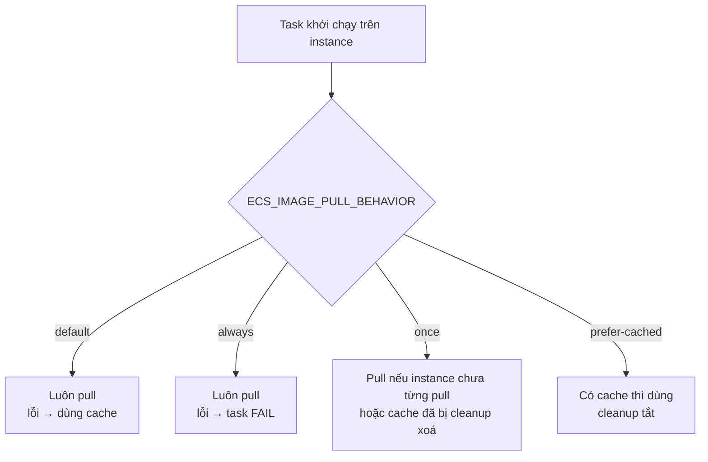

# Amazon ECS trên EC2 — Toàn tập

> Tổng hợp từ **folder `09 - EC2`** (`ecs-ec2-capacity-va-image-pull-behavior.md`, `09-99`). Folder 09 chỉ có 2 trang docs, nên file này gom thêm **mọi trang chỉ dành cho EC2** đang nằm ở các folder khác (đúng như `09-99` đã trỏ tới), để có một chỗ đọc trọn vẹn về EC2:
>
> | Chủ đề | File nguồn |
> |---|---|
> | Mô hình hoá task definition, image pull behavior | `09 - EC2/ecs-ec2-capacity-va-image-pull-behavior.md` |
> | Launch type vs capacity provider, đổi compute cho service | `05/05-01-ecs-launch-types-and-capacity-providers.md` |
> | Tối ưu thời gian khởi chạy task | `05/05-07-ecs-optimize-task-launch-time.md` |
> | Capacity & availability, cluster capacity | `05/05-09-03-…`, `05/05-09-04-ecs-cluster-capacity.md` |
> | Tăng tốc cluster auto scaling | `05/05-09-06-ecs-speeding-up-cluster-capacity-provisioning-ec2.md` |
> | Networking trên EC2, IPv6-only | `13/13-02-03-ecs-task-networking-ec2.md` |
> | Swap theo container | `13/13-02-06-ecs-container-swap.md` |
> | Windows trên EC2 | `13/13-02-09-ecs-windows-ec2-task-definition-differences.md` |
> | Tham số task definition cho EC2 | `13/13-11-ecs-ec2-task-definition-parameters.md` |
> | ASG capacity provider | `14/14-03-00-ecs-ec2-asg-capacity-providers.md` |
> | Bảo mật container instance | `14/14-03-01-ecs-ec2-container-instance-security.md` |
> | Tạo cluster EC2 | `14/14-03-02-ecs-ec2-create-cluster.md` |
> | Placement strategy / constraint | `15/15-02-02-…`, `15/15-02-04-…` |
>
> **Ký hiệu**
> - Không ký hiệu = lấy từ docs AWS đã dịch trong các file trên (có ghi file nguồn ở đầu mỗi mục).
> - 🔎 = kiến thức ngoài các file trên hoặc suy luận của mình — **nên tự kiểm tra lại** với docs AWS hiện tại.
> - ✍️ = ví dụ tự đặt (tên, giá trị, ID là placeholder).
> - ⚠️ = bẫy hay gặp.

---

## Mục lục

0. [Tóm tắt một trang](#0-tóm-tắt-một-trang)
1. [EC2 trong ECS là gì: các mảnh ghép](#1-ec2-trong-ecs-là-gì-các-mảnh-ghép)
2. [Khi nào chọn EC2](#2-khi-nào-chọn-ec2)
3. [Launch type, capacity provider và đổi compute cho service](#3-launch-type-capacity-provider-và-đổi-compute-cho-service)
4. [Mô hình hoá task definition và service trên EC2](#4-mô-hình-hoá-task-definition-và-service-trên-ec2)
5. [Tạo cluster EC2](#5-tạo-cluster-ec2)
6. [ASG capacity provider](#6-asg-capacity-provider)
7. [Cluster auto scaling (CAS) và cách làm nó nhanh hơn](#7-cluster-auto-scaling-cas-và-cách-làm-nó-nhanh-hơn)
8. [Container agent và file `/etc/ecs/ecs.config`](#8-container-agent-và-file-etcecsecsconfig)
9. [Image pull behavior (`ECS_IMAGE_PULL_BEHAVIOR`)](#9-image-pull-behavior-ecs_image_pull_behavior)
10. [Networking trên EC2](#10-networking-trên-ec2)
11. [IPv6-only trên EC2](#11-ipv6-only-trên-ec2)
12. [Task definition: những gì chỉ EC2 có](#12-task-definition-những-gì-chỉ-ec2-có)
13. [Swap theo container](#13-swap-theo-container)
14. [Windows trên EC2](#14-windows-trên-ec2)
15. [Task placement trên EC2](#15-task-placement-trên-ec2)
16. [Bảo mật container instance](#16-bảo-mật-container-instance)
17. [Tối ưu thời gian khởi chạy và chi phí](#17-tối-ưu-thời-gian-khởi-chạy-và-chi-phí)
18. [Triển khai từ đầu đến cuối (Terraform + CLI)](#18-triển-khai-từ-đầu-đến-cuối-terraform--cli)
19. [Vận hành hằng ngày](#19-vận-hành-hằng-ngày)
20. [So sánh EC2 – Managed Instances – Fargate](#20-so-sánh-ec2--managed-instances--fargate)
21. [Troubleshooting](#21-troubleshooting)
22. [Chỗ docs không khớp nhau](#22-chỗ-docs-không-khớp-nhau)
23. [Checklist](#23-checklist)
24. [Câu hỏi tự kiểm tra (35 câu)](#24-câu-hỏi-tự-kiểm-tra-35-câu)
25. [Bản đồ nguồn](#25-bản-đồ-nguồn)

---

## 0. Tóm tắt một trang

```
                         ┌──────────────── ECS control plane ────────────────┐
                         │  scheduler · service · capacity provider · CAS    │
                         └───────────────▲───────────────────┬───────────────┘
                                         │ đăng ký / báo cáo │ lệnh chạy task
┌──────────── Auto Scaling group (bạn sở hữu) ───────────────┼───────────────────────────┐
│  Launch template: AMI ECS-optimized · instance type · instance role · user data       │
│                                                             ▼                          │
│  ┌─ EC2 container instance ─────────────────────────────────────────────┐            │
│  │  ECS agent  ← /etc/ecs/ecs.config (ECS_CLUSTER, ECS_IMAGE_PULL_…)    │  × N       │
│  │  Docker     ← image cache trên đĩa (root EBS)                        │            │
│  │  [task A][task B][task C] … (nhiều task trên một máy)                │            │
│  └───────────────────────────────────────────────────────────────────────┘            │
└────────────────────────────────────────────────────────────────────────────────────────┘
```

| Chủ đề | Ý phải nhớ |
|---|---|
| Khi nào dùng | Workload **lớn, cần tối ưu chi phí**; hoặc cần thứ Fargate không có (GPU, `privileged`, custom AMI, Docker volume, swap, nhiều log driver) |
| Ai quản lý gì | **Bạn**: AMI, instance type, ASG, agent config, patch. **ECS**: đặt task, scale ASG (nếu bật managed scaling) |
| Cách cung cấp capacity | **ASG capacity provider** (khuyến nghị) — không tự đăng ký instance rồi tự scale |
| ASG | Mới, **rỗng** (desired = 0), `MaxSize` > 0, **không** instance weighting, không sửa scaling policy do ECS tạo |
| Managed draining | Bật mặc định — drain task trước khi ASG terminate instance |
| CAS chậm vì | Đẩy metric + chờ alarm `CapacityProviderReservation` + warm-up (mặc định **300 s**) |
| Làm CAS nhanh hơn | Tăng `minimumScalingStepSize`, đừng để `maximumScalingStepSize` thấp, giảm `instanceWarmupPeriod`, `targetCapacity` < 100 hoặc warm pool |
| Task definition | Thành phần khác nhau → task definition riêng (scale 3–2–1). Sidecar phục vụ một thành phần → chung task definition |
| Image pull | `default` / `always` / **`once`** / **`prefer-cached`**. Hai cái sau tiết kiệm **10–20 s** mỗi task, **chỉ an toàn khi mỗi release một tag mới** |
| Network mode | `awsvpc` (khuyến nghị, ENI riêng, SG riêng) · `bridge` (mặc định Linux, dynamic port, khởi động nhanh hơn) · `host` · `none` · `default` (Windows) |
| Mật độ `awsvpc` | **ENI trunking** — vd c5.large 2 → 10 task |
| Chỉ EC2 có | Task size tuỳ chọn (tới 192 vCPU), `privileged`, `dockerSecurityOptions`, `devices`, `maxSwap`/`swappiness`, `tmpfs`, `sharedMemorySize`, Docker volume, đủ log driver, custom attribute cho placement |
| Bảo mật | Nhiều task chung một máy → threat model. Task role quyền tối thiểu, `ECS_AWSVPC_BLOCK_IMDS=true`, GuardDuty Runtime Monitoring |
| Placement | `binpack` / `spread` / `random`; `distinctInstance`, `memberOf` + thuộc tính `ecs.*` hoặc custom |

---

## 1. EC2 trong ECS là gì: các mảnh ghép

> Nguồn: `09/ecs-ec2-capacity-…` (1.1, 2.2), `05/05-09-04`, `14/14-03-02`.

**Capacity** là hạ tầng task chạy trên đó. Với EC2, bạn tự cung cấp EC2 instance cho cluster — gọi là **container instance** — còn ECS đặt task lên các instance đó.

| Mảnh ghép | Vai trò | Ai quản lý |
|---|---|---|
| **Cluster** | Nhóm logic chứa capacity provider, service, task | Bạn tạo |
| **Container instance** | Một EC2 instance đã đăng ký vào cluster | Bạn (qua ASG) |
| **AMI ECS-optimized** | AMI có sẵn Docker + ECS agent (`ecs-init`) | AWS phát hành, **bạn chọn và cập nhật** |
| **ECS container agent** | Tiến trình trên mỗi instance: nhận lệnh từ ECS, pull image, khởi chạy container, báo trạng thái | Chạy trên instance; bạn cấu hình qua `/etc/ecs/ecs.config` |
| **Container instance IAM role** (instance profile) | Quyền cho agent: đăng ký instance, pull image, ghi log… | Bạn tạo |
| **Launch template** | AMI, instance type, SSH key, user data | Bạn (hoặc console tạo qua CloudFormation) |
| **Auto Scaling group (ASG)** | Quản lý số instance | Bạn sở hữu; ECS điều khiển nếu bật managed scaling |
| **ASG capacity provider** | Gắn ASG vào cluster; cho phép CAS và capacity provider strategy | Bạn tạo |

Hai cách cung cấp capacity theo `05-09-04`:

| Cách | Ai lo scale |
|---|---|
| Tự launch EC2, đăng ký vào cluster qua agent | **Bạn** — docs nói cách này **khó** |
| **Capacity provider** (khuyến nghị) | Capacity provider |

> 🔎 Agent biết phải đăng ký vào cluster nào nhờ dòng `ECS_CLUSTER=<tên>` trong `/etc/ecs/ecs.config`. Không có dòng này, instance đăng ký vào cluster tên `default`.

---

## 2. Khi nào chọn EC2

> Nguồn: `09/ecs-ec2-capacity-…` (1.1), `09-99` (mục 1), `13-11`, `13-02-06`.

Docs nêu **một** tiêu chí: EC2 được khuyến nghị cho workload **quy mô lớn và cần tối ưu chi phí**.

Gom các trang khác lại, EC2 còn là lựa chọn khi cần những thứ **chỉ EC2 có**:

| Nhu cầu | Vì sao EC2 |
|---|---|
| GPU (kể cả GPU phân đoạn trên G6f) | Tham số `gpu` trong container definition (`13-11`) |
| Container `privileged`, thêm capability tuỳ ý, `devices` | Fargate / Managed Instances không hỗ trợ đầy đủ (`13-11`) |
| Swap theo container | `maxSwap`/`swappiness` chỉ cho EC2 Linux (`13-02-06`) |
| Docker volume (plugin driver) | `dockerVolumeConfiguration` chỉ có trên EC2 (`13-11`) |
| Log driver `fluentd`, `gelf`, `syslog`, `journald`, `json-file`… | Bạn kiểm soát daemon Docker (`13-11`) |
| Task cực lớn | CPU mức task tới **192 vCPU** (Fargate tới 32, Managed Instances tới 10 theo `13-11`) |
| Custom AMI, cấu hình kernel/host | Bạn sở hữu instance |
| Windows Server 2016 / 2004 / 20H2 | `operatingSystemFamily` trên EC2 có nhiều bản hơn Fargate (`13-11`) |
| Placement theo custom attribute | Managed Instances chỉ 4 thuộc tính, Fargate không có constraint (`15-02-04`) |

> 🔎 Đánh đổi: bạn tự lo patch AMI, thay instance, theo dõi đĩa và tận dụng tài nguyên. Nếu không cần những thứ trên, Fargate hoặc Managed Instances ít việc vận hành hơn.

---

## 3. Launch type, capacity provider và đổi compute cho service

> Nguồn: `05-01`, `14-03-00` (mục 5).

### 3.1. Phân vai

| Dùng | Ở đâu | Để làm gì |
|---|---|---|
| **Launch type** | `requiresCompatibilities` trong task definition | Khai báo task **tương thích** với hạ tầng nào: `EC2`, `FARGATE`, `EXTERNAL`, `MANAGED_INSTANCES` (chọn được nhiều) |
| **Capacity provider strategy** | Khi chạy task / tạo service | Quyết định task **thực sự** chạy trên capacity nào |

AWS khuyến nghị **chỉ dùng launch type để khai báo tương thích**, còn chạy task/service thì dùng **capacity provider**.

- Fargate và Fargate Spot capacity provider có sẵn trên mọi cluster; **ASG capacity provider bạn phải tự tạo** (một hoặc nhiều mỗi cluster).
- Spot Fleet chỉ có dưới dạng capacity provider, không có launch type.
- Cluster chứa lẫn được mọi loại; **một strategy chỉ chứa một loại** (không trộn ASG với Fargate trong cùng strategy).

### 3.2. Quy tắc strategy (`14-03-00`)

| # | Quy tắc |
|---|---|
| 1 | Gắn capacity provider vào cluster **trước** khi đưa vào strategy |
| 2 | Tối đa **20** capacity provider trong một strategy |
| 3 | `weight` không khai báo: **console = 1**, **API/CLI = 0** |
| 4 | Ít nhất một provider có weight **> 0**; tất cả 0 → `RunTask`/`CreateService` **thất bại** |
| 5 | Chỉ **một** provider có `base`; mặc định 0 |
| 6 | Chuyển service từ launch type sang strategy phải **force new deployment** |

✍️ Ví dụ strategy hai ASG (On-Demand làm nền, Spot gánh phần còn lại):

```json
"capacityProviderStrategy": [
  { "capacityProvider": "cp-ondemand", "base": 2, "weight": 1 },
  { "capacityProvider": "cp-spot",                "weight": 3 }
]
```

10 task → 2 task `base` lên On-Demand, 8 task còn lại chia 1:3 → 2 On-Demand + 6 Spot → tổng **4 On-Demand + 6 Spot**.

### 3.3. Đổi compute cho service (`05-01` mục 2)

| Từ \ Sang | Capacity provider | Launch type |
|---|---|---|
| **Capacity provider** | ✅ Mọi hướng (ASG ↔ Fargate ↔ Managed Instances) | ❌ — **trừ** quay về đúng launch type ban đầu bằng `capacityProviderStrategy: []` |
| **Launch type** | ✅ Mọi hướng (EC2/Fargate/External → ASG/Fargate/MI) | ❌ (EC2 ↔ Fargate) — dùng capacity provider tương đương |

Quy trình: (1) task definition có `requiresCompatibilities` chứa đích → (2) tạo ASG capacity provider nếu cần → (3) `UpdateService` dùng strategy → (4) kiểm tra deployment → (5) giám sát, chỉnh.

⚠️ Bước 1 hay hỏng nhất: task definition chưa khai báo tương thích với đích → `UpdateService` thất bại.

⚠️ `14-03-00` lại ghi "không chuyển service từ ASG capacity provider sang Fargate và ngược lại" — mâu thuẫn với `05-01`. Xem [mục 22](#22-chỗ-docs-không-khớp-nhau).

---

## 4. Mô hình hoá task definition và service trên EC2

> Nguồn: `09/ecs-ec2-capacity-…` (Phần 1), `09-99` (mục 2).

### 4.1. Hai câu hỏi phải trả lời trước

1. Những **process nào cần chạy cùng nhau**?
2. **Scale** từng thành phần theo cách nào?

Hai câu này gắn với nhau vì **service scale theo số task**, mà container nằm chung một task definition thì luôn scale cùng nhau.

### 4.2. Ví dụ ba thành phần của docs

Ứng dụng có frontend (web), backend (API cho frontend), data store. Mỗi thành phần **một task definition riêng** → ba service, scale độc lập. Cluster 3 instance chạy **3 frontend, 2 backend, 1 data store**:

```
┌──────── Instance 1 ────────┐ ┌──────── Instance 2 ────────┐ ┌──────── Instance 3 ────────┐
│ frontend                   │ │ frontend                   │ │ frontend                   │
│ data store                 │ │ backend                    │ │ backend                    │
└────────────────────────────┘ └────────────────────────────┘ └────────────────────────────┘
```

- Gộp cả ba vào một task definition → tỉ lệ luôn **3–3–3**, không thể có 3–2–1.
- Frontend và backend nằm chung một instance **không** có nghĩa là chung task — chúng là các task khác nhau được scheduler đặt lên cùng máy.

### 4.3. Khi nào gộp

Container **liên quan, phải chạy cùng** → chung task definition. Ví dụ docs: một container **stream log** chỉ phục vụ frontend → khai báo cùng task definition với frontend; mỗi task frontend có một container log đi kèm.

| Quan hệ | Cách làm |
|---|---|
| Cùng mục đích, phải chạy cùng (sidecar) | **Chung** task definition |
| Thành phần khác nhau, scale khác nhau | **Tách** task definition |

### 4.4. Từ task definition đến service

```
Task definition ──► Service (giữ số task mong muốn) ──► gắn Elastic Load Balancing
                         │
                         └── UpdateService: đổi desired count (scale) hoặc revision mới (deploy)
```

🔎 Trên EC2 còn một cân nhắc mà Fargate không có: **task size so với instance size**. Task quá lớn so với instance thì mỗi máy chứa ít task, dễ thừa tài nguyên lẻ. Xem phép tính m5.large ở [mục 17](#17-tối-ưu-thời-gian-khởi-chạy-và-chi-phí).

---

## 5. Tạo cluster EC2

> Nguồn: `14-03-02`.

### 5.1. Console tạo gì phía sau

Console tạo tài nguyên bằng một **CloudFormation stack**:

| Tài nguyên | Tiền tố tên |
|---|---|
| Launch template | `EC2ContainerService-<ClusterName>` |
| ASG | `<ClusterName>-ECS-Infra-ECSAutoScalingGroup` (trang `14-03-00` lại ghi `EC2ContainerService-<ClusterName>`) |

ASG tạo từ console được cấu hình: **ECS quản lý** scale-in/out, và ECS **không ngăn** instance **đang chứa task** bị terminate khi scale-in (không bật instance scale-in protection). Managed instance draining (mặc định bật) là thứ giúp task được dời đi trước.

### 5.2. Các bước trên console

1. Mở <https://console.aws.amazon.com/ecs/v2> → chọn Region → **Clusters** → **Create cluster**.
2. **Cluster name**: duy nhất, ≤ 255 ký tự (chữ, số, gạch nối). Tuỳ chọn **Default namespace** cho Service Connect.
3. **Infrastructure** → **Fargate and Self-managed instances** → chọn ASG có sẵn hoặc **Create new group**:

| Trường | Ghi chú |
|---|---|
| Provisioning model | **On-demand** hoặc **Spot** |
| Allocation Strategy (Spot) | Đa số workload: **Price capacity optimized** |
| Container instance AMI | ECS-optimized |
| EC2 instance type | Managed scaling **chạy tốt nhất** khi ASG dùng instance type **giống hoặc tương tự nhau** |
| EC2 instance role | Có sẵn hoặc tạo mới |
| Capacity | Min / max (max phải > 0) |
| SSH key pair | 🔎 Không cần SSH thì bỏ, dùng Session Manager / ECS Exec |
| Root EBS volume size | Tăng nếu image lớn hoặc dùng `prefer-cached` |

4. **Networking**: VPC, subnet, security group, **Auto-assign public IP** (Use subnet setting / Turn on). IPv6-only: subnet chỉ có IPv6 CIDR.
5. **Monitoring**: Container Insights with enhanced observability (khuyến nghị).
6. **Task events** → EventBridge.
7. **ECS Exec**: KMS key, logging CloudWatch / S3 / None.
8. **GuardDuty** chế độ thủ công: tag `guardDutyRuntimeMonitoringManaged = true`.
9. **Encryption** managed storage (KMS), **Tags** → **Create**.

Security group mới cần ít nhất một inbound rule; nguồn **Custom** / **Anywhere** (`0.0.0.0/0`, `::/0`) / **Source group**.

⚠️ Đừng mở **Anywhere** cho port quản trị. Với task `awsvpc`, SG của **task** mới điều khiển traffic ứng dụng; SG của **instance** chủ yếu cho traffic tới instance và tới task `bridge`/`host`.

🔎 Khi đã quản lý hạ tầng bằng Terraform/CloudFormation, tự tạo launch template + ASG + capacity provider bằng IaC thay vì để console sinh stack, tránh hai nguồn cùng quản lý một tài nguyên.

---

## 6. ASG capacity provider

> Nguồn: `14-03-00`, `05-09-04`.

Mỗi EC2 capacity provider gắn với **một ASG**. Bật **managed scaling** thì **cluster auto scaling** giữ kích thước ASG sao cho **mọi task đã lên lịch đều đặt được**.

| | Managed scaling bật | Tự quản lý |
|---|---|---|
| Ai quyết định số instance | ECS | Bạn (scaling policy của ASG, lịch…) |
| Task thiếu chỗ | Chờ ở `PROVISIONING` trong lúc ECS scale ASG | Có thể không đặt được |
| Desired count ASG ban đầu | **0** | Bạn đặt |

### 6.1. Quy tắc riêng cho ASG

| # | Quy tắc |
|---|---|
| 1 | Nên tạo **ASG mới, rỗng** (desired = 0); tạo capacity provider, gắn vào cluster **rồi** mới scale out |
| 2 | Dùng ASG có sẵn: instance đã chạy và đăng ký **trước** khi có capacity provider có thể **không gắn đúng** capacity provider → kiểm tra bằng `DescribeContainerInstances` |
| 3 | `MaxSize` > 0 |
| 4 | **Không** instance weighting (cẩn thận mixed instances policy với `weighted_capacity`) |
| 5 | ASG không scale đủ → task **kẹt ở `PROVISIONING`** |
| 6 | **Không sửa** scaling policy mà capacity provider tạo trên ASG |
| 7 | Hỗ trợ **warm pool** — instance khởi tạo sẵn, scale out lấy từ pool thay vì launch "lạnh" |
| 8 | Dùng **managed instance draining** (mặc định bật) để terminate instance êm |

⚠️ "Managed instance draining" là tính năng của **ASG capacity provider**, **không** liên quan tới sản phẩm *Amazon ECS Managed Instances*. Tên dễ nhầm.

✍️🔎 Kiểm tra instance có gắn capacity provider không:

```bash
aws ecs describe-container-instances --cluster <CLUSTER> \
  --container-instances $(aws ecs list-container-instances --cluster <CLUSTER> --query 'containerInstanceArns' --output text) \
  --query 'containerInstances[].{ec2:ec2InstanceId,cp:capacityProviderName,status:status,agent:agentConnected}'
```

Instance nào thiếu `cp` → drain rồi terminate để ASG tạo instance mới đăng ký đúng.

### 6.2. Bẫy Terraform (🔎)

Capacity provider tạo target tracking policy trên ASG và tự đổi `desired_capacity`. Nếu Terraform cũng quản lý `desired_capacity`, mỗi lần `apply` sẽ giành giật với ECS → dùng `lifecycle { ignore_changes = [desired_capacity] }`. Ví dụ đầy đủ ở [mục 18](#18-triển-khai-từ-đầu-đến-cuối-terraform--cli).

### 6.3. Managed termination protection (🔎)

Ngoài draining, ASG capacity provider có `managedTerminationProtection`: khi bật (yêu cầu ASG bật `protect_from_scale_in`), ECS chỉ cho ASG scale-in những instance **không còn task** (trừ daemon). Đây là thiết lập của trang *cluster auto scaling*, không nằm trong các file của folder.

---

## 7. Cluster auto scaling (CAS) và cách làm nó nhanh hơn

> Nguồn: `05-09-06`.

### 7.1. CAS hoạt động thế nào

CAS dùng metric **`CapacityProviderReservation`** trên CloudWatch và các alarm (cao/thấp) để chỉnh ASG.

🔎 Ý nghĩa của metric (theo blog *Deep Dive on ECS Cluster Auto Scaling* mà trang trỏ tới):

```
CapacityProviderReservation = (số instance cần có / số instance đang chạy) × 100

> targetCapacity  → scale out
< targetCapacity  → scale in
= targetCapacity  → đứng yên
```

### 7.2. Ba nguồn độ trễ

```
1. Đẩy CloudWatch metric
2. Chờ CapacityProviderReservation vượt alarm (cao hoặc thấp)
3. Chờ EC2 instance mới warm-up
```

### 7.3. Các nút chỉnh

| Nút | Mặc định | Ảnh hưởng | Chỉnh qua |
|---|---|---|---|
| `minimumScalingStepSize` | **1** | Thấp → cần nhiều instance phải scale nhiều vòng → chậm. **Tăng lên** | API `CreateCapacityProvider` / `UpdateCapacityProvider` (chỉ API) |
| `maximumScalingStepSize` | (docs không nêu) | Quá thấp → giới hạn số instance mỗi vòng | Như trên |
| `instanceWarmupPeriod` | **300 s** | Instance mới chưa tính vào metric trong thời gian này. **Giảm** để CAS ra quyết định tiếp sớm hơn | Như trên |
| `targetCapacity` | (docs không nêu) | Vd **80%** → luôn giữ **20% dự phòng** → standalone task chạy ngay, không bị throttle; đổi lại **tốn tiền** | Cấu hình capacity provider |
| Dư ở service | — | Tăng replica qua target tracking / step scaling. **Chỉ giúp workload đột biến**, **không** giúp khi deploy service mới từ 0 lên N | Service auto scaling |
| Warm pool | — | Instance khởi tạo sẵn | ASG (`14-03-00`) |

✍️ Chỉnh qua CLI:

```bash
aws ecs update-capacity-provider --name cp-ondemand \
  --auto-scaling-group-provider '{
    "managedScaling": {
      "status": "ENABLED",
      "targetCapacity": 90,
      "minimumScalingStepSize": 2,
      "maximumScalingStepSize": 20,
      "instanceWarmupPeriod": 120
    },
    "managedDraining": "ENABLED"
  }'
```

⚠️ Giảm `instanceWarmupPeriod` thấp hơn thời gian instance thật sự cần để boot + agent đăng ký → CAS tính sai và có thể scale thừa (🔎).

---

## 8. Container agent và file `/etc/ecs/ecs.config`

> Nguồn: gom từ `09/…` (2.3), `13-02-03`, `13-11`, `14-03-01`.

Mọi cấu hình agent nằm ở `/etc/ecs/ecs.config` (Linux), thường ghi qua **user data** của launch template. Sửa trên instance đang chạy thì phải **restart agent**.

| Biến | Dùng để | Nguồn |
|---|---|---|
| `ECS_CLUSTER` | Cluster mà instance đăng ký vào | 🔎 (có trong ví dụ của `14-03-01`) |
| `ECS_IMAGE_PULL_BEHAVIOR` | `default` / `always` / `once` / `prefer-cached` | `09` |
| `ECS_AWSVPC_BLOCK_IMDS` | `true` → task `awsvpc` không lấy được credential của instance profile | `14-03-01` |
| `ECS_INSTANCE_IP_COMPATIBILITY` | Ghi đè phát hiện IPv4/IPv6 (`ipv4` / `ipv6`) | `13-02-03` |
| `ECS_AVAILABLE_LOGGING_DRIVERS` | Khai báo log driver container được dùng | `13-11` |
| `ECS_SELINUX_CAPABLE` / `ECS_APPARMOR_CAPABLE` | Cho phép `dockerSecurityOptions` SELinux / AppArmor | `13-11` |
| `ECS_DYNAMIC_HOST_PORT_RANGE` | Dải host port động tuỳ chỉnh (tránh trùng port) | `13-11` |
| `ECS_CONTAINER_STOP_TIMEOUT` | `stopTimeout` mặc định khi task definition không khai báo (không có cả hai → 30 s) | `13-11` |

Mốc phiên bản agent cần nhớ (`13-11`, `13-02-03`):

| Tính năng | Agent tối thiểu |
|---|---|
| UDP port mapping | 1.2.0 |
| `dependsOn`, `stopTimeout`, `proxyConfiguration` | 1.26.0 (`ecs-init` 1.26.0-1; AMI `20190301`+ có sẵn) |
| `containerPortRange` | 1.67.0 |
| CPU > 256 vCPU được ép về 256 cho Docker | 1.84.0 |
| IPv6-only | **1.99.1** |

✍️ User data mẫu (Amazon Linux ECS-optimized):

```bash
#!/bin/bash
cat <<'EOF' >> /etc/ecs/ecs.config
ECS_CLUSTER=prod-cluster
ECS_IMAGE_PULL_BEHAVIOR=once
ECS_AWSVPC_BLOCK_IMDS=true
ECS_AVAILABLE_LOGGING_DRIVERS=["json-file","awslogs","awsfirelens"]
ECS_CONTAINER_STOP_TIMEOUT=60s
EOF
```

🔎 Restart agent trên instance đang chạy: `sudo systemctl restart ecs`. Cách bền nhất vẫn là sửa launch template rồi thay instance (instance refresh).

---

## 9. Image pull behavior (`ECS_IMAGE_PULL_BEHAVIOR`)

> Nguồn: `09/ecs-ec2-capacity-…` (Phần 2), `05-07` (mục 1). Phạm vi: **EC2 và external instance** (ECS Anywhere) — nơi có agent bạn cấu hình được.

### 9.1. Bối cảnh

- Thời gian khởi động phụ thuộc image: bản đầy đủ Debian / Ubuntu / Amazon Linux 1-2 chậm hơn bản **slim** hay **Alpine**.
- Mặc định agent **pull image từ registry** mỗi lần khởi chạy task, rồi lưu bản sao vào cache local.
- Nếu **mỗi release dùng một tag mới**, việc pull lại một tag đã có là **thừa** — nội dung tag đó không đổi.

### 9.2. Bốn giá trị

| Giá trị | Khi nào pull từ xa | Pull lỗi | Image cleanup | Mục đích |
|---|---|---|---|---|
| `default` | Luôn pull | **Dùng bản cache** | (docs không nói thay đổi) | Mặc định |
| `always` | Luôn pull | **Task thất bại** | (không nói) | Luôn chắc lấy từ registry |
| `once` ⭐ | Chỉ khi **chưa task nào pull** image đó trên instance này, hoặc cache **đã bị cleanup xoá** | (không nói) | **Vẫn chạy** | Tăng tốc deploy |
| `prefer-cached` ⭐ | Chỉ khi **không có cache** | (không nói) | **Tắt** cho container | Tăng tốc deploy |



Tiết kiệm được: tải image lớn qua mạng có thể mất **10–20 giây** mỗi task.

### 9.3. So sánh các cặp

- **`default` vs `always`**: giống nhau khi pull thành công; khác lúc pull lỗi (`default` lùi về cache, `always` cho task fail).
- **`once` vs `prefer-cached`**: đều tránh pull khi đã có image. `once` để cleanup chạy (image cũ có thể bị xoá rồi pull lại khi cần); `prefer-cached` tắt cleanup → cache được giữ, nhưng **đĩa đầy dần**.

### 9.4. Tăng hiệu quả cache (`05-07`)

```
prefer-cached / once  → lần sau không pull lại
binpack               → nhiều task trên cùng instance → nhiều task hưởng cache
ENI trunking (awsvpc) → instance chứa được nhiều task awsvpc hơn
```

Lợi nhất với **image Windows** (thường hàng chục GB).

### 9.5. Bẫy

⚠️ **Tag ghi đè** (luôn push `latest`, hoặc `:prod`): với `once`/`prefer-cached`, instance đã có cache sẽ **không pull lại** → tiếp tục chạy nội dung cũ mà không ai biết. Điều kiện bắt buộc: **mỗi release một tag riêng** (git SHA) hoặc tham chiếu bằng **digest**.

⚠️ `prefer-cached` tắt cleanup → tăng **root EBS volume size** và giám sát đĩa (🔎).

🔎 Nhắc lại `versionConsistency` (mặc định `enabled`, `13-11`): ECS resolve tag sang digest khi deploy, nên các task trong **cùng một deployment** dùng cùng digest. Kết hợp với cache tag-ghi-đè thì càng khó đoán — lại thêm lý do dùng tag bất biến.

> Fargate không có tham số này; cách Fargate pull image xem `08 - AWS Fargate/08-05-ecs-fargate-linux-image-pull-behavior.md`.

---

## 10. Networking trên EC2

> Nguồn: `13-02-03`, `13-11` (2.2, port mappings), `05-07` (mục 2), `05-09-03`.

### 10.1. Các network mode

| Mode | Linux | Windows | Đặc điểm |
|---|---|---|---|
| **`awsvpc`** ⭐ | ✅ | ✅ | **ENI riêng**, IP private riêng, **security group riêng** mỗi task. Phải có `networkConfiguration` khi chạy task/tạo service |
| **`bridge`** | ✅ (**mặc định** khi bỏ trống) | ❌ | Mạng ảo Docker (driver `bridge`), ra ngoài qua IP instance; có **dynamic port mapping** |
| **`host`** | ✅ | ❌ | Port container map thẳng vào ENI instance; **không** dynamic port; phải khai báo `hostPort`; **không** chạy 2 task cùng task definition trên 1 instance; **không chạy container bằng root** |
| **`none`** | ✅ | ❌ | Không có mạng ra ngoài; không khai báo được port mapping |
| **`default`** | ❌ | ✅ (**mặc định**) | Mạng ảo Docker Windows (driver `nat`) |

AWS khuyến nghị **`awsvpc`** trừ khi có nhu cầu cụ thể. `host` và `awsvpc` cho hiệu năng mạng cao nhất.

```
awsvpc:  Task A ── ENI A (IP A)      Task B ── ENI B (IP B)        mỗi task một IP + SG
bridge:  Task A ─┐
         Task B ─┴─ docker0 ── ENI instance (IP instance)         ra ngoài bằng IP instance
host:    Task A ── :8080 trên ENI instance                          task A thứ 2 không lấy được 8080
```

### 10.2. Dynamic port mapping (`bridge`)

- Bỏ trống `hostPort` hoặc đặt `0` → nhận port trong **dải ephemeral** (`/proc/sys/net/ipv4/ip_local_port_range`, không có thì `49153–65535`).
- Khai báo `containerPort` mà không có `hostPort` → tự nhận host port ephemeral; **không tính** vào quota 100 port giữ.
- Port giữ sẵn trên instance: `22`, `2375`, `2376`, `51678–51680`; tối đa **100** port giữ mỗi instance.
- Task lỗi khởi động vì **trùng port** với tiến trình khác (kết nối ra ngoài cũng dùng dải ephemeral) → đặt `ECS_DYNAMIC_HOST_PORT_RANGE`.
- `containerPortRange` dùng được với `bridge` hoặc `awsvpc` (agent ≥ 1.67.0, tối đa 100 dải).
- 🔎 ALB/NLB với `bridge` dùng target type **`instance`** + port động; với `awsvpc` dùng target type **`ip`**.

### 10.3. `awsvpc` vs `bridge` — đánh đổi tốc độ

| | `awsvpc` | `bridge` |
|---|---|---|
| Khởi chạy task | Chậm hơn **vài giây** — ECS gọi API EC2 cấp và gắn ENI cho mỗi task | Nhanh hơn |
| Kiểm soát traffic | **SG riêng mỗi task** | Dùng SG của instance |
| Load balancing | Target `ip` | Target `instance`, có hệ quả với LB (`05-09-03`) |
| Mật độ task | Giới hạn bởi số ENI của instance → cần **ENI trunking** | Không bị giới hạn ENI |
| Bắt buộc khi dùng | Fargate, ECS Gateway, VPC Lattice, `ECS_AWSVPC_BLOCK_IMDS` | — |

Docs gợi ý: **tốc độ deploy** là ưu tiên → cân nhắc `bridge`.

### 10.4. ENI trunking

Mỗi instance chỉ gắn được số ENI giới hạn theo instance type → giới hạn số task `awsvpc`. **ENI trunking** tăng con số này: vd **c5.large** từ **2** lên **10** task (`05-07`).

🔎 Bật bằng account setting `awsvpcTrunking` (`aws ecs put-account-setting --name awsvpcTrunking --value enabled`); chỉ áp cho instance **launch sau khi bật**, và chỉ một số instance family hỗ trợ. Kiểm tra trang *Increasing Amazon ECS Linux container instance network interfaces*.

### 10.5. Windows networking

Port mapping trên Windows dùng địa chỉ gateway **`NetNAT`**, không có loopback → **không** truy cập port container từ chính host (`13-11`).

---

## 11. IPv6-only trên EC2

> Nguồn: `13-02-03` (mục 3–5).

Thiết lập VPC: thêm IPv6 CIDR → subnet **chỉ IPv6** → route table IPv6 → SG rule IPv6.

| Yêu cầu | Chi tiết |
|---|---|
| Chuyển service | Update trực tiếp sang subnet IPv6-only, hoặc tạo service song song + **blue/green** |
| Load balancer | Phải **dualstack** + target group **IPv6** |
| OS | **Không hỗ trợ Windows**; dùng **ECS-optimized Linux AMI** |
| Instance | Launch với **`--enable-primary-ipv6`**. Thiếu → task `host`/`bridge` **không đăng ký được** LB / Cloud Map |
| Agent | ≥ **1.99.1**; tự phát hiện qua default route, ghi đè bằng `ECS_INSTANCE_IP_COMPATIBILITY` |
| Gọi endpoint chỉ IPv4 | **DNS64 + NAT64** |
| ECR | Dùng **image URI endpoint dualstack**; ECR **không** có interface VPC endpoint dualstack |
| ECS Exec | **Không hỗ trợ** |

Có danh sách Region hỗ trợ trong `13-02-03` mục 5 — kiểm tra lại trước khi chọn Region.

---

## 12. Task definition: những gì chỉ EC2 có

> Nguồn: `13-11`.

### 12.1. Mức task

| Tham số | Trên EC2 |
|---|---|
| `requiresCompatibilities` | `EC2` |
| `networkMode` | **Tuỳ chọn** (mặc định `bridge` Linux / `default` Windows) |
| `cpu`, `memory` mức task | **Tuỳ chọn**; CPU 0,125 → **192 vCPU**. Cluster không có instance đủ → task thất bại. **Bị bỏ qua với Windows** |
| `runtimePlatform.operatingSystemFamily` | `LINUX` (mặc định) + nhiều bản Windows (2025/2022/2019/2016 Full/Core, 2004/20H2 Core) |
| `runtimePlatform.cpuArchitecture` | `X86_64` / `ARM64`; không khai báo → theo capacity provider |
| `taskRoleArn` | Windows: launch AMI Windows với **`-EnableTaskIAMRole`** + code cấu hình trong container |
| `placementConstraints` | Có, `memberOf` + cluster query language |

### 12.2. Memory

- Phải có `memory` ở **mức task hoặc mức container** (ít nhất một).
- `memory` (hard) > `memoryReservation` (soft) nếu khai báo cả hai. `memoryReservation` không có trên Windows.
- Tối thiểu 6 MiB (Docker 20.10.0+).

🔎 Trên EC2, `memoryReservation` là thứ scheduler dùng để **tính chỗ** trên instance, còn `memory` là trần → đặt reservation thấp + hard limit cao cho phép "overcommit" có kiểm soát.

### 12.3. CPU mức container

- CPU unit của instance = vCPU × 1024. Linux: CPU **share** (2–262144) — chỉ có tác dụng khi tranh chấp.
- Agent ≥ 1.2.0: null / 0 / 1 → 2 share.
- Windows: quota tuyệt đối; null/0 = 1% một CPU.

### 12.4. Tham số chỉ EC2 hỗ trợ đầy đủ

| Nhóm | Tham số |
|---|---|
| GPU | `gpu` (số nguyên, thập phân cho G6f, hoặc `ALL`) — 🪟✗ |
| Quyền | `privileged` (**AWS khuyến nghị không dùng**), `user` (không root với `host`), `dockerSecurityOptions` (`no-new-privileges`, `apparmor:`, `label:`, `credentialspec:`) — cần `ECS_SELINUX_CAPABLE`/`ECS_APPARMOR_CAPABLE` |
| `linuxParameters` | `capabilities.add/drop` (đủ danh sách, kể cả `SYS_ADMIN`, `NET_ADMIN`), `devices`, `initProcessEnabled`, `maxSwap`, `swappiness`, `sharedMemorySize`, `tmpfs` |
| Mạng/DNS (với `bridge`/`host`) | `links` (chỉ `bridge`), `hostname`, `dnsServers`, `dnsSearchDomains`, `extraHosts`, `disableNetworking` |
| Logging | Đủ driver: `awslogs`, `fluentd`, `gelf`, `json-file`, `journald`, `syslog`, `splunk`, `awsfirelens` — phải khai báo trong `ECS_AVAILABLE_LOGGING_DRIVERS` |
| `environmentFiles` | Tối đa 10 file `.env` trên S3. ⚠️ Bật **FIPS** thì tên bucket có **dấu chấm** không hỗ trợ |
| `systemControls` | Với `host`: sysctl namespace mạng **không** hỗ trợ |
| `stopTimeout` | Mặc định theo `ECS_CONTAINER_STOP_TIMEOUT`, không có → 30 s |
| `startTimeout` | Tối đa 120 s |

### 12.5. Volume

| Loại | Trên EC2 |
|---|---|
| Amazon EBS | Task Linux, 1 volume mỗi task, `configuredAtLaunch: true` |
| Amazon EFS | ✅ |
| FSx for Windows File Server | Task Windows |
| **Docker volume** | **Chỉ EC2**. Ở `/var/lib/docker/volumes`; driver `local` hoặc plugin; `scope` `task` / `shared`; `autoprovision` chỉ với `shared`. Windows chỉ driver `local` |
| Bind mount | `host.sourcePath` có giá trị → dữ liệu còn tới khi xoá tay (gắn vòng đời với **host**, không với task) |

⚠️ Bind mount với `sourcePath` gắn dữ liệu vào **một instance cụ thể** — task bị dời sang instance khác sẽ không thấy dữ liệu cũ (🔎).

---

## 13. Swap theo container

> Nguồn: `13-02-06`.

ECS cho bật/tắt swap **theo từng container** trên EC2 **Linux**: tắt cho container nhạy độ trễ, bật cho container có memory tăng đột biến để giảm OOM.

| Tham số (`linuxParameters`) | Ý nghĩa |
|---|---|
| `maxSwap` (MiB) | `0` = không swap; `N` = tối đa N MiB; **bỏ trống** = theo cấu hình instance. Ánh xạ `--memory-swap` = memory + `maxSwap` |
| `swappiness` | 0–100, mặc định **60**. 0 = chỉ swap khi bắt buộc; 100 = swap mạnh. **Bị bỏ qua nếu không có `maxSwap`**. Ánh xạ `--memory-swappiness` |

✍️

```json
"containerDefinitions": [
  { "name": "worker", "memory": 1024, "linuxParameters": { "maxSwap": 512, "swappiness": 10 } },
  { "name": "api",    "memory": 512,  "linuxParameters": { "maxSwap": 0 } }
]
```

Điều kiện:

```
[ ] Task chạy trên EC2 (không hỗ trợ Fargate)
[ ] Container Linux (không Windows)
[ ] Instance ĐÃ BẬT swap — ECS-optimized AMI mặc định KHÔNG có (làm trong user data)
[ ] Amazon Linux 2023 → không hỗ trợ swappiness (chỉ còn maxSwap)
```

⚠️ Bỏ trống cả hai + instance có swap → container dùng swap tới **gấp đôi memory**. Muốn chắc không swap thì đặt `maxSwap: 0` rõ ràng.

⚠️ Khai báo `maxSwap` **không tự tạo** swap trên instance.

---

## 14. Windows trên EC2

> Nguồn: `13-02-09`, `13-11`, `13-02-03`, `15-02-04`.

**Không hỗ trợ trong container definition**: `disableNetworking`, `dnsServers`, `dnsSearchDomains`, `extraHosts`, `links`, `linuxParameters` (→ không swap, không capability), `privileged`, `readonlyRootFilesystem`, `user`, `ulimits`. Trong volume: `dockerVolumeConfiguration`.

**Không hỗ trợ mức task**: `cpu`, `memory` (**đặt ở mức container**), `proxyConfiguration`, `ipcMode`, `pidMode`.

**`taskRoleArn`**: dùng được nhưng cần cấu hình bổ sung (`-EnableTaskIAMRole` khi khởi tạo agent trên AMI Windows).

**Mạng**: chỉ `awsvpc` và `default` (driver `nat`); không loopback tới port container; **không IPv6-only**.

**Placement**: container Windows phải khớp phiên bản OS với host → `memberOf` với `attribute:ecs.os-family == WINDOWS_SERVER_2022_CORE` khi cluster có nhiều bản Windows.

**Image**: rất lớn (hàng chục GB) → `prefer-cached` + `binpack` có lợi nhất (`05-07`).

✍️

```json
{
  "family": "win-web",
  "requiresCompatibilities": ["EC2"],
  "networkMode": "awsvpc",
  "runtimePlatform": { "operatingSystemFamily": "WINDOWS_SERVER_2022_CORE" },
  "containerDefinitions": [
    { "name": "web", "image": "<IMAGE_WINDOWS>", "cpu": 1024, "memory": 2048, "essential": true }
  ]
}
```

---

## 15. Task placement trên EC2

> Nguồn: `15-02-02`, `15-02-04`, `13-11` (mục 6). Chi tiết đầy đủ ở `15-98` mục 5–8.

EC2 là nơi placement có **đầy đủ** sức mạnh: strategy, constraint, built-in và **custom attribute**.

### 15.1. Strategy

| `type` | Đặt task | Scale in | `field` |
|---|---|---|---|
| `binpack` | Dồn để CPU/memory **thừa ít nhất** → ít instance, rẻ | Dừng task ở instance **còn nhiều tài nguyên nhất** sau khi dừng | `cpu`, `memory` |
| `spread` | Trải đều theo giá trị | Giữ cân bằng AZ; trong AZ chọn ngẫu nhiên | `instanceId` / `host`, hoặc `attribute:...` |
| `random` | Ngẫu nhiên | — | (không dùng) |

Mặc định: task của **service** `spread` theo `attribute:ecs.availability-zone`.

✍️ Vừa HA vừa rẻ (thứ tự quan trọng):

```json
"placementStrategy": [
  { "type": "spread",  "field": "attribute:ecs.availability-zone" },
  { "type": "binpack", "field": "memory" }
]
```

### 15.2. Constraint

| `type` | Ý nghĩa | Khai báo ở |
|---|---|---|
| `distinctInstance` | Mỗi task một instance khác | `RunTask`, `CreateService` (**không** trong task definition) |
| `memberOf` | Lọc instance theo biểu thức cluster query language | Cả task definition |

Thuộc tính built-in: `ecs.ami-id`, `ecs.availability-zone`, `ecs.instance-type`, `ecs.os-type`, `ecs.os-family`, `ecs.cpu-architecture`, `ecs.vpc-id`, `ecs.subnet-id`.

✍️ Custom attribute:

```bash
aws ecs put-attributes --cluster prod-cluster \
  --attributes name=stack,value=prod,targetType=container-instance,targetId=<CONTAINER_INSTANCE_ARN>
```

```json
"placementConstraints": [
  { "type": "memberOf", "expression": "attribute:stack == prod and attribute:ecs.instance-type =~ g5.*" }
]
```

⚠️ `distinctInstance` dựa vào **desired status** → có lúc thấy 2 task `RUNNING` trên cùng instance (task cũ đang dừng). Cần cô lập thật → Fargate.

🔎 `binpack` giúp CAS scale in được: dồn task lại thì có instance trống hẳn để ASG terminate. `spread` theo `instanceId` thì gần như không bao giờ có instance trống.

---

## 16. Bảo mật container instance

> Nguồn: `14-03-01`, `13-11` (4.5), `14-03-02` (bước 11).

### 16.1. Rủi ro gốc

Nhiều task trên **một** instance → đưa container instance vào **threat model**: task bị xâm nhập có thể lợi dụng **quyền IAM của task khác** trên cùng instance, hoặc lấy credential **instance profile** qua IMDS (`169.254.169.254`).

### 16.2. Bốn khuyến nghị của AWS

| # | Khuyến nghị |
|---|---|
| 1 | **Không dùng quyền admin** khi chạy task |
| 2 | **Task role quyền tối thiểu** (agent tạo token với credential ID riêng) |
| 3 | Task `awsvpc`: **`ECS_AWSVPC_BLOCK_IMDS=true`** + restart agent → chặn credential instance profile, giữ quyền task role |
| 4 | **GuardDuty Runtime Monitoring** — quan sát truy cập file, thực thi tiến trình, kết nối mạng |

🔎 `ECS_AWSVPC_BLOCK_IMDS` **chỉ áp cho `awsvpc`**. Task `bridge`/`host` cần cách khác: đặt IMDSv2 **hop limit = 1** trên launch template (container sau bridge cần 2 hop nên không tới được) hoặc chặn bằng iptables. Thêm một lý do ưu tiên `awsvpc`.

### 16.3. Checklist

```
IAM
[ ] Mỗi task definition family một task role, quyền tối thiểu
[ ] Không gắn quyền admin cho task role
[ ] Instance profile chỉ đủ cho agent (🔎 AmazonEC2ContainerServiceforEC2Role)

Cô lập
[ ] awsvpc + ECS_AWSVPC_BLOCK_IMDS=true
[ ] IMDSv2 bắt buộc, hop limit 1 nếu có task bridge/host            (🔎)
[ ] Tránh privileged / root; dùng capability cụ thể
[ ] dockerSecurityOptions: no-new-privileges; SELinux/AppArmor nếu cần
[ ] readonlyRootFilesystem khi được
[ ] Workload cần cô lập mạnh → Fargate

Giám sát
[ ] GuardDuty Runtime Monitoring (tag guardDutyRuntimeMonitoringManaged=true nếu chế độ thủ công)
[ ] ECS Exec có logging (CloudWatch/S3); không mở SSH khi không cần

Vận hành
[ ] AMI ECS-optimized cập nhật thường xuyên, thay instance định kỳ    (🔎)
[ ] Managed instance draining bật
```

---

## 17. Tối ưu thời gian khởi chạy và chi phí

> Nguồn: `05-07`, `05-09-03`, `05-09-06`, `09`.

### 17.1. Chọn instance type theo task size

Tính số task vừa một instance theo **reservation** (CPU, memory). Ví dụ docs: **4 task × (0,5 vCPU, 2 GB)** trên **m5.large (2 vCPU, 8 GB)** → dùng trọn, không thừa.

| | Mỗi task | × 4 | m5.large |
|---|---|---|---|
| vCPU | 0,5 | 2 | 2 |
| Memory | 2 GB | 8 GB | 8 GB |

⚠️🔎 Thực tế instance **không** cho task dùng hết 8 GB: OS, Docker và agent chiếm một phần, nên memory "registered" của container instance thấp hơn con số trên giấy. Tính dư một chút hoặc xem `registeredResources` qua `describe-container-instances`; có thể giữ lại memory cho hệ thống bằng `ECS_RESERVED_MEMORY`.

### 17.2. Tổng hợp các nút tăng tốc

| Nút | Tác dụng | Nguồn |
|---|---|---|
| `once` / `prefer-cached` | Bỏ 10–20 s pull image | `09`, `05-07` |
| `binpack` | Nhiều task hưởng cache; ít instance | `05-07` |
| ENI trunking | Nhiều task `awsvpc` hơn mỗi instance | `05-07` |
| `bridge` thay `awsvpc` | Bỏ vài giây gắn ENI (mất SG riêng) | `05-07`, `05-09-03` |
| Instance lớn hơn, EBS nhanh hơn | Throughput mạng/EBS tăng theo size (`m5.xlarge` → `m5.2xlarge`); `gp2` dùng volume lớn hơn; `gp3` chỉ định throughput/IOPS | `05-09-03` |
| Image slim / Alpine | Khởi động nhanh hơn | `09` |
| Đo `StartedAt` container vs task | Biết phần thời gian do ứng dụng gây ra | `05-07` |
| CAS: step size, warm-up, target capacity, warm pool | Có instance sớm hơn | `05-09-06`, `14-03-00` |

### 17.3. Chi phí

| Cách | Ghi chú |
|---|---|
| Spot + **Price capacity optimized** | Rẻ cho workload chịu gián đoạn; cần managed draining |
| Strategy On-Demand `base` + Spot `weight` | Giữ nền ổn định, phần dư chạy Spot ([mục 3.2](#32-quy-tắc-strategy-14-03-00)) |
| `binpack` + `targetCapacity` 100 | Tối đa mật độ; đổi lại không có dự phòng |
| `targetCapacity` < 100 | Nhanh nhưng **trả tiền** cho capacity trống |
| 🔎 Graviton (`ARM64`) | Thường rẻ hơn x86 cùng cỡ; image phải build cho arm64 |

---

## 18. Triển khai từ đầu đến cuối (Terraform + CLI)

> ✍️ Toàn bộ mục này là ví dụ tự viết, ghép từ khuyến nghị ở các mục trên. Tên resource theo Terraform AWS provider; **kiểm tra lại với phiên bản provider và CLI bạn dùng** — mình chưa chạy thử.

### 18.1. Launch template + ASG + capacity provider

```hcl
data "aws_ssm_parameter" "ecs_ami" {
  # 🔎 AMI ECS-optimized Amazon Linux 2023 mới nhất
  name = "/aws/service/ecs/optimized-ami/amazon-linux-2023/recommended/image_id"
}

resource "aws_launch_template" "ecs" {
  name_prefix   = "ecs-ec2-"
  image_id      = data.aws_ssm_parameter.ecs_ami.value
  instance_type = "m5.large"

  iam_instance_profile { name = aws_iam_instance_profile.ecs_instance.name }
  vpc_security_group_ids = [aws_security_group.ecs_instance.id]

  metadata_options {
    http_tokens                 = "required" # IMDSv2
    http_put_response_hop_limit = 1          # container sau bridge không tới được IMDS
  }

  block_device_mappings {
    device_name = "/dev/xvda"
    ebs {
      volume_size = 50   # chỗ cho image cache
      volume_type = "gp3"
    }
  }

  user_data = base64encode(<<-EOF
    #!/bin/bash
    cat <<'CFG' >> /etc/ecs/ecs.config
    ECS_CLUSTER=${aws_ecs_cluster.main.name}
    ECS_IMAGE_PULL_BEHAVIOR=once
    ECS_AWSVPC_BLOCK_IMDS=true
    CFG
  EOF
  )
}

resource "aws_autoscaling_group" "ecs" {
  name_prefix           = "ecs-ec2-"
  min_size              = 0
  max_size              = 10      # MaxSize > 0
  desired_capacity      = 0       # ASG rỗng khi tạo
  vpc_zone_identifier   = var.private_subnet_ids
  protect_from_scale_in = true    # đi cùng managed termination protection

  launch_template {
    id      = aws_launch_template.ecs.id
    version = "$Latest"
  }

  tag {
    key                 = "AmazonECSManaged"
    value               = "true"
    propagate_at_launch = true
  }

  lifecycle {
    ignore_changes = [desired_capacity] # để ECS điều khiển
  }
}

resource "aws_ecs_cluster" "main" {
  name = "prod-cluster"
  setting {
    name  = "containerInsights"
    value = "enhanced"
  }
}

resource "aws_ecs_capacity_provider" "ec2" {
  name = "cp-ondemand"
  auto_scaling_group_provider {
    auto_scaling_group_arn         = aws_autoscaling_group.ecs.arn
    managed_termination_protection = "ENABLED"
    managed_draining               = "ENABLED"
    managed_scaling {
      status                    = "ENABLED"
      target_capacity           = 90
      minimum_scaling_step_size = 2
      maximum_scaling_step_size = 10
      instance_warmup_period    = 120
    }
  }
}

resource "aws_ecs_cluster_capacity_providers" "main" {
  cluster_name       = aws_ecs_cluster.main.name
  capacity_providers = [aws_ecs_capacity_provider.ec2.name]
  default_capacity_provider_strategy {
    capacity_provider = aws_ecs_capacity_provider.ec2.name
    weight            = 1 # API mặc định 0 → khai báo rõ
  }
}
```

### 18.2. Task definition (frontend + sidecar log)

```json
{
  "family": "frontend",
  "requiresCompatibilities": ["EC2"],
  "networkMode": "awsvpc",
  "taskRoleArn": "arn:aws:iam::<ACCOUNT>:role/frontend-task",
  "executionRoleArn": "arn:aws:iam::<ACCOUNT>:role/ecsTaskExecutionRole",
  "cpu": "512",
  "memory": "2048",
  "containerDefinitions": [
    {
      "name": "web",
      "image": "<ACCOUNT>.dkr.ecr.<REGION>.amazonaws.com/frontend:3f9c2ab",
      "essential": true,
      "portMappings": [{ "name": "http", "containerPort": 8080, "protocol": "tcp" }],
      "linuxParameters": { "maxSwap": 0 },
      "logConfiguration": {
        "logDriver": "awslogs",
        "options": {
          "awslogs-group": "/ecs/frontend",
          "awslogs-region": "<REGION>",
          "awslogs-stream-prefix": "web"
        }
      }
    },
    {
      "name": "log-streamer",
      "image": "<LOG_SIDECAR_IMAGE>:1.4.2",
      "essential": false,
      "memoryReservation": 128
    }
  ]
}
```

- Tag là **git SHA** (`3f9c2ab`) → an toàn với `ECS_IMAGE_PULL_BEHAVIOR=once`.
- `maxSwap: 0` → frontend nhạy độ trễ không swap.
- Sidecar log chung task definition với frontend (đúng ví dụ docs).

### 18.3. Service

```bash
aws ecs register-task-definition --cli-input-json file://frontend.json

aws ecs create-service --cluster prod-cluster --service-name frontend \
  --task-definition frontend --desired-count 3 \
  --capacity-provider-strategy capacityProvider=cp-ondemand,weight=1 \
  --network-configuration 'awsvpcConfiguration={subnets=[<SUBNET_A>,<SUBNET_B>],securityGroups=[<SG_TASK>]}' \
  --placement-strategy type=spread,field=attribute:ecs.availability-zone type=binpack,field=memory \
  --load-balancers targetGroupArn=<TG_ARN>,containerName=web,containerPort=8080
```

Lặp lại cho `backend` (desired 2) và `datastore` (desired 1) → đúng tỉ lệ 3–2–1 của docs.

### 18.4. Kiểm tra

```bash
# Instance đã đăng ký, gắn capacity provider, agent kết nối
aws ecs describe-container-instances --cluster prod-cluster \
  --container-instances $(aws ecs list-container-instances --cluster prod-cluster --query 'containerInstanceArns' --output text) \
  --query 'containerInstances[].{ec2:ec2InstanceId,cp:capacityProviderName,agent:agentConnected,ver:versionInfo.agentVersion,running:runningTasksCount}'

# Service ổn định chưa
aws ecs wait services-stable --cluster prod-cluster --services frontend
```

---

## 19. Vận hành hằng ngày

> 🔎 Phần lớn là kinh nghiệm vận hành chung, ghép với các khuyến nghị trong folder.

| Việc | Cách làm |
|---|---|
| Cập nhật AMI | Đổi AMI trong launch template → **instance refresh** của ASG; managed draining dời task trước khi terminate |
| Cập nhật agent | Theo AMI mới (cách sạch), hoặc `update-container-agent` (agent trên AMI ECS-optimized) |
| Gỡ một instance | `aws ecs update-container-instances-state --status DRAINING` → chờ task dời đi → terminate |
| Đổi cấu hình agent | Sửa user data / launch template rồi thay instance; sửa tay thì `systemctl restart ecs` |
| Theo dõi đĩa | Nhất là khi dùng `prefer-cached` (cleanup tắt) |
| Theo dõi tận dụng | Container Insights: CPU/memory reservation vs utilization theo cluster và instance |
| Spot bị thu hồi | Managed draining dời task; 🔎 có thể bật `ECS_ENABLE_SPOT_INSTANCE_DRAINING=true` trên agent |
| Xem metric CAS | `CapacityProviderReservation` trong namespace `AWS/ECS/ManagedScaling` |

---

## 20. So sánh EC2 – Managed Instances – Fargate

> Nguồn: ghép `14-03-00` (mục 7), `14-03-02` (mục 7), `13-02-03` (mục 6), `13-11`.

| | EC2 (ASG) | Managed Instances | Fargate |
|---|---|---|---|
| Bạn quản lý | AMI, launch template, ASG, agent config, patch | Thuộc tính instance, subnet | Không gì về hạ tầng |
| Scale hạ tầng | Managed scaling (tuỳ chọn) | AWS + consolidation | AWS |
| Nhiều task / máy | ✅ | ✅ | ❌ (1 task : 1 tài nguyên) |
| Network mode | `awsvpc`, `bridge`, `host`, `none`, `default` | `awsvpc`, `host` | `awsvpc` |
| CPU mức task | Tuỳ chọn, tới 192 vCPU | Tuỳ chọn, tới 10 vCPU | Bắt buộc, tới 32 vCPU |
| Image pull cache | `ECS_IMAGE_PULL_BEHAVIOR` | AWS quản lý | Không cache |
| `privileged`, swap, Docker volume | ✅ | Hạn chế | ❌ |
| Placement constraint | Đủ + custom attribute | 4 thuộc tính | ❌ |
| Drain an toàn | Managed instance draining | Theo vòng đời 14–21 ngày | — |
| Warm pool | ✅ | — | — |
| Bảo mật đa task | Bạn tự lo (IMDS, task role) | Một phần AWS lo | Cô lập mỗi task |

---

## 21. Troubleshooting

| Triệu chứng | Nguyên nhân thường gặp | Cách xử lý |
|---|---|---|
| Task kẹt `PROVISIONING` | ASG không scale out đủ: `MaxSize` chạm trần, `MaxSize` = 0, Spot hết capacity | Tăng `MaxSize`, thêm instance type/AZ, kiểm tra activity của ASG (`14-03-00`) |
| Task không đặt được, lỗi tài nguyên | Task CPU/memory lớn hơn mọi instance; constraint quá chặt | So task size với `registeredResources`; nới `memberOf` (`13-11`, `15-02-04`) |
| Instance chạy nhưng không có trong cluster | Sai `ECS_CLUSTER`, instance role thiếu quyền, không ra được endpoint ECS (không NAT/VPC endpoint) | Kiểm tra `/etc/ecs/ecs.config`, log agent (🔎 `/var/log/ecs/ecs-agent.log`) |
| Instance không thuộc capacity provider | Instance có trước khi tạo capacity provider từ ASG có sẵn | Drain + terminate để ASG tạo mới (`14-03-00`) |
| Strategy lỗi khi `RunTask`/`CreateService` | Mọi weight = 0 (API mặc định 0); provider chưa gắn vào cluster | Đặt weight > 0; gắn trước (`14-03-00`) |
| Deploy xong vẫn chạy code cũ | `once`/`prefer-cached` + tag ghi đè | Dùng tag theo git SHA / digest (`09`) |
| Đĩa instance đầy | `prefer-cached` tắt cleanup; image lớn | Tăng root EBS; dùng `once` (`09`, `14-03-02`) |
| Task lỗi vì trùng port | Dải ephemeral trùng tiến trình khác | `ECS_DYNAMIC_HOST_PORT_RANGE` (`13-11`) |
| Chạy được ít task `awsvpc` mỗi instance | Giới hạn ENI | ENI trunking (`05-07`) |
| Task `host` thứ hai không lên | `hostPort` cố định | Dùng `bridge` + dynamic port hoặc `awsvpc` (`13-02-03`) |
| Container không dùng swap | Instance chưa bật swap; Fargate; Windows | Bật swap trong user data (`13-02-06`) |
| `swappiness` không có tác dụng | Thiếu `maxSwap`; AMI Amazon Linux 2023 | (`13-02-06`) |
| Log driver bị từ chối | Chưa khai báo trong `ECS_AVAILABLE_LOGGING_DRIVERS` | (`13-11`) |
| `dockerSecurityOptions` bị từ chối | Thiếu `ECS_SELINUX_CAPABLE`/`ECS_APPARMOR_CAPABLE` | (`13-11`) |
| `environmentFiles` làm task không khởi động | FIPS + bucket có dấu chấm | Đổi tên bucket (`13-11`) |
| Task IPv6-only `bridge` không đăng ký LB | Instance thiếu `--enable-primary-ipv6` | (`13-02-03`) |
| Container đọc được credential instance profile | IMDS chưa chặn | `ECS_AWSVPC_BLOCK_IMDS=true` (awsvpc) / hop limit 1 (`14-03-01`) |
| Scale-out chậm | Step size 1, warm-up 300 s, không dự phòng | [Mục 7](#7-cluster-auto-scaling-cas-và-cách-làm-nó-nhanh-hơn) |
| Terraform apply làm ASG giật số instance | Terraform và ECS cùng sửa `desired_capacity` | `ignore_changes` (🔎) |

---

## 22. Chỗ docs không khớp nhau

| Chủ đề | Trang A | Trang B | Cách xử lý |
|---|---|---|---|
| Đổi service ASG ↔ Fargate | `14-03-00`: **không** chuyển được | `05-01`: ASG → Fargate và Fargate → ASG **được hỗ trợ** | 🔎 `05-01` (service mutability) mới hơn; thử trên môi trường test trước |
| Tiền tố tên ASG do console tạo | `14-03-02`: `<ClusterName>-ECS-Infra-ECSAutoScalingGroup` | `14-03-00`: `EC2ContainerService-<ClusterName>` | Tìm theo cả hai, hoặc xem trong CloudFormation stack |
| Dùng ASG có sẵn | `14-03-02`: console cho chọn ASG có sẵn | `14-03-00`: khuyến nghị ASG **mới, rỗng** | Theo khuyến nghị: ASG mới |
| Tuỳ chọn "Source group" | `14-03-02`: thêm IP máy của bạn | (giống **My IP** trên console EC2) | Kiểm tra trên console |
| Loại capacity provider | `05-09-04`: EC2, Fargate, Fargate Spot | `05-01`: thêm **Managed Instances** | `05-09-04` viết trước khi có Managed Instances |
| `ecs.os-family` | `15-02-04`: không có `WINDOWS_SERVER_2025_*`, `2004_CORE` | `13-11`: `operatingSystemFamily` có | Kiểm tra trên container instance thật |
| `taskRoleArn` trên Windows | `13-02-09`: nằm trong danh sách "không hỗ trợ" | Cùng trang: dùng được nếu cấu hình thêm | Dùng được, cần `-EnableTaskIAMRole` |
| Pull lỗi với `once`/`prefer-cached` | `09`: docs không nói | — | 🔎 Đừng dựa vào cache như cơ chế dự phòng |

---

## 23. Checklist

```
Thiết kế
[ ] Lý do chọn EC2 rõ ràng (chi phí ở quy mô lớn, GPU, privileged, swap, custom AMI…)
[ ] Mỗi thành phần một task definition; sidecar chung task definition với thành phần nó phục vụ
[ ] Task size khớp instance size (tính cả phần OS/agent giữ lại)
[ ] Network mode: awsvpc (mặc định chọn) — bridge chỉ khi cần tốc độ/mật độ và chấp nhận mất SG riêng

Hạ tầng
[ ] AMI ECS-optimized, lấy qua SSM parameter
[ ] Launch template: instance role, SG, IMDSv2, root EBS đủ lớn, user data ghi ecs.config
[ ] ASG mới, rỗng (desired 0), MaxSize > 0, không instance weighting, nhiều AZ
[ ] Instance type giống/tương tự nhau trong một ASG
[ ] ASG capacity provider: managed scaling, managed draining, managed termination protection
[ ] Gắn capacity provider vào cluster; default strategy weight > 0
[ ] CAS: minimumScalingStepSize, instanceWarmupPeriod, targetCapacity đã cân nhắc
[ ] Terraform: ignore_changes desired_capacity

Agent
[ ] ECS_CLUSTER đúng
[ ] ECS_IMAGE_PULL_BEHAVIOR=once/prefer-cached + quy ước tag bất biến (git SHA)
[ ] ECS_AWSVPC_BLOCK_IMDS=true
[ ] ECS_AVAILABLE_LOGGING_DRIVERS nếu dùng driver ngoài awslogs
[ ] Agent đủ phiên bản cho tính năng cần (dependsOn 1.26.0, IPv6-only 1.99.1)

Service
[ ] Capacity provider strategy (không dùng launch type để chạy)
[ ] Placement: spread AZ → binpack memory
[ ] LB target type khớp network mode (ip cho awsvpc, instance cho bridge)

Bảo mật & vận hành
[ ] Task role quyền tối thiểu; không admin; không privileged khi không cần
[ ] GuardDuty Runtime Monitoring; Container Insights; ECS Exec có log
[ ] Quy trình thay AMI định kỳ (instance refresh)
[ ] Giám sát đĩa instance
```

---

## 24. Câu hỏi tự kiểm tra (35 câu)

**1. Docs nêu tiêu chí gì để chọn EC2?**
<details><summary>Đáp án</summary>

Workload **quy mô lớn và cần tối ưu chi phí**. Ngoài ra (ghép từ các trang khác) EC2 là lựa chọn khi cần thứ chỉ EC2 có: GPU, `privileged`, swap, Docker volume, custom AMI, task tới 192 vCPU.
</details>

**2. "Container instance" là gì?**
<details><summary>Đáp án</summary>

Một EC2 instance chạy ECS agent và đã đăng ký vào cluster; ECS đặt task lên đó.
</details>

**3. Vì sao ứng dụng frontend/backend/data store nên tách ba task definition?**
<details><summary>Đáp án</summary>

Service scale theo số task; container chung task definition luôn scale cùng nhau. Tách ra thì mỗi thành phần có số lượng riêng (3–2–1). Gộp thì luôn 3–3–3.
</details>

**4. Khi nào gộp container vào cùng task definition? Ví dụ của docs?**
<details><summary>Đáp án</summary>

Khi chúng liên quan và phải chạy cùng nhau. Ví dụ: container stream log chỉ phục vụ frontend → chung task definition với frontend.
</details>

**5. Frontend và backend cùng nằm trên Instance 2 có nghĩa là chúng chung task không?**
<details><summary>Đáp án</summary>

Không. Chúng là hai task khác nhau (từ hai task definition), chỉ được scheduler đặt lên cùng máy.
</details>

**6. Launch type và capacity provider nên dùng ở đâu?**
<details><summary>Đáp án</summary>

Launch type chỉ dùng trong `requiresCompatibilities` để khai báo tương thích. Chạy task/service thì dùng capacity provider strategy.
</details>

**7. Weight mặc định của capacity provider trong strategy khi không khai báo?**
<details><summary>Đáp án</summary>

Console = 1, API/CLI = 0. Nếu mọi weight là 0 thì `RunTask`/`CreateService` thất bại.
</details>

**8. Strategy `cp-ondemand base=2 weight=1` + `cp-spot weight=3`, 10 task chia thế nào?**
<details><summary>Đáp án</summary>

2 task base lên On-Demand; 8 task còn lại chia 1:3 → 2 On-Demand + 6 Spot. Tổng 4 On-Demand + 6 Spot.
</details>

**9. Một strategy có trộn ASG capacity provider với FARGATE được không?**
<details><summary>Đáp án</summary>

Không. Cluster chứa lẫn được, nhưng một strategy chỉ một loại.
</details>

**10. Service tạo bằng EC2 launch type muốn sang Fargate thì làm sao?**
<details><summary>Đáp án</summary>

Không đổi launch type → launch type. Cập nhật service sang **capacity provider** Fargate (task definition phải có `FARGATE` trong `requiresCompatibilities`).
</details>

**11. Vì sao AWS khuyên dùng ASG mới, rỗng?**
<details><summary>Đáp án</summary>

Instance của ASG có sẵn đã đăng ký vào cluster trước khi có capacity provider có thể không gắn đúng capacity provider, gây lỗi khi dùng strategy. Tạo ASG desired 0, tạo capacity provider, gắn vào cluster rồi mới scale.
</details>

**12. Kể 4 quy tắc riêng cho ASG dùng làm capacity provider.**
<details><summary>Đáp án</summary>

`MaxSize` > 0; không instance weighting; không sửa scaling policy do capacity provider tạo; bật managed scaling thì desired được đặt 0. (Thêm: thiếu capacity → task kẹt `PROVISIONING`; hỗ trợ warm pool.)
</details>

**13. "Managed instance draining" có phải tính năng của Amazon ECS Managed Instances?**
<details><summary>Đáp án</summary>

Không. Đó là tính năng của ASG capacity provider: drain task trước khi ASG terminate EC2 instance. Bật mặc định.
</details>

**14. ASG do console tạo có bảo vệ instance đang chạy task khỏi scale-in không?**
<details><summary>Đáp án</summary>

Không — ECS không ngăn instance có task bị terminate. Managed instance draining dời task trước; muốn chặn hẳn thì bật managed termination protection + `protect_from_scale_in`.
</details>

**15. Ba nguồn độ trễ của cluster auto scaling?**
<details><summary>Đáp án</summary>

Đẩy CloudWatch metric; chờ `CapacityProviderReservation` vượt alarm; chờ instance mới warm-up.
</details>

**16. `minimumScalingStepSize` mặc định bao nhiêu và vì sao nên tăng?**
<details><summary>Đáp án</summary>

1. Cần nhiều instance thì phải scale nhiều vòng → deploy chậm. Tăng lên để mỗi vòng thêm nhiều instance. Chỉ chỉnh qua API `CreateCapacityProvider`/`UpdateCapacityProvider`.
</details>

**17. `instanceWarmupPeriod` là gì, mặc định?**
<details><summary>Đáp án</summary>

Thời gian sau khi launch mà instance chưa được tính vào metric của ASG. Mặc định 300 s; giảm để CAS ra quyết định tiếp theo sớm hơn.
</details>

**18. `targetCapacity` = 80 nghĩa là gì? Đánh đổi?**
<details><summary>Đáp án</summary>

Luôn giữ 20% capacity dự phòng → standalone task chạy ngay, không bị throttle. Đánh đổi: tốn tiền cho capacity trống.
</details>

**19. Dư ở service (tăng replica) thay cho dư ở capacity provider có hạn chế gì?**
<details><summary>Đáp án</summary>

Chỉ giúp workload đột biến; không giúp khi deploy service mới từ 0 lên N task.
</details>

**20. Bốn giá trị `ECS_IMAGE_PULL_BEHAVIOR` và khác biệt chính?**
<details><summary>Đáp án</summary>

`default`: luôn pull, lỗi thì dùng cache. `always`: luôn pull, lỗi thì task fail. `once`: chỉ pull nếu instance chưa từng pull hoặc cache bị cleanup xoá. `prefer-cached`: chỉ pull nếu không có cache, tắt cleanup.
</details>

**21. `once` và `prefer-cached` khác nhau ở đâu?**
<details><summary>Đáp án</summary>

`once` để automated image cleanup chạy (image có thể bị xoá và pull lại). `prefer-cached` tắt cleanup để giữ cache (đĩa dễ đầy).
</details>

**22. Điều kiện bắt buộc để dùng `once`/`prefer-cached` an toàn?**
<details><summary>Đáp án</summary>

Mỗi release một tag mới (vd git SHA). Nếu ghi đè tag (`latest`), instance có cache sẽ tiếp tục chạy image cũ.
</details>

**23. Tiết kiệm được bao nhiêu thời gian khi bỏ pull image lớn?**
<details><summary>Đáp án</summary>

Khoảng 10–20 giây mỗi task (theo docs).
</details>

**24. Network mode mặc định trên EC2 Linux và Windows khi bỏ trống?**
<details><summary>Đáp án</summary>

Linux: `bridge`. Windows: `default` (driver `nat`).
</details>

**25. Vì sao không chạy được hai task cùng task definition trên một instance với `host`?**
<details><summary>Đáp án</summary>

`host` không có dynamic port mapping, container phải khai báo `hostPort` cố định; một port host không chia cho hai task.
</details>

**26. `awsvpc` vs `bridge` về tốc độ khởi chạy và bảo mật?**
<details><summary>Đáp án</summary>

`awsvpc` chậm hơn vài giây (ECS gọi API EC2 cấp và gắn ENI) nhưng có SG riêng mỗi task. `bridge` nhanh hơn nhưng dùng SG của instance và có hệ quả với load balancing.
</details>

**27. ENI trunking giải quyết vấn đề gì? Ví dụ docs?**
<details><summary>Đáp án</summary>

Số ENI mỗi instance giới hạn số task `awsvpc`. Trunking tăng con số này: c5.large từ 2 lên 10 task.
</details>

**28. Chạy task IPv6-only trên EC2 cần gì ở instance?**
<details><summary>Đáp án</summary>

ECS-optimized **Linux** AMI (không Windows), launch với `--enable-primary-ipv6`, agent ≥ 1.99.1; tuỳ chọn `ECS_INSTANCE_IP_COMPATIBILITY`. Thiếu primary IPv6 → task `host`/`bridge` không đăng ký được LB/Cloud Map.
</details>

**29. Swap theo container cần những điều kiện gì?**
<details><summary>Đáp án</summary>

EC2 (không Fargate), Linux (không Windows), instance đã bật swap (AMI ECS-optimized mặc định không có), có `maxSwap` để `swappiness` có hiệu lực; Amazon Linux 2023 không hỗ trợ `swappiness`.
</details>

**30. Bỏ trống cả `maxSwap` và `swappiness` thì container swap thế nào?**
<details><summary>Đáp án</summary>

Theo cấu hình instance: `swappiness` 60, swap tối đa gấp đôi memory của container. Muốn chắc không swap thì `maxSwap: 0`.
</details>

**31. Trên EC2 Windows, CPU/memory đặt ở đâu?**
<details><summary>Đáp án</summary>

Ở mức **container**. CPU/memory mức task không hỗ trợ (bị bỏ qua).
</details>

**32. `ECS_AWSVPC_BLOCK_IMDS=true` làm gì, áp cho mode nào?**
<details><summary>Đáp án</summary>

Chặn container lấy credential instance profile qua IMDS, vẫn giữ quyền task role. Chỉ cho task `awsvpc`; đặt trong `ecs.config` rồi restart agent.
</details>

**33. Bốn khuyến nghị bảo mật container instance của AWS?**
<details><summary>Đáp án</summary>

Không dùng quyền admin; task role quyền tối thiểu; chặn IMDS cho task `awsvpc`; GuardDuty Runtime Monitoring.
</details>

**34. Placement `spread` AZ rồi `binpack` memory — vì sao thứ tự quan trọng?**
<details><summary>Đáp án</summary>

Strategy áp theo thứ tự: trải đều AZ trước (HA), rồi trong mỗi AZ dồn task (tiết kiệm). Đảo lại thì có thể dồn hết vào một AZ.
</details>

**35. m5.large (2 vCPU, 8 GB) chứa được bao nhiêu task 0,5 vCPU / 2 GB theo docs? Thực tế cần lưu ý gì?**
<details><summary>Đáp án</summary>

4 task, dùng trọn tài nguyên. 🔎 Thực tế OS/Docker/agent chiếm một phần memory nên memory registered thấp hơn 8 GB — task 2 GB thứ tư có thể không vừa; kiểm tra `registeredResources`.
</details>

---

## 25. Bản đồ nguồn

| Mục | File nguồn |
|---|---|
| 1, 2, 4, 9 | `09 - EC2/ecs-ec2-capacity-va-image-pull-behavior.md`, `09-99-thuyet-trinh-cto.md` |
| 3 | `05/05-01-ecs-launch-types-and-capacity-providers.md`, `14/14-03-00` |
| 5 | `14/14-03-02-ecs-ec2-create-cluster.md` |
| 6 | `14/14-03-00-ecs-ec2-asg-capacity-providers.md`, `05/05-09-04-ecs-cluster-capacity.md` |
| 7 | `05/05-09-06-ecs-speeding-up-cluster-capacity-provisioning-ec2.md` |
| 8 | Gom từ `09`, `13-02-03`, `13-11`, `14-03-01` |
| 10, 11 | `13/13-02-03-ecs-task-networking-ec2.md`, `13/13-11`, `05/05-07`, `05/05-09-03` |
| 12 | `13/13-11-ecs-ec2-task-definition-parameters.md` |
| 13 | `13/13-02-06-ecs-container-swap.md` |
| 14 | `13/13-02-09-ecs-windows-ec2-task-definition-differences.md` |
| 15 | `15/15-02-02-ecs-task-placement-strategies.md`, `15/15-02-04-ecs-task-placement-constraints.md` (chi tiết: `15-98` mục 5–8) |
| 16 | `14/14-03-01-ecs-ec2-container-instance-security.md` |
| 17 | `05/05-07-ecs-optimize-task-launch-time.md`, `05/05-09-03`, `05/05-09-06` |
| 18, 19 | ✍️ / 🔎 tự viết, ghép từ các mục trên |
| 20 | `14-03-00`, `14-03-02`, `13-02-03`, `13-11` |

Link docs gốc chính:
- Architect for EC2 capacity — <https://docs.aws.amazon.com/AmazonECS/latest/developerguide/launch-type-ec2.html>
- Container image pull behavior — <https://docs.aws.amazon.com/AmazonECS/latest/developerguide/pull-behavior.html>
- Capacity providers for EC2 — <https://docs.aws.amazon.com/AmazonECS/latest/developerguide/asg-capacity-providers.html>
- Cluster auto scaling — <https://docs.aws.amazon.com/AmazonECS/latest/developerguide/cluster-auto-scaling.html>
- Container agent configuration — <https://docs.aws.amazon.com/AmazonECS/latest/developerguide/ecs-agent-config.html>
- Task networking for EC2 — <https://docs.aws.amazon.com/AmazonECS/latest/developerguide/task-networking.html>
- EC2 container instance security — <https://docs.aws.amazon.com/AmazonECS/latest/developerguide/ec2-security-considerations.html>
