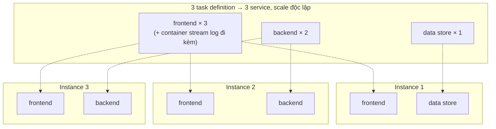
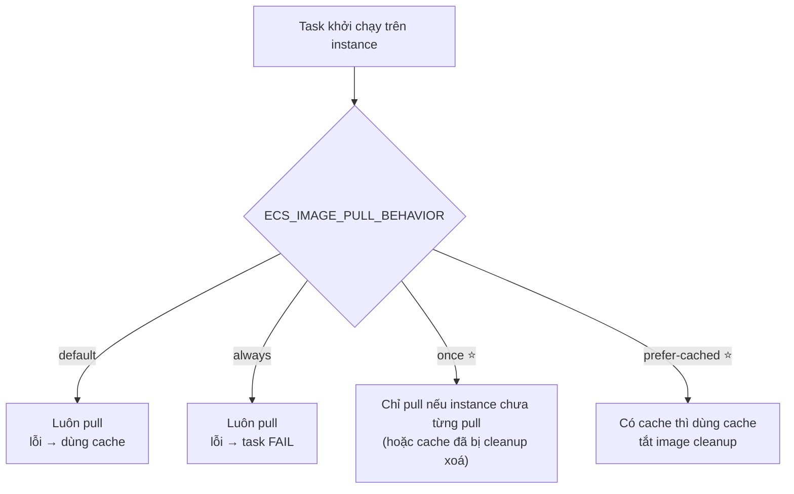

# Thuyết trình cho CTO — EC2 capacity cho Amazon ECS

> Tổng hợp từ `ecs-ec2-capacity-va-image-pull-behavior.md`. Folder này nhỏ, nên bài chỉ khoảng **3 slide**. Nên ghép vào bài `05-99` (mục 1, Chọn compute) hoặc `08-99` (Fargate), thay vì trình bày riêng.
>
> Ký hiệu: ⚠️ = rủi ro cần nói rõ · 💬 = ý của mình, docs không nói.

---

## Tổng quan folder 09 — EC2

**Folder này nói về gì:** folder nhỏ, chỉ có hai ý. Một là cách **chia task definition theo cách muốn scale** khi tự quản lý EC2. Hai là cách **tăng tốc deploy bằng cache image** (`ECS_IMAGE_PULL_BEHAVIOR`).

**Vị trí trong tổng thể:** là lựa chọn compute "toàn quyền" trong ba lựa chọn ở `05-99` (mục 1). Phần lớn nội dung vận hành EC2 nằm ở các folder khác.

```
05 (chọn compute) ──► 09 EC2
                         ├─ ASG, bảo mật container instance (IMDS) → 14 (mục 5)
                         ├─ bridge, swap, privileged: chỉ có trên EC2 → 13 (mục 3–4)
                         └─ placement strategy spread/binpack       → 15 (mục 3)
```

**Những ý cần nhớ của riêng folder này:**
1. Chọn EC2 khi **workload lớn và cần tối ưu chi phí**, hoặc khi cần những thứ Fargate không có.
2. Mỗi thành phần một task definition, để scale theo tỉ lệ riêng (ví dụ 3 frontend, 2 backend, 1 data store).
3. Dùng `once` hoặc `prefer-cached` để tiết kiệm 10–20 giây mỗi task, **với điều kiện** mỗi release dùng một tag riêng.

---

## 1. Khi nào chọn EC2

Docs chỉ nêu một tiêu chí: **workload lớn và cần tối ưu chi phí**. Khi đó team tự cung cấp EC2 instance (container instance), còn ECS đặt task lên các instance đó.

💬 Kết hợp với `05-99`: chọn EC2 khi cần GPU/HPC, custom AMI, privileged container hoặc capacity reservation. Đây cũng là những thứ Fargate không làm được (xem `08-99`, mục 1).

---

## 2. Chia task definition theo cách muốn scale

Nguyên tắc: container nào **cùng mục đích, phải chạy cùng nhau** thì để chung task definition. Thành phần khác nhau thì tách riêng, để mỗi thành phần scale theo số lượng riêng.

Ví dụ của docs: 3 instance chạy 3 frontend, 2 backend, 1 data store.



**Cách nói:** nếu gộp cả ba vào một task definition thì tỉ lệ luôn là 3–3–3, không thể có 3–2–1. Container stream log thì ngược lại: nó chỉ phục vụ frontend, nên phải nằm chung task definition với frontend.

---

## 3. Deploy nhanh hơn bằng cache image

Với image lớn, pull qua mạng mất **10–20 giây** cho mỗi task. Tham số agent `ECS_IMAGE_PULL_BEHAVIOR` quyết định khi nào agent phải pull lại:



- AWS khuyến nghị `once` hoặc `prefer-cached` để deploy nhanh hơn.
- ⚠️ Điều kiện bắt buộc: **mỗi release dùng một tag mới** (vd git SHA). Nếu cứ ghi đè cùng một tag như `latest`, instance sẽ tiếp tục chạy image cũ mà không ai biết.
- Thêm nữa: image slim hoặc Alpine khởi động nhanh hơn image Debian, Ubuntu bản đầy đủ.

---

## 4. Quyết định cần CTO chốt

| # | Quyết định |
|---|---|
| 1 | Workload nào đủ lớn để EC2 rẻ hơn Fargate |
| 2 | Bật `prefer-cached`/`once` không, kèm điều kiện bắt buộc dùng tag theo git SHA |
| 3 | Quy chuẩn base image (slim/Alpine) cho toàn team |
