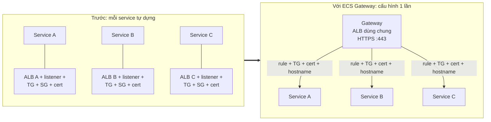
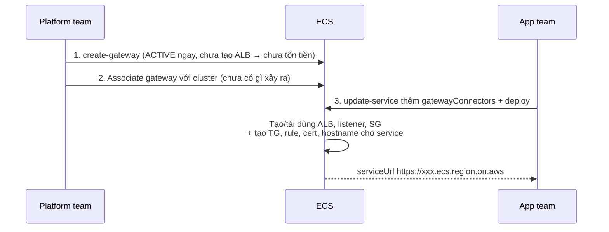
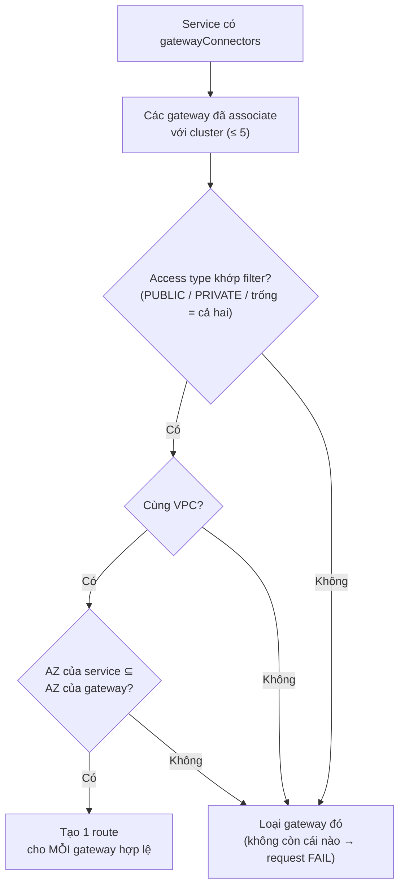
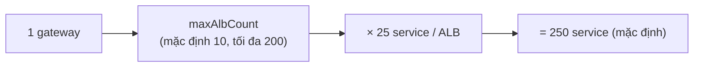
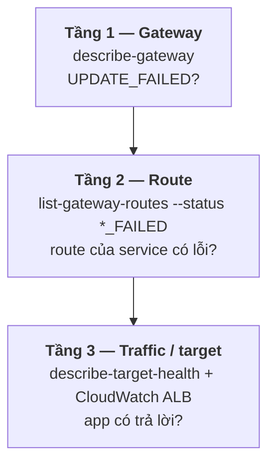

# Thuyết trình cho CTO — Amazon ECS Gateway

> Tổng hợp từ các file `12-*` trong folder này. Mục đích: nói về **quyết định, chi phí, rủi ro**, không đi vào thao tác.
>
> Ký hiệu: ⚠️ = rủi ro cần nói rõ · 💬 = ý của mình, docs không nói.
>
> Sơ đồ viết bằng **Mermaid**. Muốn đưa vào slide thì dán vào <https://mermaid.live> rồi export PNG/SVG.
>
> Liên quan: `05-99` mục 2 (traffic vào), `15-99` mục 5 (load balancer cho service).

---

## Tổng quan folder 12 — Amazon ECS Gateway

**Folder này nói về gì:** cách **expose service ra ngoài bằng HTTPS** mà không phải dựng một ALB cho mỗi service. Platform team cấu hình gateway một lần, app team chỉ cần thêm một tham số trên service. Folder đi qua: chia vai giữa platform team và app team, cách ECS chọn gateway, sức chứa và chi phí, thiết lập bất biến, giám sát và troubleshoot.

**Vị trí trong tổng thể:** thuộc nhóm "chạy thế nào". Đây là phương án ingress thay cho việc tự cấu hình ALB ở `15-99` (mục 5) và `05-99` (mục 2).

```
05 (traffic vào) ─┬─ ALB/NLB tự quản lý → 15 (mục 5)
                  └─ ECS Gateway         → 12 ◄── yêu cầu awsvpc + named port (13)
```

**Những ý cần nhớ của riêng folder này:**
1. Tối đa **25 service dùng chung một ALB**, giảm số ALB phải trả tiền. Bản thân gateway miễn phí.
2. App team **không cần quyền networking**, vì ECS tự tạo ALB, target group, certificate.
3. ⚠️ **Subnet và scheme không đổi được** sau khi tạo gateway. Phải chốt ngay từ đầu.
4. ⚠️ Service nội bộ phải đặt `filters.accessTypes: PRIVATE`. Nếu bỏ trống, service có thể bị lộ ra internet khi có gateway public được gắn thêm.
5. Mọi thay đổi liên quan gateway **chỉ có hiệu lực sau khi service deploy lại**.

---

## Mục lục

0. [Vấn đề cần giải quyết](#0-vấn-đề-cần-giải-quyết)
1. [Chia vai: platform team và app team](#1-chia-vai-platform-team-và-app-team)
2. [Ba bước thiết lập](#2-ba-bước-thiết-lập)
3. [ECS chọn gateway cho service thế nào](#3-ecs-chọn-gateway-cho-service-thế-nào)
4. [Chi phí và sức chứa](#4-chi-phí-và-sức-chứa)
5. [Thiết lập bất biến: phải chốt ngay từ đầu](#5-thiết-lập-bất-biến-phải-chốt-ngay-từ-đầu)
6. [Giám sát ba tầng](#6-giám-sát-ba-tầng)
7. [Bẫy vận hành](#7-bẫy-vận-hành)
8. [Giới hạn](#8-giới-hạn)
9. [Quyết định cần CTO chốt](#9-quyết-định-cần-cto-chốt)

---

## 0. Vấn đề cần giải quyết



**Cách nói:** gom phần dùng chung (ALB, listener, security group) về một chỗ. Phần riêng của từng service (target group, rule, certificate, hostname) thì ECS **tự tạo** khi service kết nối. Kết quả là mỗi service có một URL `https://<unique-id>.ecs.<region>.on.aws`.

| Lợi ích | Ý nghĩa |
|---|---|
| Self-service | App team expose service mà **không cần biết networking**, không cần quyền tạo LB |
| Chi phí | Tối đa **25 service dùng chung một ALB**, nên giảm số ALB tính phí theo giờ |
| Kiểm soát tập trung | WAF, security group, access log, chống HTTP desync được đặt một lần cho mọi service |
| Minh bạch | Tài nguyên nằm trong account của bạn, nhìn thấy được trên console |
| Progressive deployment | Header test traffic phục vụ blue/green và canary |

Gateway **miễn phí**, chỉ trả tiền cho ALB và các tài nguyên bên dưới.

---

## 1. Chia vai: platform team và app team

| | Platform team | App team |
|---|---|---|
| Làm việc với | Gateway, association với cluster | `gatewayConnectors` trên service |
| Quyết định | Public/internal, subnet, SG, WAF, log, sức chứa, header test | Port nào nhận traffic, access type, health check |
| Quyền IAM | Thao tác gateway + `iam:PassRole` cho infrastructure role | **Không cần** PassRole, không cần quyền tạo LB |

Quyền tạo hạ tầng nằm ở **infrastructure role của ECS**, không nằm ở người deploy. Đây là lý do app team không cần quyền networking.

---

## 2. Ba bước thiết lập



⚠️ Quy tắc xuyên suốt: **mọi thay đổi liên quan đến gateway chỉ có hiệu lực qua một lần deploy service**. Associate hay disassociate gateway, đổi header test… đều chờ lần deploy kế tiếp của từng service.

---

## 3. ECS chọn gateway cho service thế nào



⚠️ **Rủi ro bảo mật:** nếu để trống `filters.accessTypes`, service sẽ nối vào **mọi** gateway hợp lệ, kể cả gateway public mà platform team gắn thêm sau này. Service nội bộ (admin API, service chỉ cho service khác gọi) **phải** đặt `PRIVATE` ngay từ đầu.

---

## 4. Chi phí và sức chứa



- Theo dõi `currentAlbCount` / `maxAlbCount`. Hết chỗ thì deploy lỗi, nên cần nâng giới hạn trước khi cần.
- ⚠️ ALB **không tự gom lại** khi bớt service, nên ALB dư vẫn tiếp tục tính phí.
- ⚠️ Mỗi route có một certificate riêng. Ngắt rồi nối lại nhiều lần sẽ tốn hạn mức certificate hằng năm (`CertificateAnnualLimitExceeded`), và xoá đi cũng không lấy lại được hạn mức.

---

## 5. Thiết lập bất biến: phải chốt ngay từ đầu

| Bất biến (không đổi được sau khi tạo) | Đổi được |
|---|---|
| Tên, **subnet**, IP address type, **scheme** (public/internal), listener HTTPS 443 | Inbound SG, `maxAlbCount`, WAF, HTTP desync, access log, header test, deletion protection |

- Subnet quyết định gateway phục vụ được service nào (VPC và AZ), nên chọn subnet **phủ rộng hơn** các service.
- Cần cả public lẫn internal thì tạo **hai gateway**.
- ⚠️ Dạng tối giản `{"hostSharedAlb": {}}` sẽ dùng subnet của default VPC và scheme `internet-facing`. Cấu hình này **không sửa được** về sau.
- ⚠️ Phía app: với deployment `ROLLING`, **không đổi được health check** sau khi đã thêm connector. Phải chốt health check path ngay từ đầu, hoặc dùng blue/green/canary.

---

## 6. Giám sát ba tầng



"Xanh" ở tầng trên **không** đảm bảo "xanh" ở tầng dưới.

| Ai | Dimension CloudWatch | Alarm gợi ý |
|---|---|---|
| App team | `TargetGroup` | `UnHealthyHostCount`, `TargetResponseTime`, `HTTPCode_Target_5XX_Count` |
| Platform team | `LoadBalancer` | `HTTPCode_ELB_5XX_Count`, `RejectedConnectionCount` |

⚠️ Đừng gắn alarm vào ARN cứng. ALB có thể bị gateway thay, khi đó alarm vẫn "OK" nhưng không đo gì nữa. Nên chọn tài nguyên theo tag và cấu hình cách xử lý missing data.

---

## 7. Bẫy vận hành

| Bẫy | Hậu quả | Cách tránh |
|---|---|---|
| ⚠️ `UpdateGateway` **ghi đè toàn bộ** cấu hình | Quên `webACLArn` thì **mất WAF**; quên `inboundSecurityGroup` thì mở 443 cho mọi IP; quên deletion protection thì nó bị bật lại | `describe-gateway` trước rồi truyền **đủ**; 💬 quản lý bằng IaC |
| Sửa tay ALB/TG/SG có tag `AmazonECSManaged=true` | Gateway vẫn báo bình thường vì không đọc lại trạng thái thật | Mọi thay đổi đi qua cấu hình gateway hoặc service |
| Xoá gateway cuối cùng của cluster | Service còn connector cũ, nên `update-service` (kể cả chỉ đổi image) bị từ chối | Gỡ connector trước |
| Ngắt rồi nối lại connector | **URL mới** | Cập nhật client và DNS |

---

## 8. Giới hạn

| Giới hạn | Giá trị |
|---|---|
| Gateway mỗi cluster | 5 |
| Connector mỗi service | 1 (có thể sinh nhiều route) |
| Service mỗi ALB | 25 |
| ALB mỗi gateway | 200 |
| Protocol | Chỉ **HTTPS :443** |
| Network mode | Chỉ `awsvpc` (EC2, Fargate, Managed Instances) |
| Khác | Cùng account; không hỗ trợ Express Mode; không chọn gateway theo tên |

💬 Cần TCP/UDP, custom domain hoặc cross-account thì vẫn phải dùng ALB/NLB tự quản lý (xem `05-99`).

---

## 9. Quyết định cần CTO chốt

| # | Quyết định |
|---|---|
| 1 | Chuẩn hoá ingress HTTPS qua ECS Gateway, thay cho mỗi service một ALB |
| 2 | Team nào làm platform team, sở hữu gateway |
| 3 | Số gateway: một public + một internal? Chọn subnet và AZ nào (không đổi được về sau) |
| 4 | Bắt buộc `filters.accessTypes` tường minh cho mọi service, `PRIVATE` cho service nội bộ |
| 5 | WAF, access log, inbound SG mặc định cho gateway public |
| 6 | Deployment strategy (blue/green/canary) để còn đổi được health check |
| 7 | Quản lý gateway bằng IaC để tránh bẫy ghi đè của `UpdateGateway` |
