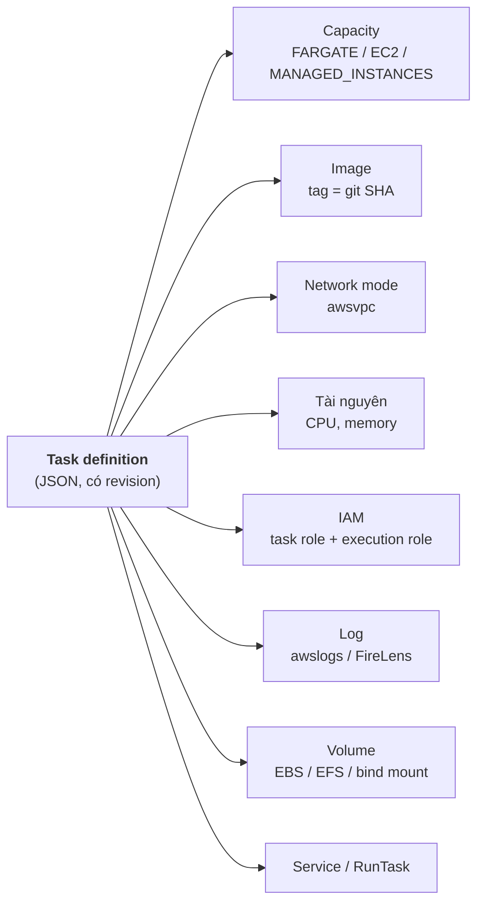
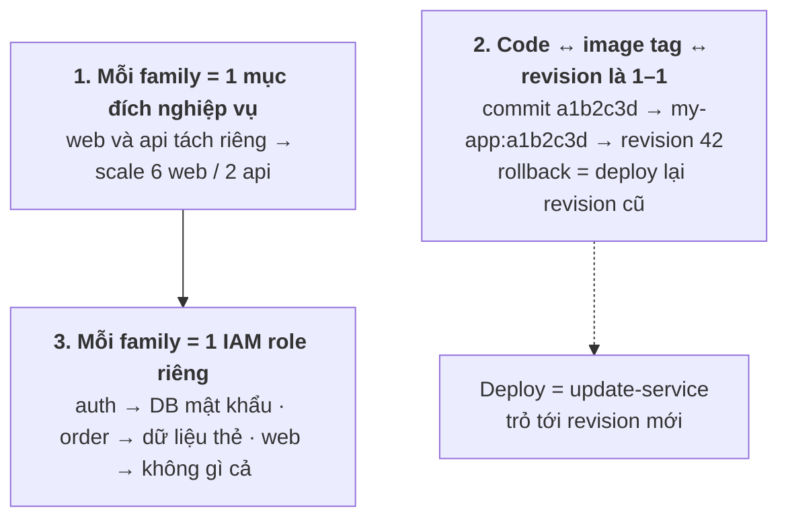
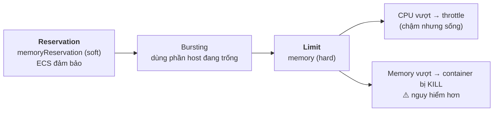
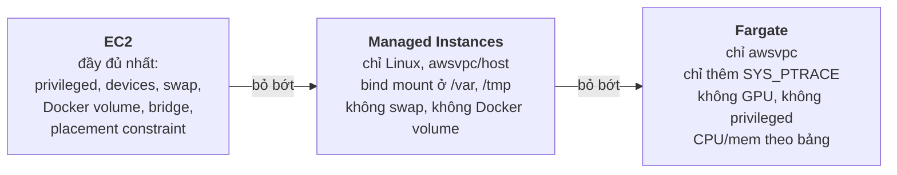
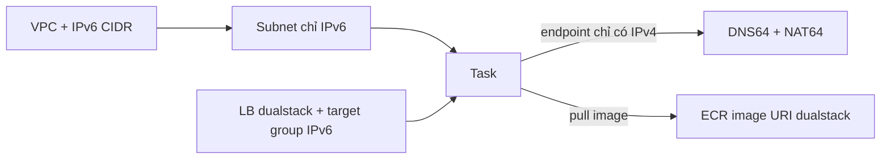
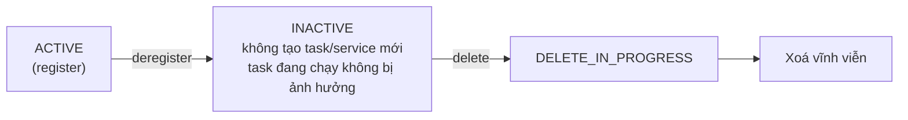

# Thuyết trình cho CTO — Task definitions trên Amazon ECS

> Tổng hợp từ các file `13-*` trong folder này. Mục đích: nói về **quy chuẩn, quyết định, rủi ro**. Danh sách tham số chi tiết nằm ở các file `13-09`, `13-10`, `13-11`.
>
> Ký hiệu: ⚠️ = rủi ro cần nói rõ · 💬 = ý của mình, docs không nói.
>
> Sơ đồ viết bằng **Mermaid**. Muốn đưa vào slide thì dán vào <https://mermaid.live> rồi export PNG/SVG.

---

## Tổng quan folder 13 — Task definitions

**Folder này nói về gì:** **"hợp đồng" mô tả cách app chạy**: image, CPU/memory, network mode, IAM role, log, volume. Folder đi qua: nguyên tắc thiết kế, cách tính kích thước, các network mode, khác biệt tham số giữa EC2, Managed Instances và Fargate, IPv6-only, và vòng đời của revision.

**Vị trí trong tổng thể:** là **điểm chung** mà mọi folder khác dựa vào. Cluster (`14-99`) chạy task definition, service (`15-99`) deploy task definition, gateway (`12-99`) đọc named port trong task definition.

```
13 Task definition ──► chạy trên compute 06 / 08 / 09 (mỗi nền tảng hỗ trợ tham số khác nhau)
                   ──► được service ở 15 deploy (deploy = trỏ service tới revision mới)
                   ──► gateway ở 12 dùng network mode awsvpc + port có tên
```

**Những ý cần nhớ của riêng folder này:**
1. Mỗi family chỉ cho **một mục đích nghiệp vụ** và dùng **một IAM role riêng**.
2. Commit, image tag và revision **tương ứng 1–1**. Rollback chỉ là deploy lại revision cũ.
3. Vượt CPU limit thì bị throttle. Vượt **memory limit thì container bị kill**.
4. Chuẩn hoá `awsvpc`: chạy được trên cả ba nền tảng và dùng được ECS Gateway.
5. Khi register luôn khai báo `requiresCompatibilities`, để ECS báo lỗi ngay thay vì chờ tới lúc deploy.

---

## Mục lục

0. [Task definition là bản hợp đồng](#0-task-definition-là-bản-hợp-đồng)
1. [Ba nguyên tắc thiết kế](#1-ba-nguyên-tắc-thiết-kế)
2. [Sizing: reservation và limit](#2-sizing-reservation-và-limit)
3. [Network mode: chuẩn hoá awsvpc](#3-network-mode-chuẩn-hoá-awsvpc)
4. [Khác biệt giữa EC2, Managed Instances, Fargate](#4-khác-biệt-giữa-ec2-managed-instances-fargate)
5. [IPv6-only](#5-ipv6-only)
6. [Vòng đời revision](#6-vòng-đời-revision)
7. [Quyết định cần CTO chốt](#7-quyết-định-cần-cto-chốt)

---

## 0. Task definition là bản hợp đồng

> Nguồn: [`13-02-00`](13-02-00-ecs-architect-your-application.md)



**Cách nói:** "kiến trúc ứng dụng" trên ECS được thể hiện cụ thể trong task definition. Service, capacity, gateway… đều dựa trên nó. Vì vậy cần một **quy chuẩn chung** cho mọi team.

---

## 1. Ba nguyên tắc thiết kế

> Nguồn: [`13-02-00`](13-02-00-ecs-architect-your-application.md)



- Nguyên tắc 1 và 3 đi cùng nhau: gộp nhiều thành phần vào một task thì buộc phải dùng **chung quyền** và **chung tỉ lệ scale**.
- Ngoại lệ: sidecar phục vụ trực tiếp cho app (log router, proxy) thì để chung task.

---

## 2. Sizing: reservation và limit

> Nguồn: [`13-02-01`](13-02-01-ecs-task-size-best-practices.md) · [`13-02-06`](13-02-06-ecs-container-swap.md) · [`13-02-08`](13-02-08-ecs-fargate-task-definition-differences.md) · [`13-09`](13-09-ecs-managed-instances-task-definition-parameters.md) · [`13-11`](13-11-ecs-ec2-task-definition-parameters.md)



| | EC2 | Managed Instances | Fargate |
|---|---|---|---|
| CPU/memory mức task | Tuỳ chọn, tới 192 vCPU | Tuỳ chọn, 0,125–10 vCPU | **Bắt buộc**, theo bảng tổ hợp (tới 32 vCPU) |
| Trả tiền theo | Instance | Instance | **Kích thước task đã chọn** |

- Chọn con số bằng **load test**.
- CPU nhỏ (256 = ¼ vCPU) thì scale chi tiết, rẻ, nhưng có thể không kịp đỡ spike. CPU lớn thì ngược lại.
- Swap theo từng container (`maxSwap`, `swappiness`) **chỉ có trên EC2 Linux** và instance phải bật swap.

---

## 3. Network mode: chuẩn hoá `awsvpc`

> Nguồn: [`13-02-02`](13-02-02-ecs-managed-instances-networking.md) · [`13-02-03`](13-02-03-ecs-task-networking-ec2.md) · [`13-02-04`](13-02-04-ecs-task-networking-fargate.md)

| | `awsvpc` | `bridge` | `host` | `none` |
|---|---|---|---|---|
| IP riêng mỗi task | ✅ | ❌ (IP của instance) | ❌ | — |
| Security group mỗi task | ✅ | ❌ | ❌ | — |
| Nhiều task cùng task definition trên một instance | ✅ | ✅ (dynamic port) | ❌ | — |
| EC2 | ✅ | ✅ (mặc định Linux) | ✅ | ✅ |
| Managed Instances | ✅ (phải khai báo rõ) | ❌ | ✅ | ❌ |
| Fargate | ✅ **bắt buộc** | ❌ | ❌ | ❌ |
| ECS Gateway / Service Connect | ✅ | Service Connect ✅ | ❌ | — |

**Kết luận:** AWS khuyến nghị `awsvpc` cho mọi nền tảng. Chuẩn hoá `awsvpc` ngay từ đầu thì task definition chạy được trên cả ba nền tảng, dùng được ECS Gateway, và không phải sửa khi migrate.

💬 Đánh đổi: `awsvpc` khởi động chậm hơn vài giây (phải gắn ENI) và tốn ENI. Trên EC2 thì dùng ENI trunking để bù (xem `05-99`, mục 9).

---

## 4. Khác biệt giữa EC2, Managed Instances, Fargate

> Nguồn: [`13-02-07`](13-02-07-ecs-managed-instances-task-definition-differences.md) · [`13-02-08`](13-02-08-ecs-fargate-task-definition-differences.md) · [`13-02-09`](13-02-09-ecs-windows-ec2-task-definition-differences.md) · [`13-09`](13-09-ecs-managed-instances-task-definition-parameters.md) · [`13-10`](13-10-ecs-fargate-task-definition-parameters.md) · [`13-11`](13-11-ecs-ec2-task-definition-parameters.md)

Slide này để trả lời câu hỏi "chuyển nền tảng có phải sửa task definition không":



| Tham số | EC2 | Managed Instances | Fargate |
|---|---|---|---|
| `privileged`, capability đầy đủ | ✅ | ✅ (phải bật trên capacity provider) | ❌ (chỉ `SYS_PTRACE`) |
| GPU | ✅ | ✅ | ❌ |
| `maxSwap`, `swappiness` | ✅ | ❌ | ❌ |
| Docker volume | ✅ | ❌ | ❌ |
| `ephemeralStorage` | — | ❌ | ✅ (tối đa 200 GiB) |
| EBS / EFS | ✅ | ✅ | ✅ |
| Windows | ✅ (nhiều bản nhất) | ❌ | ✅ (2019/2022/2025) |
| `cpuArchitecture` mặc định | Không có | Không có | `X86_64` |
| `stopTimeout` tối đa | Theo agent | 86.400s | 120s |

⚠️ Lúc register, luôn khai báo `requiresCompatibilities` (`FARGATE` / `MANAGED_INSTANCES` / `EC2`) để ECS **kiểm tra hợp lệ ngay từ đầu**, không phải chờ tới lúc deploy mới lỗi.

⚠️ Image ARM64 (Graviton) phải khai báo `cpuArchitecture: ARM64`. Nếu để trống, task có thể bị đặt lên x86 và lỗi.

---

## 5. IPv6-only

> Nguồn: [`13-02-02`](13-02-02-ecs-managed-instances-networking.md) · [`13-02-03`](13-02-03-ecs-task-networking-ec2.md) · [`13-02-04`](13-02-04-ecs-task-networking-fargate.md)



| Hạn chế | |
|---|---|
| ⚠️ Không có ECS Exec | Mất công cụ debug |
| Không hỗ trợ Windows | |
| ECR không có interface endpoint dualstack | Phải dùng image URI dualstack |
| Fargate: không có CloudWatch dualstack FIPS endpoint | Ảnh hưởng hệ thống cần FIPS |

Cách chuyển: update trực tiếp, hoặc chạy service song song rồi chuyển bằng blue/green.

---

## 6. Vòng đời revision

> Nguồn: [`13-01`](13-01-ecs-task-definition-states.md)



- Việc xoá bị chặn khi còn standalone task, task của service, deployment hoặc task set tham chiếu tới revision.
- Tên family được giữ lại, số revision tiếp tục tăng.
- ⚠️ AWS Config tính phí **mỗi lần register/deregister**. 💬 Pipeline CI/CD register revision cho mỗi build sẽ làm tăng phí này.

---

## 7. Quyết định cần CTO chốt

> Nguồn: tổng hợp từ các mục 0–6 ở trên.

| # | Quyết định |
|---|---|
| 1 | Quy chuẩn chung: `awsvpc`, image tag = git SHA, mỗi family một mục đích nghiệp vụ, mỗi family một task role |
| 2 | Bắt buộc khai báo `requiresCompatibilities` và `cpuArchitecture` |
| 3 | Quy trình load test để chốt CPU/memory, không đoán |
| 4 | Ai duyệt các tham số đặc quyền (`privileged`, capability, `pidMode: host`) |
| 5 | Chính sách dọn revision cũ (deregister/delete) |
| 6 | Có đi IPv6-only không (đánh đổi: mất ECS Exec) |
