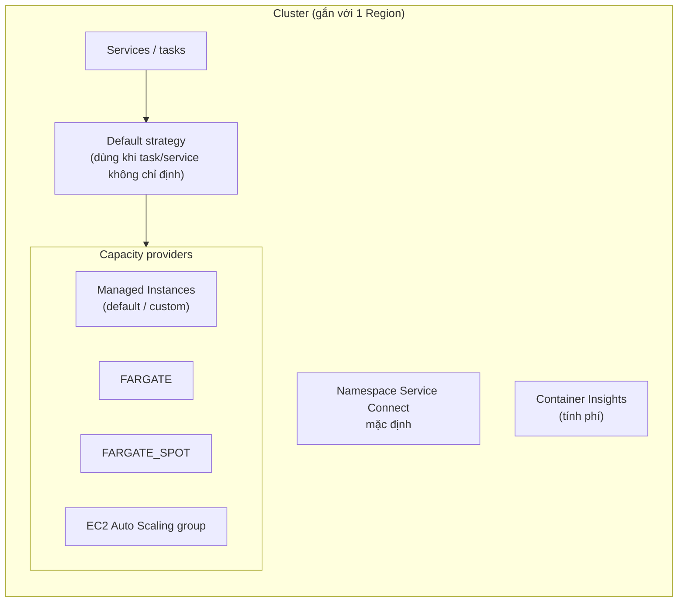
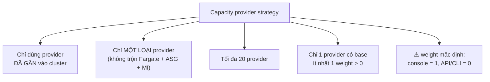
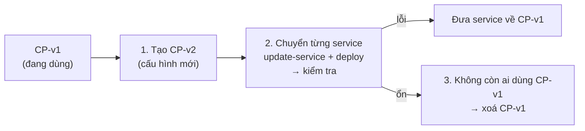
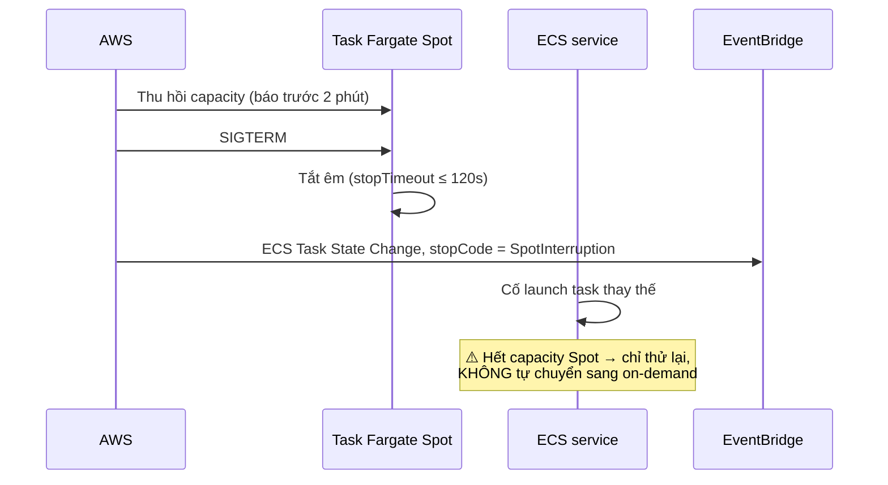
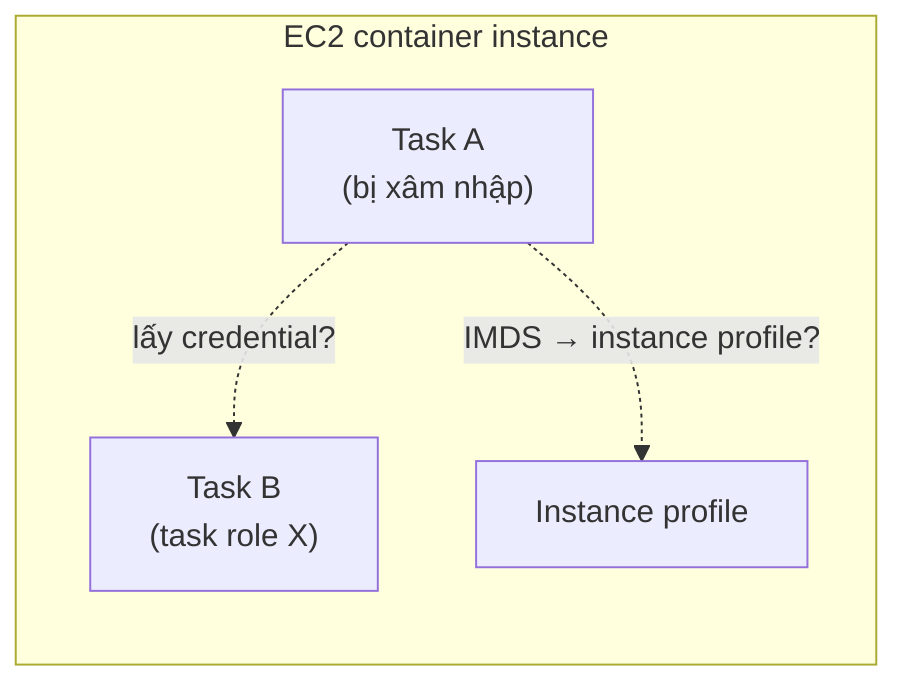
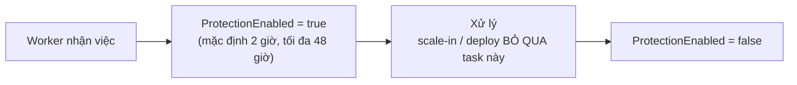

# Thuyết trình cho CTO — Cluster trên Amazon ECS

> Tổng hợp từ các file `14-*` trong folder này. Mục đích: nói về **cách tổ chức cluster, quyết định, rủi ro**, không đi vào thao tác console/CLI.
>
> Ký hiệu: ⚠️ = rủi ro cần nói rõ · 💬 = ý của mình, docs không nói.
>
> Sơ đồ viết bằng **Mermaid**. Muốn đưa vào slide thì dán vào <https://mermaid.live> rồi export PNG/SVG.
>
> Liên quan: `05-99` (chọn compute), `06-99` (Managed Instances), `15-99` (base/weight).

---

## Tổng quan folder 14 — Cluster

**Folder này nói về gì:** **cluster là nhóm logic** chứa capacity provider, service và task. Folder đi qua: các quy tắc của capacity provider strategy, cách tạo và cập nhật cluster cho từng loại hạ tầng (Managed Instances, Fargate, EC2), xử lý khi Spot bị thu hồi, bảo mật container instance, và task scale-in protection.

**Vị trí trong tổng thể:** là **cầu nối** giữa compute (`06/08/09`) và việc chạy service (`15-99`). Task definition (`13-99`) được chạy bên trong cluster.

```
            ┌── 06 Managed Instances ┐
14 Cluster ─┼── 08 Fargate / Spot    ├── capacity provider strategy ──► service ở 15
            └── 09 EC2 (ASG)         ┘
```

**Những ý cần nhớ của riêng folder này:**
1. Một cluster chứa được **cả ba loại** hạ tầng, nhưng **một strategy chỉ chứa một loại**.
2. **Coi capacity provider là bất biến**: tạo bản mới, chuyển dần từng service, rồi xoá bản cũ.
3. ⚠️ Khi Fargate Spot hết capacity, ECS **không** tự chuyển sang on-demand.
4. Cluster EC2: đặt `ECS_AWSVPC_BLOCK_IMDS=true` để task không lấy được credential của instance.
5. Task scale-in protection giữ cho job dài không bị dừng giữa chừng. Đặt hạn bảo vệ quá dài thì deploy bị kẹt.

---

## Mục lục

0. [Cluster là gì, chứa gì](#0-cluster-là-gì-chứa-gì)
1. [Ba loại hạ tầng trong một cluster](#1-ba-loại-hạ-tầng-trong-một-cluster)
2. [Quy tắc capacity provider strategy](#2-quy-tắc-capacity-provider-strategy)
3. [Cluster Managed Instances: coi capacity provider là bất biến](#3-cluster-managed-instances-coi-capacity-provider-là-bất-biến)
4. [Cluster Fargate: xử lý Spot bị gián đoạn](#4-cluster-fargate-xử-lý-spot-bị-gián-đoạn)
5. [Cluster EC2: Auto Scaling group và bảo mật](#5-cluster-ec2-auto-scaling-group-và-bảo-mật)
6. [Task scale-in protection](#6-task-scale-in-protection)
7. [Tuỳ chọn cấp cluster](#7-tuỳ-chọn-cấp-cluster)
8. [Quyết định cần CTO chốt](#8-quyết-định-cần-cto-chốt)

---

## 0. Cluster là gì, chứa gì



**Cách nói:** cluster là **nhóm logic** để tách biệt tài nguyên (theo môi trường, team hoặc mức độ quan trọng). Bản thân cluster không chạy gì; capacity provider mới là thứ cung cấp máy.

Trạng thái của cluster: `ACTIVE`, `PROVISIONING`, `DEPROVISIONING`, `FAILED`, `INACTIVE`. ⚠️ Cluster đã xoá vẫn có thể thấy ở trạng thái `INACTIVE` một thời gian, nhưng **đừng dựa vào** việc đó.

💬 Cách chia cluster hay gặp: mỗi môi trường (dev/staging/prod) một cluster, kết hợp IAM policy để giới hạn ai được thao tác trên cluster nào.

---

## 1. Ba loại hạ tầng trong một cluster

| | Managed Instances | Fargate | EC2 (ASG) |
|---|---|---|---|
| Docs đánh giá | **Khuyến nghị cho đa số workload mới** | Serverless | Toàn quyền, custom AMI |
| Cần chuẩn bị | Infrastructure role + instance profile | Không | Launch template + ASG + instance role |
| Capacity provider | Tự tạo bản default; custom nếu cần GPU, Spot, reservation… | `FARGATE`, `FARGATE_SPOT` có sẵn | Gắn ASG vào |

- Một cluster chứa được **cả ba loại** cùng lúc, nên có thể migrate **từng service một** trong cùng cluster.
- Một instance chỉ thuộc **một** cluster.
- 💬 Console tạo cluster thông qua CloudFormation. Nếu team quản lý hạ tầng bằng Terraform thì nên tạo bằng Terraform, để không có hai nguồn cùng quản lý một tài nguyên.

---

## 2. Quy tắc capacity provider strategy



- ⚠️ **Không** chuyển được service giữa ASG và Fargate.
- ⚠️ Default strategy của cluster **chỉ** được dùng khi task hoặc service không chỉ định launch type hay strategy.
- ⚠️ Nếu dùng launch type EC2 (không qua capacity provider), ECS sẽ **không** tự scale ASG.

---

## 3. Cluster Managed Instances: coi capacity provider là bất biến

Docs khuyến nghị **không sửa tại chỗ** capacity provider, mà tạo bản mới rồi chuyển dần:



| Cách cập nhật | Rủi ro |
|---|---|
| ✅ Tạo CP mới, chuyển dần | Rollout có kiểm soát, rollback dễ, blast radius nhỏ |
| ⚠️ Sửa tại chỗ | Chỉ áp cho instance **mới** và **không** kích hoạt deployment, nên lỗi cấu hình có thể chỉ lộ ra **rất lâu sau**, đúng lúc service cần scale |

Những gì sửa tại chỗ thì an toàn: mức giám sát (basic ↔ detailed). Còn tag thêm sau khi tạo thì **không áp** cho instance cũ, nên cần lên kế hoạch tag cho báo cáo chi phí ngay từ lúc tạo.

Trước khi xoá một capacity provider, cần soát hết những nơi còn dùng nó: strategy của mọi service (kèm force new deployment), default strategy của cluster, standalone task, EventBridge Scheduler, Managed Daemons.

---

## 4. Cluster Fargate: xử lý Spot bị gián đoạn



- ⚠️ Service chỉ có **1 task** chạy trên Spot sẽ bị **gián đoạn** cho tới khi có capacity trở lại.
- Cách giảm rủi ro: đặt `base` trên `FARGATE` on-demand (xem `15-99`, mục 2) và cảnh báo qua EventBridge khi thấy `SpotInterruption`.

---

## 5. Cluster EC2: Auto Scaling group và bảo mật

| Khuyến nghị | Vì sao |
|---|---|
| Dùng **ASG mới, rỗng** (desired = 0) | ASG có sẵn có thể chứa instance cũ không gắn đúng capacity provider |
| Bật **managed scaling** | ECS tự scale ASG theo nhu cầu task. Thiếu capacity thì task chờ ở `PROVISIONING` |
| Bật **managed instance draining** (mặc định bật) | Dời task ra trước khi terminate instance, kể cả khi Spot bị thu hồi |
| Không sửa scaling policy do capacity provider quản lý | — |
| Có thể dùng **warm pool** | Scale nhanh hơn |

**Bảo mật: một instance chạy nhiều task**



| # | Khuyến nghị của AWS |
|---|---|
| 1 | Không chạy task với quyền admin |
| 2 | Task role cấp quyền tối thiểu |
| 3 | Task `awsvpc`: đặt **`ECS_AWSVPC_BLOCK_IMDS=true`** để task không lấy được credential của instance |
| 4 | Bật GuardDuty Runtime Monitoring |

💬 Thay SSH bằng Session Manager hoặc ECS Exec, và không mở port 22 cho Anywhere.

---

## 6. Task scale-in protection

Dùng cho công việc **tốn kém nếu phải làm lại**, ví dụ chuyển mã video, game server, xử lý message dài:



- Hai cách bật: gọi endpoint agent từ trong container (**khuyến nghị**, có retry, không cần SDK), hoặc gọi API `UpdateTaskProtection` từ bên ngoài.
- Task role cần quyền `ecs:GetTaskProtection` và `ecs:UpdateTaskProtection`.
- ⚠️ Rolling deploy sẽ **chờ** task hết bảo vệ. Đặt hạn bảo vệ quá dài có thể làm kẹt deploy (`DEPLOYMENT_BLOCKED`, CloudFormation timeout sau 3 giờ).
- Chỉ áp dụng cho task **của service**.

---

## 7. Tuỳ chọn cấp cluster

| Tuỳ chọn | Ghi chú |
|---|---|
| Container Insights (thường / enhanced) | ⚠️ **Tính phí**; bật/tắt ảnh hưởng **cả cluster** |
| Namespace Service Connect mặc định | Có thể dùng shared namespace (cross-account) |
| Task events → EventBridge | Cảnh báo task dừng, Spot bị thu hồi |
| ECS Exec | KMS + log ra CloudWatch/S3 để audit |
| KMS | Cho Fargate ephemeral storage và managed storage |
| Monitoring capacity provider (Managed Instances) | Basic (miễn phí, 5 phút) / detailed (1 phút) |

---

## 8. Quyết định cần CTO chốt

| # | Quyết định |
|---|---|
| 1 | Chia cluster theo gì: môi trường, team hay mức độ quan trọng |
| 2 | Loại hạ tầng mặc định cho workload mới (docs khuyến nghị Managed Instances) |
| 3 | Default strategy của từng cluster; tỉ lệ Spot/on-demand |
| 4 | Quy trình cập nhật capacity provider: luôn tạo mới rồi chuyển dần, không sửa tại chỗ |
| 5 | Bật Container Insights ở cluster nào (có phí) |
| 6 | Chuẩn bảo mật cho cluster EC2: `ECS_AWSVPC_BLOCK_IMDS`, không SSH, GuardDuty |
| 7 | Workload nào cần task scale-in protection, hạn bảo vệ bao lâu |
| 8 | Quản lý cluster bằng IaC (Terraform/CloudFormation), không tạo bằng tay trên console |
