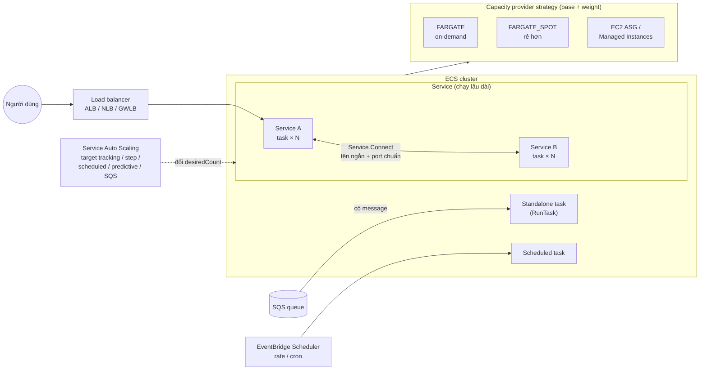
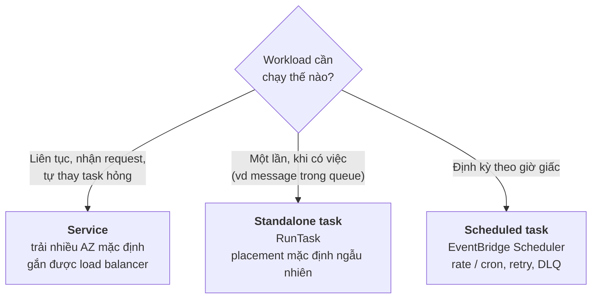
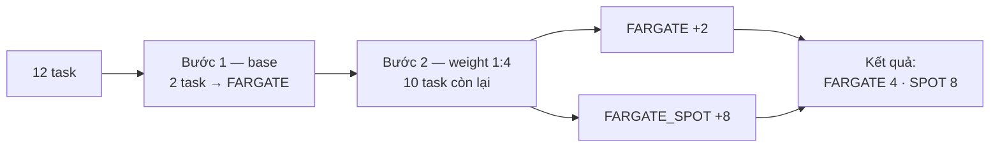
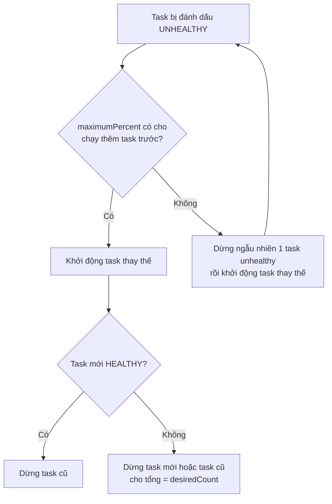
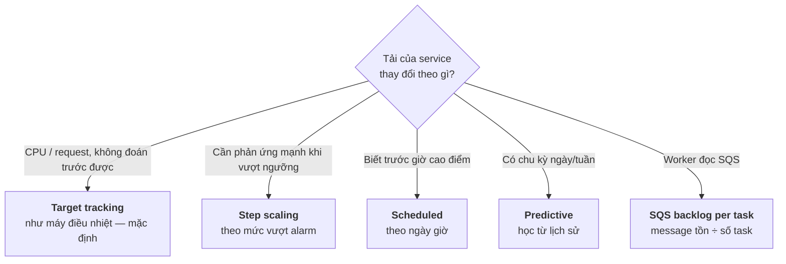
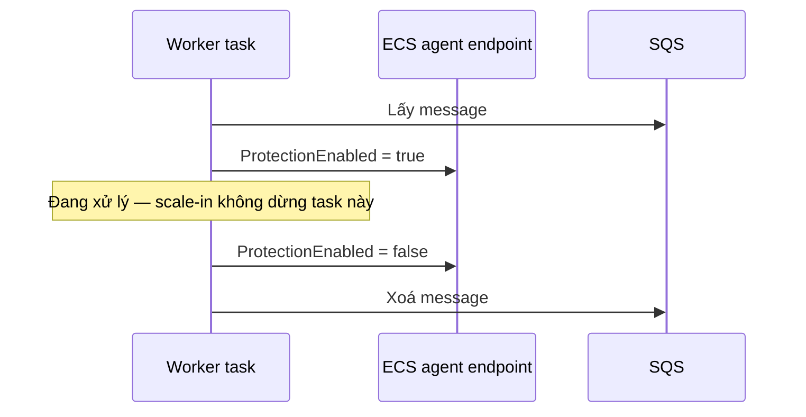
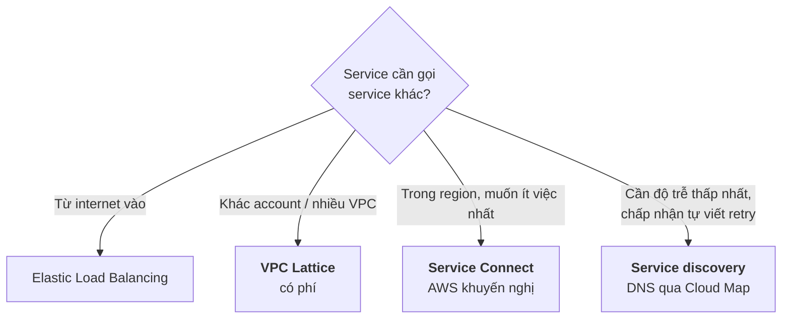

# Thuyết trình cho CTO — Schedule your containers on Amazon ECS

> Tổng hợp từ các file `15-*` trong folder này. Mục đích: nói về **quyết định, chi phí, rủi ro**, không đi vào thao tác console/CLI.
>
> Ký hiệu: ⚠️ = rủi ro cần nói rõ · 💬 = ý của mình, docs không nói.
>
> Sơ đồ viết bằng **Mermaid**: GitHub, GitLab, IntelliJ (bật plugin Mermaid) và VS Code (extension *Markdown Preview Mermaid Support*) đều render được. Muốn đưa vào slide thì dán vào <https://mermaid.live> rồi export PNG/SVG.

---

## Tổng quan folder 15 — Schedule your containers

**Folder này nói về gì:** phần **vận hành**: ECS chạy, đặt, scale và kết nối container ra sao. Folder đi qua: ba cách chạy workload (service, standalone task, scheduled task), base/weight, placement, auto scaling, load balancer, cách tăng tốc deploy, và cách các service gọi nhau (Service Connect, service discovery, VPC Lattice).

**Vị trí trong tổng thể:** là bước **sau cùng**: thiết kế ở `05-99`, mô tả app ở `13-99`, cluster ở `14-99`, rồi tới đây để vận hành.

```
13 task definition ──► 15 service / job / cron ──► chạy trên cluster 14
                              ├─ traffic vào: ALB/NLB (mục 5) hoặc 12 Gateway
                              └─ service gọi nhau: Service Connect (mục 7)
```

**Những ý cần nhớ của riêng folder này:**
1. Chạy liên tục thì dùng **Service**. Chạy theo sự kiện thì dùng **RunTask**. Chạy theo lịch thì dùng **EventBridge Scheduler**.
2. **base + weight** trộn on-demand với Spot (ví dụ 12 task chia thành 4 on-demand và 8 Spot).
3. Có 5 kiểu auto scaling. Target tracking là mặc định, SQS backlog dùng cho worker.
4. Deploy nhanh hơn chỉ bằng cách chỉnh tham số: deregistration delay 300s → 5s, stop timeout 30s → 2s.
5. **Service Connect** là cách AWS khuyến nghị để các service gọi nhau, không tính thêm phí.

---

## Mục lục

0. [Sơ đồ tổng thể (slide mở đầu)](#0-sơ-đồ-tổng-thể-slide-mở-đầu)
1. [Ba cách chạy workload](#1-ba-cách-chạy-workload)
2. [Chi phí compute: base và weight](#2-chi-phí-compute-base-và-weight)
3. [Độ sẵn sàng (HA)](#3-độ-sẵn-sàng-ha)
4. [Auto scaling](#4-auto-scaling)
5. [Traffic vào: chọn load balancer](#5-traffic-vào-chọn-load-balancer)
6. [Deploy nhanh hơn](#6-deploy-nhanh-hơn)
7. [Kết nối giữa các service](#7-kết-nối-giữa-các-service)
8. [Quyết định cần CTO chốt](#8-quyết-định-cần-cto-chốt)
9. [Phụ lục: bỏ khỏi slide, giữ để trả lời câu hỏi](#9-phụ-lục)

---

## 0. Sơ đồ tổng thể (slide mở đầu)

Một sơ đồ gom cả bài: traffic đi vào thế nào, task được đặt ở đâu, scale theo gì, các service nói chuyện với nhau ra sao.



**Cách nói:** đi từ trái sang phải. Người dùng đi qua load balancer vào service. Các service gọi nhau qua Service Connect. Job thì do queue hoặc lịch kích hoạt. Mọi thứ chạy trên capacity provider, và Auto Scaling quyết định số task.

---

## 1. Ba cách chạy workload

*(Nguồn: `15-00`, `15-03-*`)*



| | Service | Standalone task | Scheduled task |
|---|---|---|---|
| Vòng đời | Lâu dài, ECS giữ số task | Chạy xong rồi dừng | Chạy xong rồi dừng, lặp theo lịch |
| Ai kích hoạt | ECS (theo `desiredCount`) | App gọi `RunTask` | EventBridge Scheduler |
| Ví dụ | API, web, gateway | Xử lý job từ queue | Backup, quét log |

👉 **Trên slide:** điền workload thật của công ty vào từng cột.

---

## 2. Chi phí compute: base và weight

*(Nguồn: `15-00`, `15-04-00`)*

- `base`: số task **tối thiểu** chạy trên một provider. Trong một strategy, chỉ một provider được có base.
- `weight`: tỉ lệ chia số task còn lại sau khi đã đủ base.
- Muốn dùng **Managed Instances** thì bắt buộc chọn capacity provider strategy.

Ví dụ: chạy 12 task với `FARGATE` (base 2, weight 1) và `FARGATE_SPOT` (weight 4).



```json
"capacityProviderStrategy": [
  { "capacityProvider": "FARGATE",      "base": 2, "weight": 1 },
  { "capacityProvider": "FARGATE_SPOT",            "weight": 4 }
]
```

💬 Spot có thể bị thu hồi. Base trên on-demand là phần đảm bảo luôn có task chạy. Folder không nói về chuyện thu hồi, nên đây là ý của mình.

---

## 3. Độ sẵn sàng (HA)

*(Nguồn: `15-04-00`, `15-02-*`)*

Service scheduler tự thay task unhealthy (khi container health check hoặc health check của target group thất bại):



- Task crash liên tục (chưa tới `RUNNING`) thì scheduler giảm tần suất thử lại và gửi service event, nên không đốt tài nguyên.
- Placement strategy (chỉ áp dụng cho EC2; Fargate tự lo) là trade-off giữa HA và chi phí:

| Strategy | Làm gì | Ưu tiên |
|---|---|---|
| `spread` | Trải đều theo AZ/instance | HA |
| `binpack` | Dồn task vào ít instance nhất | Chi phí |
| `random` | Đặt ngẫu nhiên | Đơn giản |

---

## 4. Auto scaling

*(Nguồn: `15-04-06-*`)*



Những điểm nên nói:

- Scale-out nhanh, còn scale-in thận trọng vì có cooldown.
- Có thể **scale về 0** bằng cách đặt min capacity = 0.
- Trong lúc deploy, scale-in bị tắt nhưng scale-out vẫn chạy.
- ⚠️ Khi scale in, ECS có thể dừng task đang xử lý message, dẫn tới mất tiến độ hoặc xử lý trùng. Cách xử lý:



---

## 5. Traffic vào: chọn load balancer

*(Nguồn: `15-04-05-*`)*

| Loại | Tầng | Dùng khi |
|---|---|---|
| **ALB** | 7 — HTTP/HTTPS | Web/API; định tuyến theo path, nhiều service dùng chung một ALB, dynamic port |
| **NLB** | 4 — TCP/UDP | Giao thức không phải HTTP |
| **GWLB** | 4 | Firewall, IDS/IPS, deep packet inspection |

Một service có thể đăng ký **nhiều target group**, ví dụ một LB nội bộ và một LB internet.

---

## 6. Deploy nhanh hơn

*(Nguồn: `15-04-05-01`, `15-04-05-02`)* ⭐ slide dễ gây ấn tượng: chỉ cần chỉnh tham số, không phải đổi kiến trúc.

Thời gian gỡ một task cũ khi deploy:

```mermaid
gantt
    title Gỡ task cũ khi deploy — mặc định vs đã tối ưu (giây)
    dateFormat s
    axisFormat %S
    section Mặc định
    Deregistration delay 300s :a1, 0, 300s
    Stop timeout 30s          :a2, after a1, 30s
    section Đã tối ưu
    Deregistration delay 5s   :b1, 0, 5s
    Stop timeout 2s           :b2, after b1, 2s
```



| Thứ đang chờ | Tham số | Mặc định | Có thể giảm còn | Điều kiện |
|---|---|---|---|---|
| LB chờ đóng kết nối | `deregistration_delay.timeout_seconds` | 300s | 5s | Response < 1s, không upload chậm/streaming |
| ECS chờ trước SIGKILL | `ECS_CONTAINER_STOP_TIMEOUT` | 30s | 2s | App tắt trong < 1s |
| Health check (khi target hồi phục từ unhealthy) | interval × threshold | 30s × 5 = 150s | giảm interval/threshold | Target mới chỉ cần 1 lần đạt |

⚠️ Điều kiện tiên quyết: app phải **bắt SIGTERM** để tắt gọn.

---

## 7. Kết nối giữa các service

*(Nguồn: `15-04-07-*`)*



| | Service Connect | Service discovery | VPC Lattice |
|---|---|---|---|
| Cơ chế | Proxy (agent) trong mỗi task | DNS (Cloud Map) đi thẳng tới IP | Dịch vụ mạng được quản lý |
| Phí | Không tính thêm phí (proxy dùng chung CPU/RAM của task) | Theo Cloud Map | **Có phí** |
| Sửa code | Không | Phải thêm retry, xử lý TTL | Không |
| Network mode | bridge, awsvpc (**không** chạy với host) | awsvpc; bridge/host cần SRV | Cả ba |
| Phụ trợ | Access log, zone-aware routing, TLS | — | Quan sát và bảo mật cross-account |

Phí TLS khi dùng Service Connect với AWS Private CA:

```
phí cert/tháng ≈ số service bật TLS × giá 1 cert × 6   (cert tự xoay vòng mỗi 5 ngày)
                 + phí của chính private CA
```

---

## 8. Quyết định cần CTO chốt

| # | Quyết định | Lựa chọn |
|---|---|---|
| 1 | Tỉ lệ on-demand/Spot | base = ? , weight = ? |
| 2 | Kiểu scaling cho từng workload | target tracking / SQS / predictive … |
| 3 | Chuẩn hoá kết nối service-to-service | Service Connect làm mặc định? |
| 4 | Mã hoá traffic nội bộ | Bật TLS (có phí Private CA)? |
| 5 | Tối ưu tốc độ deploy | Cho chỉnh các tham số ở mục 6? Yêu cầu app xử lý SIGTERM? |

---

## 9. Phụ lục

Bỏ khỏi slide, chỉ giữ ở đây để trả lời khi bị hỏi:

- Các bước làm trên console/CLI: `15-03-01`, `15-03-02`, `15-04-07-01-07`, `15-04-07-02-01`, `15-04-07-03-01`
- Vòng đời task và các trạng thái: `15-01`
- Placement constraint, task group: `15-02-03`, `15-02-04`
- Định dạng access log: `15-04-07-01-04-*`
- Troubleshooting shared namespace: `15-04-07-01-03-02`
- Verify TLS: `15-04-07-01-06-02`
