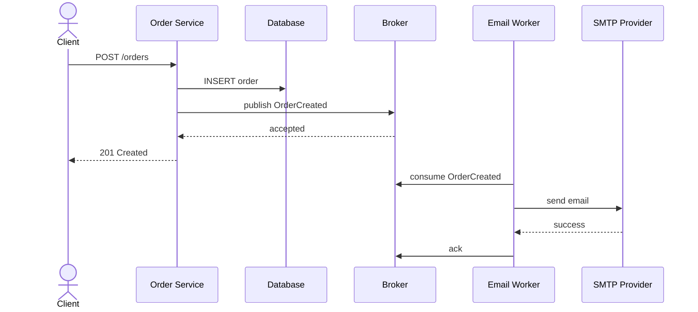

# Tuần 1 — Messaging và tư duy bất đồng bộ

> Mục tiêu của bài này là thay đổi cách nhìn về việc các service giao tiếp với nhau. Trước khi học exchange, binding hay `@RabbitListener`, cần hiểu message giải quyết vấn đề gì, đổi lại những độ phức tạp nào, và vì sao RabbitMQ không thể tự biến một quy trình phân tán thành exactly-once.

## 1. Kết quả cần đạt

Sau bài học, bạn có thể:

- Mô tả khác nhau giữa gọi đồng bộ bằng HTTP và gửi message bất đồng bộ.
- Phân biệt broker, producer, consumer, worker, command và event.
- Chọn message hoặc REST cho một tình huống cụ thể.
- Giải thích các delivery semantics: at-most-once, at-least-once và effectively-once.
- Nhận diện các vấn đề phải thiết kế ngay từ đầu: duplicate, ordering, backpressure, timeout và eventual consistency.
- Viết một mô phỏng producer/consumer bằng `BlockingQueue`.
- Vẽ sequence diagram cho flow tạo đơn hàng rồi gửi email.

## 2. Bài toán mở đầu: tạo đơn hàng và gửi email

Giả sử API `POST /orders` tạo đơn hàng. Sau khi tạo thành công, hệ thống cần gửi email xác nhận.

### Cách 1: gọi email service đồng bộ

```text
Client -> Order Service: POST /orders
Order Service -> Database: INSERT order
Order Service -> Email Service: POST /emails
Email Service -> SMTP provider: gửi email
Email Service --> Order Service: 200 OK
Order Service --> Client: 201 Created
```

Trong flow này, request tạo đơn bị phụ thuộc vào toàn bộ chuỗi phía sau. Nếu SMTP chậm hoặc Email Service đang lỗi:

- thời gian phản hồi của API tăng;
- request có thể timeout dù đơn hàng đã được ghi vào database;
- retry HTTP có thể tạo duplicate email hoặc duplicate order;
- Order Service phải biết endpoint và trạng thái hoạt động của Email Service.

### Cách 2: gửi message bất đồng bộ

```text
Client -> Order Service: POST /orders
Order Service -> Database: INSERT order
Order Service -> Broker: publish OrderCreated
Order Service --> Client: 201 Created

Email Worker -> Broker: consume OrderCreated
Email Worker -> SMTP provider: gửi email
Email Worker -> Broker: ack sau khi xử lý xong
```

Order Service chỉ cần hoàn thành phần thuộc trách nhiệm của nó: tạo đơn và phát thông báo. Email Worker xử lý phần gửi email ở thời điểm phù hợp.

Điểm quan trọng: bất đồng bộ không có nghĩa là công việc chắc chắn thành công. Nó chỉ tách thời điểm gửi request khỏi thời điểm xử lý công việc. Ta vẫn phải giải quyết retry, duplicate, message lỗi và quan sát hệ thống.

## 3. Messaging là gì?

Messaging là cách một thành phần gửi một message cho thành phần khác thông qua một lớp trung gian gọi là message broker.

```text
Producer -> Broker -> Queue -> Consumer/Worker
```

### Các vai trò

| Thành phần | Vai trò |
|---|---|
| Producer | Tạo và gửi message |
| Broker | Nhận, lưu tạm, định tuyến và giao message |
| Queue | Nơi message chờ consumer xử lý |
| Consumer | Nhận message và thực hiện xử lý |
| Worker | Một dạng consumer chuyên xử lý công việc nền |
| Acknowledgement | Tín hiệu cho broker biết consumer đã xử lý xong |

Trong RabbitMQ, producer thường publish vào exchange. Exchange định tuyến message vào queue; consumer đọc từ queue. Ở tuần này chỉ cần nắm mental model đó, tuần 2 sẽ đi sâu vào topology AMQP.

### Message không chỉ là một lời gọi hàm từ xa

Một message nên được xem là dữ liệu có thể:

- tồn tại lâu hơn request tạo ra nó;
- được xử lý muộn hơn;
- được giao lại;
- bị xử lý bởi một instance khác;
- đến sau một message khác;
- bị consumer từ chối vì dữ liệu không hợp lệ.

Vì vậy, code consumer phải chịu được việc chạy lại. Đây là một trong những thay đổi tư duy lớn nhất khi chuyển từ gọi hàm nội bộ sang hệ thống phân tán.

## 4. Đồng bộ và bất đồng bộ

### Giao tiếp đồng bộ

Gọi đồng bộ có mô hình “gửi request và chờ response”. Ví dụ:

```java
PaymentResult result = paymentClient.charge(orderId, amount);
if (result.isSuccessful()) {
    return "paid";
}
return "payment_failed";
```

Đặc điểm:

- caller biết kết quả ngay;
- dễ hiểu trong flow ngắn;
- caller bị phụ thuộc vào latency và availability của callee;
- timeout và retry cần được thiết kế rõ ràng.

### Giao tiếp bất đồng bộ

Gửi bất đồng bộ có mô hình “gửi message và tiếp tục”.

```java
publisher.publish(new PaymentRequested(orderId, amount));
return "payment_processing";
```

Đặc điểm:

- producer không cần chờ consumer xử lý xong;
- queue hấp thụ một phần lưu lượng tăng đột biến;
- producer và consumer có thể deploy, scale và khởi động độc lập;
- kết quả thường đến sau, nên trạng thái trung gian và eventual consistency là bình thường;
- lỗi không biến mất, mà chuyển thành retry, redelivery, DLQ hoặc trạng thái failed.

### Khi nào chọn message?

Message thường phù hợp khi:

1. Công việc không cần trả kết quả ngay cho người dùng, như gửi email, resize ảnh hoặc tạo báo cáo.
2. Muốn tách producer khỏi tốc độ xử lý của consumer.
3. Consumer có thể tạm thời không hoạt động nhưng message vẫn cần được xử lý sau đó.
4. Nhiều consumer độc lập cần phản ứng với cùng một sự kiện.
5. Muốn giới hạn tốc độ xử lý để bảo vệ database hoặc hệ thống bên ngoài.

REST hoặc gọi đồng bộ thường phù hợp khi:

1. Caller cần kết quả để tiếp tục cùng request.
2. Người dùng cần biết ngay thao tác thành công hay thất bại.
3. Thao tác là truy vấn ngắn và không cần buffer.
4. Luồng nghiệp vụ cần một phản hồi tức thời, ví dụ kiểm tra số dư trước khi hiển thị.

Không nên chọn message chỉ vì “microservice nên dùng message”. Một hệ thống thường dùng cả hai: REST cho command/query cần phản hồi nhanh, message cho công việc nền và event.

## 5. Queue giải quyết được gì?

### Decoupling — giảm phụ thuộc

Producer chỉ cần biết contract của message và điểm gửi. Producer không phải giữ kết nối trực tiếp đến từng worker trong toàn bộ thời gian xử lý.

### Buffering — hấp thụ lưu lượng

Nếu producer tạo 1.000 việc/phút nhưng worker chỉ xử lý 600 việc/phút, queue có thể giữ phần chênh lệch tạm thời.

Queue không tạo thêm năng lực xử lý. Nếu tốc độ vào luôn cao hơn tốc độ ra, queue sẽ phình to và cuối cùng cạn tài nguyên. Vì vậy cần theo dõi queue depth, oldest message age và consumer throughput.

### Load leveling — san bằng tải

Thay vì để 1.000 request đồng thời đánh vào hệ thống gửi email, worker xử lý từng lượng vừa phải. Đây là cách bảo vệ hệ thống downstream, không phải cách làm mất đi tải.

### Retry và khả năng phục hồi

Nếu consumer tạm thời mất kết nối, message chưa được xác nhận có thể được giao lại. Cơ chế này hữu ích nhưng cũng tạo duplicate nếu consumer đã gây side effect rồi mới crash.

### Fan-out

Một sự kiện `OrderCreated` có thể khiến nhiều thành phần phản ứng:

```text
OrderCreated
  ├── Email Service: gửi email
  ├── Analytics Service: ghi dữ liệu phân tích
  └── Loyalty Service: cộng điểm
```

Các consumer này không nhất thiết phải biết nhau. Đây là nền tảng cho event-driven architecture.

## 6. Command và event

### Command: “hãy làm việc này”

Command biểu đạt yêu cầu gửi tới một consumer cụ thể hoặc một nhóm consumer có cùng trách nhiệm.

Ví dụ:

```json
{
  "type": "SendOrderConfirmationEmail",
  "orderId": "order-123",
  "recipient": "user@example.com"
}
```

Đặc điểm:

- có ý định thực hiện hành động;
- thường có một owner xử lý;
- cần cân nhắc rõ khi command bị giao lại;
- tên nên dùng động từ: `CreateInvoice`, `ReserveInventory`.

### Event: “việc này đã xảy ra”

Event mô tả một sự kiện đã xảy ra trong quá khứ.

```json
{
  "type": "OrderCreated",
  "eventId": "event-789",
  "orderId": "order-123",
  "occurredAt": "2026-10-02T10:15:00Z"
}
```

Đặc điểm:

- thường dùng thì quá khứ: `OrderCreated`, `PaymentCaptured`;
- có thể có nhiều consumer độc lập;
- producer không nên giả định consumer nào sẽ phản ứng;
- event cần schema ổn định và có versioning khi contract thay đổi.

### Một cách kiểm tra nhanh

Nếu câu bắt đầu bằng “hãy…”, đó thường là command.

Nếu câu bắt đầu bằng “đã…”, đó thường là event.

```text
Hãy gửi email xác nhận cho đơn hàng  -> SendOrderConfirmationEmail (command)
Đơn hàng đã được tạo                 -> OrderCreated (event)
```

Đừng dùng từ “event” cho một command chỉ vì nó được gửi qua RabbitMQ. Message transport không quyết định semantics của message; nội dung và contract mới quyết định.

## 7. Delivery semantics: message được giao bao nhiêu lần?

### At-most-once — nhiều nhất một lần

Message có thể được giao 0 hoặc 1 lần. Hệ thống ưu tiên tránh duplicate, nhưng chấp nhận mất message.

Ví dụ: consumer nhận message, ghi nhận đã nhận trước khi xử lý; nếu process crash, message không được giao lại.

Phù hợp với dữ liệu không quan trọng hoặc có thể tái tạo. Không phù hợp cho thanh toán, trừ điểm hoặc tạo hóa đơn.

### At-least-once — ít nhất một lần

Message được giữ lại hoặc giao lại cho đến khi broker nhận acknowledgement. Nếu consumer xử lý xong nhưng crash trước khi ack, broker không biết việc xử lý đã hoàn tất và có thể giao lại.

```text
1. Consumer nhận message
2. Consumer gửi email thành công
3. Process crash trước khi ack
4. Broker giao lại message
5. Email có thể bị gửi lần hai
```

Đây là mô hình thực tế phổ biến vì ưu tiên không mất message. Cái giá phải trả là consumer phải idempotent.

### Effectively-once — hiệu quả như một lần

Transport có thể giao nhiều lần, nhưng kết quả cuối cùng giống như chỉ xử lý một lần. Điều này đạt được bằng thiết kế ứng dụng, ví dụ:

- lưu `eventId` đã xử lý vào bảng có unique constraint;
- dùng idempotency key khi gọi payment provider;
- cập nhật trạng thái theo điều kiện thay vì cộng dồn mù quáng;
- dùng transaction để ghi kết quả và inbox record cùng nhau.

### Exactly-once — đúng một lần

Exactly-once end-to-end rất khó vì có nhiều ranh giới độc lập: broker, database, HTTP provider, SMTP provider và process. RabbitMQ acknowledgement không thể cùng transaction với mọi side effect bên ngoài.

Ví dụ, RabbitMQ có thể biết message đã ack, nhưng không biết nhà cung cấp email đã gửi mail thành công hay chưa nếu hai hệ thống không dùng chung transaction.

Kết luận thực dụng: hãy thiết kế theo at-least-once delivery và làm cho consumer idempotent.

## 8. Các vấn đề bất đồng bộ phải nhìn thấy trước

### Duplicate

Duplicate xuất hiện khi:

- consumer crash sau side effect nhưng trước ack;
- producer retry vì không nhận được confirm;
- broker redeliver message chưa ack;
- cùng một event được phát lại trong quá trình recovery.

Consumer nên có một định danh xử lý rõ ràng:

```text
eventId = evt-123
consumer = email-service
```

Có thể lưu cặp `(consumer, eventId)` vào database với unique constraint. Khi nhận lại event, consumer phát hiện đã xử lý và ack mà không lặp side effect.

### Ordering

Queue thường giữ thứ tự message được publish, nhưng thứ tự hoàn tất xử lý không tự động được đảm bảo.

```text
Consumer A nhận OrderCreated  -- xử lý chậm
Consumer B nhận OrderPaid     -- xử lý nhanh
```

Kết quả có thể thấy `OrderPaid` hoàn tất trước `OrderCreated`. Concurrency, retry và nhiều queue đều có thể làm thứ tự quan sát được khác thứ tự publish.

Nếu thứ tự thực sự quan trọng, cần thiết kế theo key/partitioning, serial consumer, sequence number hoặc state transition có điều kiện. Không nên chỉ dựa vào “message vào queue trước”.

### Backpressure

Backpressure là cách hệ thống báo ngược rằng consumer hoặc downstream không theo kịp tốc độ producer.

Dấu hiệu:

- số message ready tăng liên tục;
- tuổi message lâu nhất tăng;
- consumer timeout nhiều;
- CPU, memory hoặc connection tới downstream đạt giới hạn.

Các biện pháp sẽ học ở những tuần sau gồm prefetch, giới hạn concurrency, rate limit, retry có backoff và tạm dừng producer. Tăng số consumer vô hạn chỉ chuyển bottleneck sang database hoặc API bên ngoài.

### Timeout

Một message không có nghĩa là công việc hoàn thành trong thời gian vô hạn. Cần xác định:

- thời gian tối đa consumer được phép xử lý;
- timeout của call downstream;
- số lần retry;
- message hết hạn hoặc chuyển DLQ khi nào;
- người vận hành sẽ biết công việc bị kẹt bằng metric/alert nào.

Timeout không đồng nghĩa với thất bại chắc chắn. HTTP call có thể timeout ở client nhưng server đã xử lý xong. Vì vậy retry command có thể tạo duplicate và cần idempotency key.

### Eventual consistency

Sau khi Order Service ghi đơn, Email Service hoặc Analytics Service có thể chưa thấy sự kiện ngay. Trong một khoảng thời gian, các read model có thể không đồng nhất.

Đây không nhất thiết là bug. Nó là trade-off của việc không bắt request tạo đơn chờ mọi consumer. API và UI cần thể hiện trạng thái phù hợp, ví dụ `emailStatus = PENDING` thay vì giả vờ rằng email đã gửi.

## 9. Lab 1 — Vẽ hai flow gửi email

### Yêu cầu

Vẽ hai sequence diagram cho cùng một nghiệp vụ:

1. Tạo đơn hàng và gọi Email Service đồng bộ.
2. Tạo đơn hàng, publish event, rồi để Email Worker xử lý bất đồng bộ.

Bạn có thể dùng Mermaid:



### Cần ghi chú trên diagram

- Điểm nào trả response cho client?
- Điểm nào có thể timeout?
- Nếu Email Worker crash sau khi gửi email nhưng trước khi ack, chuyện gì xảy ra?
- Người dùng nhìn thấy trạng thái nào trong lúc email chưa được gửi?
- Message chứa `orderId`, `eventId` và `occurredAt` hay không?

## 10. Lab 2 — Producer/consumer bằng `BlockingQueue`

Lab này chưa dùng RabbitMQ. Mục đích là quan sát message flow, tốc độ producer/consumer và việc consumer crash.

Tạo file `MessagingSimulation.java`:

```java
import java.time.Duration;
import java.time.Instant;
import java.util.concurrent.BlockingQueue;
import java.util.concurrent.LinkedBlockingQueue;

public final class MessagingSimulation {
    private static final BlockingQueue<Message> QUEUE = new LinkedBlockingQueue<>(5);

    public static void main(String[] args) throws InterruptedException {
        Thread producer = new Thread(MessagingSimulation::produce, "producer");
        Thread consumer = new Thread(MessagingSimulation::consume, "consumer");

        producer.start();
        consumer.start();

        producer.join();
        consumer.join();
    }

    private static void produce() {
        for (int i = 1; i <= 12; i++) {
            Message message = new Message("msg-" + i, "OrderCreated", Instant.now());
            try {
                QUEUE.put(message);
                System.out.printf("PUBLISHED id=%s queueDepth=%d%n", message.id(), QUEUE.size());
                Thread.sleep(100);
            } catch (InterruptedException exception) {
                Thread.currentThread().interrupt();
                return;
            }
        }

        try {
            QUEUE.put(new Message("stop", "POISON", Instant.now()));
        } catch (InterruptedException exception) {
            Thread.currentThread().interrupt();
        }
    }

    private static void consume() {
        while (!Thread.currentThread().isInterrupted()) {
            try {
                Message message = QUEUE.take();
                System.out.printf("RECEIVED id=%s%n", message.id());

                if (message.type().equals("POISON")) {
                    return;
                }

                Thread.sleep(500);
                System.out.printf("PROCESSED id=%s%n", message.id());
            } catch (InterruptedException exception) {
                Thread.currentThread().interrupt();
                return;
            }
        }
    }

    private record Message(String id, String type, Instant createdAt) {
    }
}
```

Chạy thử và quan sát:

- producer tạo message nhanh hơn consumer;
- queue tăng lên tới capacity 5;
- `put()` sẽ block khi queue đầy — đây là một dạng backpressure;
- không có broker thật và không có acknowledgement;
- nếu process dừng sau `take()` nhưng trước `PROCESSED`, message biến mất khỏi queue.

### Bài mở rộng: mô phỏng acknowledgement

Tạo thêm một `inFlight` map hoặc một queue `REDELIVERY_QUEUE` để mô phỏng ba trạng thái:

```text
READY -> IN_FLIGHT -> ACKED
                   \-> REDELIVERED
```

Chỉ xóa message khỏi vùng theo dõi sau khi side effect và ack đều hoàn tất. Sau đó cố tình ném exception sau `PROCESSED` nhưng trước `ACKED`, rồi chạy lại message. Bạn sẽ thấy vì sao at-least-once có thể tạo duplicate.

## 11. Lab 3 — Mô phỏng crash và duplicate

Viết consumer giả lập theo kịch bản:

```text
Nhận message event-1
Ghi log "email sent"
Crash trước acknowledgement
Khởi động lại
Nhận lại event-1
```

Ghi kết quả vào bảng:

| Lần nhận | Side effect | Ack | Kết quả |
|---:|---|---|---|
| 1 | Gửi email | Không | Có thể redeliver |
| 2 | Gửi email lần nữa | Có | Duplicate email |

Sau đó thêm kiểm tra idempotency:

```text
Nếu eventId đã tồn tại trong processed_events:
    bỏ qua side effect
    ack message
Nếu chưa tồn tại:
    ghi eventId và kết quả xử lý trong transaction
    ack message
```

Trong hệ thống thật, việc đánh dấu đã xử lý và ghi business result nên được đặt trong cùng database transaction nếu có thể. Với side effect bên ngoài như email, payment hoặc HTTP API, cần thêm idempotency key hoặc cơ chế reconciliation.

## 12. Bài tập chọn REST hay message

Với mỗi tình huống, chọn `REST`, `message`, hoặc `kết hợp`, rồi giải thích:

1. Trang checkout cần kiểm tra giá và tồn kho hiện tại.
2. Gửi email chào mừng sau khi đăng ký tài khoản.
3. Tạo thumbnail cho video upload dung lượng lớn.
4. Người dùng bấm “thanh toán” và cần biết giao dịch bị từ chối hay thành công.
5. Ghi event analytics cho mỗi lần người dùng mở sản phẩm.

Gợi ý đáp án tham khảo:

| Tình huống | Lựa chọn hợp lý | Lý do |
|---|---|---|
| Kiểm tra giá/tồn kho | REST hoặc synchronous | Caller cần dữ liệu ngay |
| Email chào mừng | Message | Không cần giữ request chờ SMTP |
| Tạo thumbnail | Message | Công việc nền, có thể retry |
| Thanh toán | Kết hợp | Synchronous cho phản hồi ban đầu, event/message cho hậu xử lý |
| Analytics | Message | Tách khỏi request chính, chịu được xử lý trễ |

Không có đáp án đúng tuyệt đối. Hãy ghi rõ latency yêu cầu, hậu quả khi mất message, cách retry và cách báo trạng thái cho người dùng.

## 13. Checklist thiết kế message đầu tiên

Trước khi viết producer hoặc consumer, trả lời các câu hỏi sau:

- Đây là command hay event?
- Ai là owner xử lý message?
- Message có `messageId` hoặc `eventId` chưa?
- Có cần correlation ID để nối log giữa các service không?
- Nếu consumer nhận lại message thì kết quả có bị lặp không?
- Nếu consumer xử lý chậm, queue tăng tới mức nào?
- Nếu producer không nhận được phản hồi, retry có thể tạo duplicate không?
- Consumer cần kết quả ngay hay có thể eventual consistency?
- Message hỏng sẽ được retry bao nhiêu lần và ai quan sát nó?
- Có dữ liệu nhạy cảm nào không nên đưa thẳng vào message không?

## 14. Deliverable cuối tuần

Tạo thư mục `rabbitmq/week-01/` gồm:

```text
rabbitmq/week-01/
├── README.md
├── diagrams/
│   └── order-email-flow.md
└── src/
    └── MessagingSimulation.java
```

`README.md` cần có:

1. Hai sequence diagram synchronous/asynchronous.
2. Bảng so sánh REST và message cho 5 tình huống.
3. Định nghĩa command và event bằng ví dụ `SendOrderConfirmationEmail` và `OrderCreated`.
4. Phân tích duplicate khi crash trước acknowledgement.
5. Kết luận delivery semantics mà bạn chọn cho hệ thống: at-most-once hay at-least-once, và vì sao.
6. Ảnh chụp hoặc log chứng minh lab `BlockingQueue` đã chạy.

## 15. Tiêu chí tự kiểm tra

Bạn hoàn thành Tuần 1 khi có thể trả lời rõ, không cần học thuộc:

1. Vì sao queue giúp decouple nhưng không làm mất lỗi?
2. Vì sao consumer có thể nhận cùng một message hai lần?
3. Tại sao ack trước khi ghi database là nguy hiểm?
4. Vì sao ack sau side effect vẫn có thể tạo duplicate?
5. Khi nào một message là command, khi nào là event?
6. Vì sao queue đầy là dấu hiệu cần điều tra chứ không phải luôn là lỗi broker?
7. Tại sao thêm consumer có thể làm database quá tải?
8. Vì sao eventual consistency cần được phản ánh trong trạng thái API/UI?
9. Vì sao exactly-once end-to-end khó hơn việc broker giao message đúng một lần?
10. Nếu phải chọn một mặc định cho consumer RabbitMQ, vì sao nên bắt đầu với at-least-once và idempotency?

### Đáp án ngắn gọn cần nhớ

> Message giúp tách thời điểm và tốc độ xử lý, nhưng không xóa timeout, crash, duplicate hay lỗi downstream. Hãy giả định message có thể đến trễ và đến nhiều lần; thiết kế consumer idempotent, quan sát queue và chấp nhận eventual consistency ở nơi phù hợp.

## 16. Chuẩn bị cho Tuần 2

Tuần sau sẽ chuyển từ `BlockingQueue` sang mô hình AMQP của RabbitMQ:

- connection, channel và virtual host;
- exchange, queue, binding và routing key;
- direct, fanout và topic exchange;
- durable queue, persistent message và queue tạm thời.

Giữ lại các câu hỏi của tuần này. Khi học topology, mỗi exchange hoặc queue phải trả lời được: message nào đi vào đây, consumer nào đọc nó, nếu consumer chết thì message sống ở đâu, và duplicate được xử lý như thế nào?
