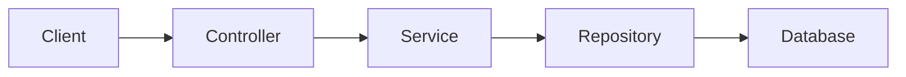

# Tuần 1 — Tư duy AI-assisted engineering

> Mục tiêu của tuần này là xây dựng cách làm việc có kiểm soát với AI khi phát triển dự án Java/Spring Boot. AI hỗ trợ khám phá, lập kế hoạch và tạo nội dung; repository, code, test và contract mới là nguồn sự thật.

## 1. Kết quả cần đạt

Sau tuần này, bạn có thể:

- Phân biệt được source of truth, context tạm thời và memory dài hạn.
- Nhận diện các rủi ro AI hallucinate API, package, behavior hoặc dependency.
- Yêu cầu AI khám phá và tóm tắt codebase trước khi cho phép sửa file.
- Phân biệt rõ fact, assumption và proposal trong câu trả lời của AI.
- Viết project brief, architecture overview và `AGENTS.md` đủ rõ để AI làm việc.
- Đặt acceptance criteria và definition of done cho một task nhỏ.
- Kiểm tra lại nhận định của AI bằng code, test, cấu hình và tài liệu trong repository.

Thời lượng đề xuất: **6–10 giờ** gồm đọc, thiết lập tài liệu và thực hành với một project Java/Spring Boot nhỏ.

## 2. Nguyên tắc làm việc

### AI không phải source of truth

Ưu tiên kiểm chứng theo thứ tự:

1. Code và test đang chạy.
2. API, schema và configuration contract đã version.
3. ADR và tài liệu kiến trúc đã được review.
4. Feature spec và acceptance criteria.
5. Handoff note của conversation trước.
6. Nội dung conversation hiện tại.

Nếu câu trả lời của AI mâu thuẫn với code hoặc test, coi câu trả lời đó là giả thuyết cần kiểm tra.

### Context window không phải memory dài hạn

AI chỉ nhìn thấy những gì được đưa vào context của lần làm việc hiện tại. Vì vậy, thông tin ổn định phải được lưu trong repository, không chỉ nằm trong conversation.

### Planning quan trọng hơn tốc độ sinh code

Một prompt mơ hồ như “làm cho tốt hơn” không có phạm vi, behavior mong muốn hoặc tiêu chí kiểm tra. Trước khi sửa code, cần xác định:

- Vấn đề cần giải quyết.
- Phạm vi và phần không thuộc phạm vi.
- File/module có khả năng bị ảnh hưởng.
- Acceptance criteria.
- Cách kiểm chứng kết quả.

## 3. Chuẩn bị project thực hành

Chọn một project Java/Spring Boot nhỏ có thể build và test được. Nếu chưa có project phù hợp, dùng một ứng dụng REST đơn giản có tối thiểu một domain, một controller, một service và test tương ứng.

Ghi lại các thông tin sau trước khi làm việc với AI:

```text
Project: ...
Java: ...
Framework: ...
Build tool: Maven / Gradle
Build command: ...
Test command: ...
Entry point chính: ...
Module hoặc package chính: ...
```

Chạy build và test bằng command thực tế của project. Không tự suy đoán command từ tên công cụ.

## 4. Việc cần làm

### Task 1 — Xác định nguồn sự thật

- [ ] Đọc toàn bộ README, hướng dẫn chạy và cấu hình build.
- [ ] Xác định file chứa source code, test, API contract, schema/migration và cấu hình môi trường.
- [ ] Chạy build sạch.
- [ ] Chạy test hiện có.
- [ ] Ghi lại kết quả, warning và lỗi đang tồn tại; không sửa lỗi ngoài phạm vi Tuần 1.
- [ ] Lập bảng nhỏ phân loại thông tin thành `fact`, `assumption` hoặc `unknown`.

Mẫu bảng:

| Nhận định | Loại | Bằng chứng | Cần kiểm tra thêm |
|---|---|---|---|
| Project dùng Maven | Fact | `pom.xml`, `mvnw` | Không |
| API này cần authentication | Assumption | Chưa thấy test/contract | Đọc security config |
| Có thể tách module payment | Proposal | Phân tích ban đầu | Trao đổi trước khi sửa |

### Task 2 — Viết project brief

Tạo file `docs/ai/project-brief.md` với các mục:

- Product giải quyết vấn đề gì.
- Người dùng và actor chính.
- Domain boundary.
- Các module chính.
- Dependency bên ngoài.
- Non-functional requirements đã biết.
- Những điều tuyệt đối không được thay đổi.
- Các câu hỏi chưa có câu trả lời.

Không điền thông tin bằng suy đoán. Với phần chưa biết, ghi rõ `Unknown` hoặc `Cần xác minh`.

### Task 3 — Viết architecture overview

Tạo file `docs/ai/architecture.md` mô tả ở mức đủ để một người mới hoặc AI bắt đầu khám phá:

- Component/module chính.
- Request flow của một use case tiêu biểu.
- Ownership của từng module.
- Integration boundary và external dependency.
- Authentication/authorization flow nếu có.
- Deployment topology hiện tại nếu đã biết.
- Failure boundary và các rủi ro nổi bật.
- Những quyết định kiến trúc chưa được chốt.

Mỗi sơ đồ cần có chú thích ngắn. Có thể bắt đầu bằng Mermaid:



### Task 4 — Tạo `AGENTS.md`

Tạo `AGENTS.md` ở root project với nội dung ngắn, có thể kiểm chứng:

```markdown
# Project instructions

## Project
- Java version: ...
- Framework: ...
- Build tool: ...
- Package/module convention: ...

## Commands
- Build: ...
- Test: ...
- Static analysis: ...

## Rules
- Đọc `docs/ai/project-brief.md` và `docs/ai/architecture.md` trước khi sửa.
- Không thay đổi public API nếu task không yêu cầu.
- Viết hoặc cập nhật test cho behavior thay đổi.
- Không tắt test để làm build xanh.
- Không thêm dependency nếu chưa nêu lý do.
- Không log secret, token hoặc dữ liệu nhạy cảm.

## Definition of done
- Compile thành công.
- Test liên quan và regression test pass.
- Contract/tài liệu được cập nhật nếu có thay đổi.
- Diff không có thay đổi ngoài scope.
- Báo rõ file đã đổi, command đã chạy và rủi ro còn lại.
```

Thay toàn bộ dấu `...` bằng thông tin đã xác minh từ project.

### Task 5 — Cho AI khám phá, chưa cho sửa

Sử dụng prompt sau với AI:

```text
Hãy chỉ khám phá repository, chưa sửa hoặc tạo file.

Mục tiêu: hiểu cấu trúc và flow chính của project.

Hãy trả về:
1. Build tool, Java version và command build/test.
2. Các module/package chính và trách nhiệm của chúng.
3. Entry point của một use case tiêu biểu.
4. Các external dependency và boundary tương ứng.
5. Test hiện có và behavior mà test đang bảo vệ.
6. File là source of truth cho từng nhận định.
7. Rủi ro hoặc điểm chưa chắc chắn.

Với mỗi nhận định, ghi rõ một trong ba nhãn: Fact, Assumption hoặc Proposal.
Mỗi Fact phải kèm path và symbol/section liên quan.
```

Sau khi nhận câu trả lời:

- [ ] Kiểm tra ít nhất 5 nhận định bằng file thực tế.
- [ ] Kiểm tra ít nhất 2 nhận định bằng test hoặc command build/test.
- [ ] Đánh dấu các nhận định không có bằng chứng.
- [ ] Ghi lại hallucination hoặc suy luận sai nếu có.
- [ ] Cập nhật `project-brief.md` và `architecture.md` nếu phát hiện thông tin chính xác hơn.

### Task 6 — Thực hành với một task nhỏ

Chọn một thay đổi nhỏ, ví dụ thêm validation cho một input hoặc thêm một endpoint read-only. Chưa cần chọn task phức tạp.

Viết feature brief trước khi yêu cầu AI triển khai:

```markdown
# Feature: ...

## Problem
...

## Scope
- ...

## Non-goals
- ...

## Acceptance criteria
- [ ] ...
- [ ] ...

## Verification
- Unit test: ...
- Integration test: ...
- Command: ...

## Risks and assumptions
- ...
```

Yêu cầu AI trả về implementation plan trước. Chỉ cho phép sửa code sau khi bạn kiểm tra:

- Plan có đúng module và entry point không.
- Có thay đổi public contract ngoài ý muốn không.
- Test nào cần thêm hoặc sửa.
- Có dependency, migration hoặc config nào bị ảnh hưởng không.
- Phần nào là assumption cần xác minh.

### Task 7 — Review behavior và tạo handoff note

Sau task nhỏ:

- [ ] Đọc diff như một reviewer, tập trung vào behavior chứ không chỉ syntax.
- [ ] Chạy build, test và các kiểm tra phù hợp.
- [ ] Đối chiếu từng acceptance criterion với bằng chứng.
- [ ] Kiểm tra không có thay đổi ngoài scope.
- [ ] Tạo `docs/ai/handoffs/week-01.md` ghi lại trạng thái.

Mẫu handoff note:

```markdown
# Handoff — Tuần 1

## Đã hoàn thành
- ...

## File context đã tạo/cập nhật
- ...

## Command đã chạy
- `...`

## Phát hiện quan trọng
- ...

## Assumption còn mở
- ...

## Việc tiếp theo
- ...
```

## 5. Checklist sản phẩm đầu ra

- [ ] `docs/ai/project-brief.md` tồn tại và không chứa thông tin chưa xác minh dưới dạng fact.
- [ ] `docs/ai/architecture.md` mô tả được flow chính và boundary quan trọng.
- [ ] `AGENTS.md` có command, rule và definition of done thực tế.
- [ ] Có bằng chứng build/test của project.
- [ ] Có một bản tóm tắt do AI tạo và bản đối chiếu với code thực tế.
- [ ] Có ít nhất một feature brief nhỏ với acceptance criteria.
- [ ] Có handoff note cho công việc của tuần.

## 6. Hoàn thành khi

Tuần 1 hoàn thành khi:

- AI biết cách build và test project dựa trên `AGENTS.md`.
- AI biết file nào là source of truth và có thể trích dẫn path/symbol.
- Bạn phân biệt được fact, assumption và proposal trong output của AI.
- Bạn không cho AI sửa code trước khi hiểu scope, behavior và cách kiểm chứng.
- Một task nhỏ đã được phân tích, triển khai hoặc mô phỏng triển khai với acceptance criteria rõ ràng.
- Build/test và các rủi ro còn lại được ghi lại trong handoff note.

## 7. Tự kiểm tra

Trả lời ngắn các câu hỏi sau, kèm bằng chứng từ repository:

1. Nếu AI nói một class có method nhưng file thực tế không có, bạn sẽ tin nguồn nào và kiểm tra ra sao?
2. Vì sao prompt “refactor cho sạch hơn” chưa đủ để bắt đầu sửa code?
3. Context nào cần lưu vào repository để conversation mới tiếp tục được?
4. Một nhận định là fact khác proposal ở điểm nào?
5. Nếu build hiện tại đã fail trước khi bắt đầu task, bạn sẽ ghi nhận và giới hạn scope thế nào?

## 8. Tham chiếu

- [Roadmap dùng AI để xây dựng và duy trì một dự án Java](roadmap-dung-ai-xay-dung-du-an-java.md)
