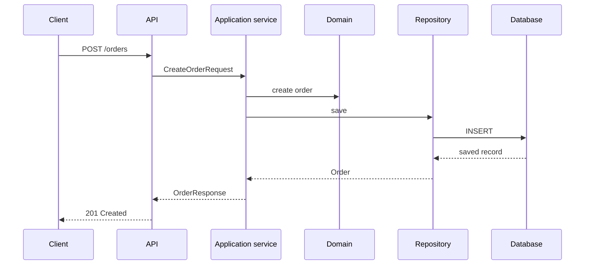

# Tuần 2 — Chuẩn hóa codebase để AI đọc được

> Mục tiêu của tuần này là làm cho cấu trúc, tên gọi và boundary của codebase đủ rõ để người mới và AI có thể tìm đúng nơi cần đọc mà không phải đoán. Chuẩn hóa không có nghĩa là refactor toàn bộ; mọi thay đổi phải có phạm vi, lý do và bằng chứng kiểm chứng.

## 1. Kết quả cần đạt

Sau tuần này, bạn có thể:

- Giải thích được module/package nào sở hữu từng feature.
- Nhận diện entry point, DTO, domain model, configuration và integration boundary.
- Áp dụng cách tổ chức package theo feature ở những nơi phù hợp.
- Đặt naming convention nhất quán cho class, method, package, endpoint và test.
- Phân biệt public contract với internal implementation.
- Nhận diện dependency direction và package cycle khó giải thích.
- Tạo `context-index.md` để AI tìm file quan trọng mà không phải đọc toàn repository.
- Viết README ngắn cho từng module.
- Xóa dead code hoặc đổi tên thành phần mơ hồ với phạm vi thay đổi có kiểm soát.
- Tạo sơ đồ request flow có thể dùng làm context cho các conversation sau.

Thời lượng đề xuất: **8–12 giờ** gồm khảo sát, chuẩn hóa có chọn lọc, cập nhật tài liệu và chạy regression test.

## 2. Nguyên tắc chuẩn hóa

### Tối ưu cho khả năng tìm hiểu, không chỉ cho sự ngắn gọn

Một codebase dễ đọc cần trả lời nhanh các câu hỏi:

- Feature này bắt đầu từ đâu?
- Logic nghiệp vụ nằm ở đâu?
- Dữ liệu đi qua những boundary nào?
- Class nào là public contract và class nào chỉ là implementation detail?
- Test nào mô tả behavior thật?
- Nếu sửa file này, những module nào có thể bị ảnh hưởng?

### Mỗi thay đổi phải giữ được behavior

Chuẩn hóa package hoặc đổi tên có thể tạo ra thay đổi lớn hơn vẻ ngoài của nó. Trước và sau mỗi nhóm thay đổi:

- Ghi rõ scope và non-goal.
- Chạy test hiện có.
- Kiểm tra import, configuration, reflection và serialization.
- Kiểm tra public API, schema và contract không bị đổi ngoài ý muốn.
- Đọc diff để chắc chắn không có thay đổi ngoài scope.

### Documentation phải trỏ đến code thật

README, context index và sơ đồ chỉ có giá trị khi đường dẫn, class, method và command còn tồn tại. Khi đổi tên hoặc di chuyển file, cập nhật tài liệu cùng một change set.

## 3. Chuẩn bị

Trước khi sửa code, đọc các tài liệu đã tạo ở Tuần 1:

- `AGENTS.md`
- `docs/ai/project-brief.md`
- `docs/ai/architecture.md`
- `docs/ai/handoffs/week-01.md` nếu đã có

Tạo một branch hoặc commit checkpoint cho trạng thái đầu tuần nếu workflow của project cho phép. Ghi nhận baseline:

```text
Build command: ...
Test command: ...
Static analysis command: ...
Test result: ...
Known failures: ...
```

Không coi một lỗi có sẵn là regression do việc chuẩn hóa. Ghi nhận nó trước khi bắt đầu.

## 4. Việc cần làm

### Task 1 — Lập inventory module và ownership

Khảo sát source, test, configuration và tài liệu để lập danh sách module/package hiện có.

- [ ] Liệt kê các module/package cấp cao.
- [ ] Ghi trách nhiệm chính của từng module.
- [ ] Ghi owner hoặc nhóm chịu trách nhiệm nếu project có thông tin này.
- [ ] Chỉ ra entry point của từng feature quan trọng.
- [ ] Ghi dependency đi vào và đi ra của mỗi module.
- [ ] Đánh dấu package chứa nhiều trách nhiệm hoặc tên không phản ánh nội dung.
- [ ] Đánh dấu module chưa có README hoặc test mô tả behavior.

Mẫu inventory:

| Module/package | Trách nhiệm | Entry point | Phụ thuộc | Được phép phụ thuộc vào | Owner |
|---|---|---|---|---|---|
| `order` | Quản lý vòng đời đơn hàng | `OrderController` | `payment`, database | `shared`, adapter | ... |
| `payment` | Xử lý thanh toán | `PaymentService` | payment provider | `shared` | ... |

Không đổi package chỉ vì package đó chưa theo một style lý tưởng. Trước hết phải hiểu ownership và dependency thực tế.

### Task 2 — Chọn và ghi lại package convention

Đánh giá cấu trúc hiện tại và quyết định convention áp dụng cho phần code được chạm tới trong tuần.

So sánh hai kiểu phổ biến:

```text
Layer-based:
controller/
service/
repository/
domain/

Feature-based:
order/
  api/
  application/
  domain/
  infrastructure/
payment/
  api/
  application/
  domain/
```

- [ ] Ghi convention hiện tại trong `docs/ai/coding-rules.md` hoặc tài liệu coding rules tương đương.
- [ ] Nêu lý do chọn hoặc chưa chọn feature-based package.
- [ ] Nêu boundary giữa API, application/service, domain và infrastructure nếu có.
- [ ] Quy định hướng dependency hợp lệ.
- [ ] Ghi rõ package nào là shared và tiêu chí để được đưa code vào đó.
- [ ] Không tạo package `util`, `common` hoặc `shared` mới nếu chưa có trách nhiệm cụ thể.

Ví dụ dependency direction cần giải thích được:

```text
api -> application -> domain
infrastructure -> application/domain interfaces
domain -X-> api
domain -X-> infrastructure
```

Nếu project chưa đủ lớn để tách các layer này, ghi rõ mức đơn giản được chọn thay vì tạo thêm abstraction hình thức.

### Task 3 — Chuẩn hóa naming

Tạo hoặc cập nhật bảng naming convention, sau đó áp dụng có chọn lọc cho các file trong scope.

- [ ] Class thể hiện đúng vai trò: `OrderController`, `CreateOrderService`, `OrderRepository`.
- [ ] Method dùng động từ và nói rõ behavior: `createOrder`, `cancelOrder`, `findById`.
- [ ] Boolean dùng tên có thể đọc như câu hỏi: `isPaid`, `hasPermission`, `canRetry`.
- [ ] DTO phân biệt được request, response và domain object.
- [ ] Event/command thể hiện đúng semantics, không dùng tên quá chung như `DataMessage`.
- [ ] Test name mô tả behavior và điều kiện, không chỉ mô tả method.
- [ ] Package name dùng lowercase, tránh viết tắt khó hiểu.
- [ ] Endpoint, field và enum nhất quán với public contract.
- [ ] Không đổi tên public API chỉ để làm đẹp nếu không có migration hoặc approval phù hợp.

Mẫu quy tắc:

| Thành phần | Quy tắc | Ví dụ tốt | Ví dụ cần tránh |
|---|---|---|---|
| Request DTO | Suffix `Request` | `CreateOrderRequest` | `OrderData` |
| Response DTO | Suffix `Response` | `OrderResponse` | `OrderDto` nếu có nhiều loại DTO |
| Use case | Động từ + danh từ | `CreateOrderService` | `OrderManager` |
| Test | Điều kiện + behavior | `createOrder_rejectsBlankCustomerId` | `testCreate` |

Đổi tên theo nhóm nhỏ. Sau mỗi nhóm, compile và chạy test liên quan để dễ xác định regression.

### Task 4 — Phân tách DTO, domain, configuration và implementation

Chọn ít nhất một feature tiêu biểu và vẽ boundary của các loại object:

```text
HTTP request
    -> Request DTO
    -> Application/use-case service
    -> Domain model
    -> Repository port
    -> Infrastructure adapter
    -> Persistence model / external client
    -> Response DTO
```

- [ ] Xác định DTO nào thuộc public API.
- [ ] Xác định domain object nào chứa business rule.
- [ ] Xác định configuration nào chỉ dùng để wiring hoặc external system.
- [ ] Không để persistence entity vô tình trở thành public API response.
- [ ] Không để controller chứa business rule có thể kiểm thử độc lập.
- [ ] Không để domain phụ thuộc trực tiếp vào framework hoặc external client nếu boundary không yêu cầu.
- [ ] Ghi rõ các trường hợp project hiện tại cố ý đơn giản hóa boundary.

Mục tiêu không phải tạo thêm class cho mọi object. Mục tiêu là để AI và người đọc biết object nào có thể thay đổi độc lập và object nào là contract.

### Task 5 — Tạo `docs/ai/context-index.md`

Tạo một index trỏ đến những file AI cần đọc theo từng mục đích. Index phải ngắn, có đường dẫn tương đối chính xác và được cập nhật cùng code.

Mẫu:

```markdown
# Context index

## Bắt đầu từ đây
- [Project brief](project-brief.md): mục tiêu, actor và boundary.
- [Architecture](architecture.md): module và request flow.
- [Coding rules](coding-rules.md): convention và dependency direction.

## Build và runtime
- `pom.xml`: dependency và build plugin.
- `src/main/resources/application.yml`: configuration runtime.

## Feature: order
- `src/main/java/.../order/api/OrderController.java`: HTTP entry point.
- `src/main/java/.../order/application/CreateOrderService.java`: use case.
- `src/main/java/.../order/domain/Order.java`: business state/rule.
- `src/test/java/.../order/`: behavior và regression test.

## Integration
- `...`: client/adapter gọi external service.
- `...`: migration hoặc schema liên quan.

## Khi sửa một feature
1. Đọc feature brief hoặc acceptance criteria.
2. Đọc entry point và application service.
3. Đọc domain rule và adapter liên quan.
4. Đọc test trước khi đổi behavior.
```

- [ ] Có link đến project brief, architecture và coding rules.
- [ ] Có entry point và test directory cho các feature quan trọng.
- [ ] Có link đến config, migration, API contract và integration boundary.
- [ ] Không đưa mọi file trong repository vào index.
- [ ] Kiểm tra toàn bộ link/path sau khi hoàn thành refactor.

### Task 6 — Viết README cho từng module

Với mỗi module chính, tạo `README.md` tại vị trí phù hợp. README cần trả lời nhanh module làm gì và cách tìm code.

Mẫu:

```markdown
# Order module

## Responsibility
Quản lý việc tạo, đọc và hủy đơn hàng.

## Entry points
- `OrderController#create`
- `OrderController#getById`

## Main flow
Request -> application service -> domain -> repository.

## Public contract
- `POST /orders`
- `GET /orders/{id}`

## Dependencies
- Database: ...
- External service: ...

## Tests
- Unit: `...`
- Integration: `...`

## Known constraints
- ...

## Related context
- [Context index](../../docs/ai/context-index.md)
- [Architecture](../../docs/ai/architecture.md)
```

- [ ] Mỗi README có responsibility và non-goal.
- [ ] Có entry point, main flow và public contract nếu module có public API.
- [ ] Có dependency, test location và constraint quan trọng.
- [ ] Không sao chép nguyên nội dung source code vào README.
- [ ] Cập nhật README nếu task chuẩn hóa làm thay đổi đường dẫn hoặc ownership.

### Task 7 — Xử lý dead code và tên mơ hồ

Chỉ xử lý những trường hợp có bằng chứng. Không xóa code chỉ vì chưa thấy nơi gọi trong một lần search đơn giản.

- [ ] Tìm class, method, resource và configuration không còn được tham chiếu.
- [ ] Kiểm tra reflection, dependency injection, serialization, framework scanning và entry point trước khi xóa.
- [ ] Tìm tên mơ hồ như `Manager`, `Helper`, `Processor`, `Data`, `Utils`.
- [ ] Với mỗi tên cần đổi, ghi tên mới phản ánh responsibility cụ thể.
- [ ] Tách việc đổi tên khỏi việc đổi behavior khi có thể.
- [ ] Chạy compile, test và static analysis sau mỗi nhóm thay đổi.
- [ ] Ghi lại code không đủ bằng chứng để xóa vào danh sách follow-up.

Mẫu decision log ngắn:

| Thành phần | Quyết định | Bằng chứng | Rủi ro |
|---|---|---|---|
| `OrderHelper` | Đổi thành `OrderPricingCalculator` | Chỉ tính giá ở 3 call site | Import cũ trong test |
| `LegacyClient` | Chưa xóa | Có thể được framework scan | Cần kiểm tra runtime |

### Task 8 — Tạo sơ đồ request flow

Chọn một flow quan trọng và mô tả từ entry point đến persistence hoặc external integration.



- [ ] Ghi rõ validation, authorization và error path nếu chúng thuộc flow.
- [ ] Đánh dấu side effect và external dependency.
- [ ] Đánh dấu boundary transaction nếu đã biết.
- [ ] Link từng bước đến package/class/method thật.
- [ ] Cập nhật `docs/ai/architecture.md` hoặc context index để trỏ đến sơ đồ.

## 5. Prompt kiểm tra với AI

Sau khi chuẩn hóa một nhóm module, yêu cầu AI chỉ kiểm tra, chưa sửa file:

```text
Hãy kiểm tra khả năng đọc hiểu của codebase sau khi chuẩn hóa, chưa sửa file.

Mục tiêu: tìm entry point và ownership của feature [tên feature].

Hãy trả về:
1. Module/package sở hữu feature.
2. Entry point và flow chính.
3. Public contract và internal implementation.
4. Dependency đi vào/đi ra.
5. Test cần đọc để hiểu behavior.
6. Các file trong context-index.md hoặc README đang sai/thiếu.
7. Package cycle hoặc naming ambiguity còn lại.

Mỗi nhận định phải kèm path và symbol liên quan.
Nếu không đủ bằng chứng, ghi rõ Unknown; không tự suy đoán.
```

Đánh giá câu trả lời:

- [ ] AI tìm được entry point mà không cần đọc toàn repository.
- [ ] AI phân biệt được DTO, domain và persistence model.
- [ ] AI nhận diện được boundary và hướng dependency.
- [ ] AI trích dẫn được README, context index và source code nhất quán.
- [ ] Mọi lỗi trong index hoặc tài liệu đã được sửa hoặc ghi thành follow-up.

## 6. Quality gate

Trước khi kết thúc tuần:

- [ ] Build thành công, hoặc các lỗi baseline đã được phân biệt rõ với regression.
- [ ] Unit/integration test liên quan pass.
- [ ] Không có public contract thay đổi ngoài scope.
- [ ] Không có package cycle mới.
- [ ] Không có import hoặc link tài liệu bị hỏng.
- [ ] Sơ đồ request flow khớp với code thực tế.
- [ ] Diff chỉ gồm chuẩn hóa, tài liệu và test cần thiết.
- [ ] Các thay đổi lớn có lý do và rủi ro được ghi lại.

## 7. Checklist sản phẩm đầu ra

- [ ] Inventory module và ownership.
- [ ] Coding/package convention được ghi lại.
- [ ] `docs/ai/context-index.md`.
- [ ] README cho từng module chính.
- [ ] Naming được chuẩn hóa trong phạm vi đã chọn.
- [ ] Dead code hoặc tên mơ hồ đã được xử lý có bằng chứng; phần chưa chắc chắn có follow-up.
- [ ] Sơ đồ request flow của ít nhất một feature.
- [ ] Cập nhật `docs/ai/architecture.md` hoặc tài liệu liên quan.
- [ ] Kết quả build/test và rủi ro còn lại được ghi lại.

## 8. Hoàn thành khi

Tuần 2 hoàn thành khi:

- Người mới có thể tìm entry point của một feature mà không cần đọc toàn repository.
- AI có thể tìm module liên quan dựa trên context index và README.
- Mỗi module chính có responsibility, ownership, entry point và test location rõ ràng.
- Public contract được phân biệt với internal implementation.
- Dependency direction có thể giải thích được.
- Không có package cycle mới hoặc cycle cũ không có lời giải thích.
- Build/test và tài liệu phản ánh cùng một cấu trúc codebase.

## 9. Tự kiểm tra

Trả lời ngắn, kèm path hoặc sơ đồ làm bằng chứng:

1. Nếu nhận một task sửa `order`, bạn sẽ bắt đầu từ file nào và vì sao?
2. Module nào sở hữu business rule và module nào chỉ làm adapter?
3. Làm sao biết một class có thể xóa mà không phá runtime do reflection hoặc framework scanning?
4. Public DTO khác persistence entity ở điểm nào?
5. Nếu AI không tìm được feature dù code vẫn chạy, context index hoặc package structure đang thiếu điều gì?

## 10. Tham chiếu

- [Roadmap dùng AI để xây dựng và duy trì một dự án Java](roadmap-dung-ai-xay-dung-du-an-java.md)
- [Tài liệu Tuần 1 — Tư duy AI-assisted engineering](tuan-01-tu-duy-ai-assisted-engineering.md)
